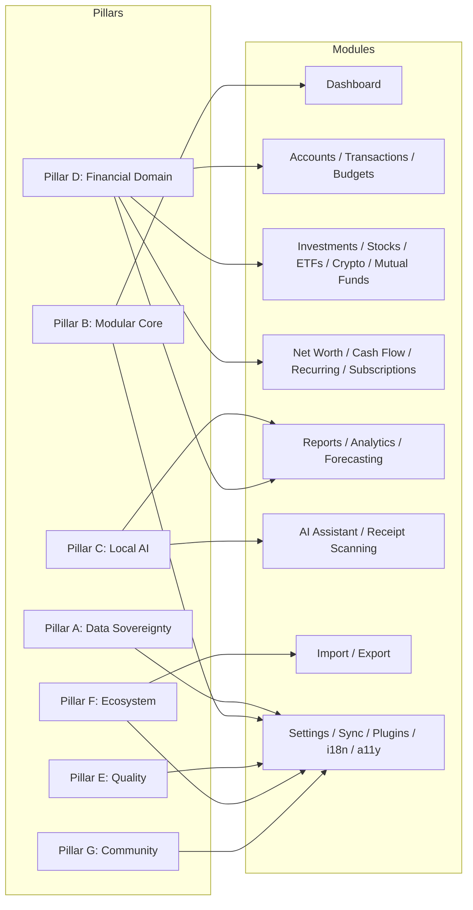

# 02 — Product Scope

| Field            | Value                                                                                |
|------------------|--------------------------------------------------------------------------------------|
| Document ID      | `PINE-DOC-02-PRODUCT-SCOPE`                                                          |
| Status           | Draft — pending review                                                               |
| Owner            | Engineering Review Board                                                             |
| Created          | 2026-07-08                                                                           |
| Last Updated     | 2026-07-08                                                                           |
| Specification Standard | IEEE 29148 (scope)                                                             |
| Glossary         | `PINE-DOC-03-GLOSSARY`                                                               |
| Prerequisites    | `PINE-DOC-00-VISION` (approved), `PINE-DOC-01-BUSINESS-REQUIREMENTS` (approved)       |
| Decisions closed | OD-05 (no MVP, full product is the scope)                                           |
| Related Documents| `00-Vision`, `01-Business-Requirements`, `07-Functional-Requirements`, `22-Release-Plan`, `23-Roadmap`, `25-ADR` |

---

## 1. Purpose

Pin down, unambiguously, which product capabilities are **in scope**
for Pine and which are **out of scope**, at the level of detail needed
to drive requirements (`07-Functional-Requirements`), UX guidelines
(`42-UX-Guidelines`), and test strategy (`18-Test-Strategy`).

## 2. Scope of this Document

In scope: the *exhaustive* set of *capabilities* the product will deliver.
The exhaustive set of *capabilities* the product will **not** deliver
(anti-goals inherited from Vision §9.2 and Business Requirements §9.2).
Module-level descriptions: what each module must do, at scope level
(no test design here). Cross-cutting scope concerns: AI scope, sync
scope, plugin scope, platform scope, accessibility scope,
internationalisation scope. Decision log: OD-05 closed by this document
(no MVP). Scope-level assumptions and deferred decisions.

Out of scope:

- Functional acceptance criteria → `07-Functional-Requirements`,
  `48-Acceptance-Criteria`.
- Architecture and technology choices → `09-System-Architecture`,
  `25-ADR`.
- Release order and roadmap → `22-Release-Plan`, `23-Roadmap`.
- Detailed UX, mockups, navigation, screens → `42-UX-Guidelines`.
- Test design and traceability → `18-Test-Strategy`,
  `19-Traceability-Matrix`, `43-Testing-Artifacts`.

## 3. Definitions

| Term        | Working definition                                                                                  |
|-------------|------------------------------------------------------------------------------------------------------|
| Capability  | A coherent, user-visible area of the product. A capability may map to one or more modules.         |
| Module      | The engineering unit (UI, domain, data) that implements a capability.                              |
| MVP         | Minimum Viable Product. **Not used in Pine** — see §6, closing OD-05.                              |
| Anti-goal   | A capability or business behaviour the product explicitly will not provide.                         |
| Scope Item  | A single line in the §8 capability table with a unique `SCOPE-*` identifier.                        |
| Release Window | A time-bounded phase of public availability (alpha, beta, GA), owned by `22-Release-Plan`.         |

> **Assumption PS-A-1.** The full module catalogue from
> `PINE-DOC-00-VISION` §16 is the authoritative source of what a
> "capability" means. If a future revision of the Vision changes that
> catalogue, this document must be revised in lockstep.

## 4. Scope Posture (Normative)

Pine ships the *full product* from the start (see `02-Product-Scope`
§6, closing OD-05). The scope therefore describes *what the product is*,
not *which slice of it is shipped first*.

The posture means:

1. Every capability listed in §8 is in scope and must eventually be
   implemented, tested, released and maintained.
2. The order in which capabilities are released to the public is a
   *release* decision, not a *scope* decision, and is owned by
   `22-Release-Plan` and `23-Roadmap`.
3. A capability may be marked as *deferred inside a release window* in
   `22-Release-Plan` (e.g. mobile parity in early windows), but it
   remains in **product scope** and must be tracked.

**Rationale.** Drawing a strict line between *scope* (what the product
is) and *release* (when the public gets it) prevents scope creep while
still allowing the engineering team to sequence work in a way that
respects risk, dependency order and platform readiness.

## 5. In-Scope vs. Out-of-Scope Boundary

### 5.1 In Scope (the product)

Pine is a **local-first, AI-assisted, plugin-based, cross-platform
personal finance platform** providing the capabilities listed in §8.

### 5.2 Out of Scope (the anti-product)

Pine is **not** any of the following, in any release window:

- A banking aggregator that *requires* Open Banking credentials.
- A payment initiation or money-movement product.
- A cryptocurrency exchange or custodian.
- An investment adviser or regulated financial product.
- A cloud-only SaaS.
- An ad-supported or data-monetised product.
- A paywalled product.
- A product that delegates AI to a paid third-party API by default.

**Rationale.** The list mirrors `PINE-DOC-00-VISION` §9.2 and
`PINE-DOC-01-BUSINESS-REQUIREMENTS` §9.2. Repeating it here makes the
scope boundary self-contained, so a reader of this document does not
have to triangulate the negative space.

## 6. Closing OD-05 — No MVP

OD-05 from `PINE-DOC-00-VISION` §14 is **closed by this document** as
follows:

> **Decision (OD-05, closed).** Pine does **not** ship an MVP. The
> product scope is the full catalogue in §8. Releases are sequenced
> by `22-Release-Plan` and `23-Roadmap`; a capability may be released
> in a later window, but it is never dropped from product scope for
> the sake of expedience.

### 6.1 Rationale

- The Vision commits to a *long-term* product (5–10 years). A
  short-term MVP optimised for speed would be inconsistent with that
  horizon and with the principles of P-07 (Plugin Based), P-08
  (Highly Modular) and P-09 (AI Powered), which require architectural
  investments that a narrow MVP would underfund.
- The Business Requirements emphasise trust, modularity and quality as
  primary objectives. Shipping a thin MVP would create user trust debt
  that the project would carry for the rest of its life.
- The release plan can already sequence capabilities by risk,
  dependency, and platform readiness. A separate MVP concept adds
  vocabulary without adding control.

### 6.2 Consequences

- Every downstream document must assume *full* scope, not "MVP scope".
- The release plan may still choose to expose the public to a
  *subset first*, but that subset is a *release window*, not an MVP.
- ADRs and release notes must never refer to "MVP". The term is
  reserved for other projects.

## 7. Cross-Cutting Scope Areas

### 7.1 AI Scope

In scope (full product, sequenced by release):

- OCR (on-device, replaceable model).
- Receipt detection and layout analysis.
- Field extraction and validation.
- Expense classification and categorisation.
- Anomaly detection.
- Recommendation engine.
- Financial insights.
- Future prediction / forecasting.

Out of scope (any release window):

- Any AI capability that requires a paid third-party API.
- Any AI capability that requires sending user data off-device by
  default.

**Rationale.** Same as `PINE-DOC-00-VISION` §11. The product may
*consume* models a user has loaded or trained themselves, including
self-hosted open-weight models, but it never *delegates* AI to a
paid, third-party hosted service.

### 7.2 Synchronisation Scope

In scope:

- Local-only (SQLite) mode, the default.
- Local + cloud sync via plugins (Google Drive, Dropbox, OneDrive,
  NextCloud, WebDAV, Git, custom providers).
- Cloud-only mode **with an encrypted local cache** that preserves
  Offline First (per the Vision §10 rule approved by the user).

Out of scope:

- Sync providers that require the user to grant Pine root credentials
  to a third-party service that the project does not control.
- Sync providers that operate on plaintext financial data.

**Rationale.** Mirrors Vision §10 and the privacy principles
P-01, P-12, P-13.

### 7.3 Plugin Scope

In scope (as extension points, not as built-in features unless
otherwise stated):

- Synchronisation providers.
- Dashboard widgets.
- Themes.
- AI models (OCR, categorisation, anomaly, recommendation).
- Financial providers / banks.
- Importers and exporters.
- Reports, analytics, charts.
- Notification providers.
- Investment providers.
- Languages / locales.

Out of scope (any release window):

- Plugins that require sending user data to a paid third-party API
  by default.
- Plugins that bypass the user-consent layer.
- Plugins that cannot be uninstalled or disabled by the user.

**Rationale.** The plugin surface is one of Pine's strategic moats. The
*out-of-scope* items protect the project from being weaponised against
its own users through a plugin channel.

### 7.4 Platform Scope

In scope, first-class (full product scope applies):

- Windows.
- Linux.
- macOS.
- Android.
- iOS.

Out of scope (any release window):

- Web-only or browser-only distribution (the product is not a SaaS).
- "Lite" variants of any platform that drop capabilities.

**Rationale.** Cross Platform is a non-negotiable principle (P-06). A
lite variant would silently violate it.

### 7.5 Internationalisation Scope

In scope:

- Full i18n: all user-visible strings externalised.
- Localisation for at least English at v0.5; additional locales are
  added continuously.
- RTL support.
- Regional formatting (numbers, dates, calendars).
- Currency formatting.
- Timezones.

Out of scope:

- Locale-specific *behaviour* beyond formatting (e.g. tax calculations
  embedded in core). Tax rules are out of product scope entirely.

**Rationale.** Pine is a personal information tool, not a tax or
accounting engine. Embedding tax rules in core would imply regulated
behaviour and is excluded.

### 7.6 Accessibility Scope

In scope:

- Keyboard navigation across all platforms.
- Screen reader support.
- Sufficient contrast in built-in themes.
- Resizable UI; respect for system font-size and DPI settings.
- No reliance on colour alone for state.

Out of scope:

- Accessibility support for *plugin* content — plugins must declare
  their own accessibility conformance level, but the core does not
  guarantee it.

**Rationale.** Accessibility is a release-blocking quality gate
(BP-09). The core must conform; plugins are an ecosystem concern
managed by `33-Plugin-SDK`.

## 8. Capability Catalogue (In-Scope Modules)

The catalogue below is the **complete** product scope for Pine. Each
row is a Scope Item (`SCOPE-*`). Every functional requirement, user
story and test case downstream must trace back to one of these.

| ID        | Module                | Scope Item (one-line description)                                                                                      |
|-----------|-----------------------|------------------------------------------------------------------------------------------------------------------------|
| SCOPE-01  | Dashboard             | Widget-based, draggable, resizable, hide-able, plugin-extensible; ships with built-in widgets listed in §8.1.          |
| SCOPE-02  | Accounts              | Multi-currency, multi-type (cash, bank, card, investment, crypto, custom), reconciled, with running balance.           |
| SCOPE-03  | Transactions          | Manual, imported, recurring, split, attached (receipt, contract, photo), searchable, filterable, exportable.            |
| SCOPE-04  | Budgets               | Per-category, per-period, rolling, with alerts via the rule engine and notification providers.                         |
| SCOPE-05  | Savings Goals         | Target-based, time-bound, contribution-tracked, visual progress, optionally linked to a specific account.             |
| SCOPE-06  | Investments           | Holdings, cost basis, realised/unrealised P/L, dividends, splits, corporate actions imported via provider plugins.    |
| SCOPE-07  | Stocks                | Subset of Investments specialised for equities; plugin-based price source.                                             |
| SCOPE-08  | ETFs                  | Subset of Investments specialised for ETFs; plugin-based price source.                                                |
| SCOPE-09  | Crypto                | Subset of Investments specialised for cryptocurrencies; plugin-based price source.                                      |
| SCOPE-10  | Mutual Funds          | Subset of Investments specialised for mutual funds; plugin-based price source.                                         |
| SCOPE-11  | Net Worth             | Aggregated view across accounts and asset classes, with historical chart and currency normalisation.                  |
| SCOPE-12  | Cash Flow             | Income vs. expense over time, broken down by category, account, and (optional) project.                                |
| SCOPE-13  | Recurring Expenses    | Detection, confirmation and projection of recurring transactions; surfaced as subscriptions.                            |
| SCOPE-14  | Subscriptions         | Lifecycle view of recurring services, with renewal reminders and trend alerts.                                         |
| SCOPE-15  | Financial Calendar    | Time-based view of upcoming bills, paydays, goals milestones, and projected low-balance days.                          |
| SCOPE-16  | Reports               | Predefined reports (categories, accounts, taxes-ready exports, year-in-review) plus user-defined report builder.        |
| SCOPE-17  | Analytics             | Cohort, distribution and correlation analyses on user data, computed locally.                                          |
| SCOPE-18  | Forecasting           | Local forecasting models for cash flow, balance and category spend; replaceable.                                         |
| SCOPE-19  | Import                | CSV, Excel, PDF, OFX, QFX, bank statements; mappable, repeatable, with a dedicated importer plugin contract.           |
| SCOPE-20  | Export                | CSV, Excel, PDF, JSON; user-chosen, full or filtered, with format plugin contract.                                     |
| SCOPE-21  | AI Assistant          | Conversational on-device assistant grounded in the user's own data; uses local models; respects privacy.              |
| SCOPE-22  | Plugin Marketplace    | In-app discovery, installation, update, removal, and permission review of plugins; plugin categories from §7.3.         |
| SCOPE-23  | Settings              | Storage mode, sync targets, security, AI, plugins, locales, themes, telemetry (opt-in), backup/restore.                |

### 8.1 Dashboard — Built-in Widgets (Scope-01 expansion)

The following widgets ship with Pine and are part of *core* scope.
Additional widgets may be added by plugins.

| Widget            | Purpose                                                                          |
|-------------------|----------------------------------------------------------------------------------|
| Balance           | Per-account and aggregate balance.                                               |
| Expenses          | Period expenses, comparison vs. previous period.                                 |
| Income            | Period income, comparison vs. previous period.                                   |
| Investments       | Aggregate investment value, day change, allocation chart.                        |
| Budget            | Top N categories with progress and overspend indicator.                          |
| Savings           | Goals with progress and projected completion date.                               |
| Net Worth         | Net worth with historical sparkline.                                             |
| Calendar          | Upcoming bills, paydays, milestones.                                             |
| Goals             | Savings goal progress.                                                           |
| Charts            | User-selectable chart of an account or category.                                 |
| Recent Transactions | Last N transactions across all accounts.                                       |
| AI Suggestions    | Locally-generated, explainable suggestions (anomaly, tip, forecast).              |

### 8.2 Receipt Scanning (AI capability, scope item 7.1)

The receipt scanning flow is in scope and is implemented as an
on-device pipeline. The pipeline itself is a scope item, not a
module:

> Take Picture → Receipt Detection → OCR → Layout Analysis → Field
> Extraction → Validation → Expense Categorisation → User Confirmation
> → Save

The *extracted fields* are also part of the data scope (see
`11-Data-Model`) and include: Merchant, Date, Time, Currency, Taxes,
Subtotal, Total, Products, Quantities, Payment Method, Invoice
Number, Location (if available), Confidence Score.

**Rationale.** Receipt scanning is the most visible AI capability. The
flow is the same in every release window; only the *quality* of
individual stages improves as models are swapped.

## 9. Capability Map (Mermaid)

The diagram below shows how scope items relate to the seven
strategic pillars defined in `PINE-DOC-00-VISION` §8. It is
*informative*; the canonical mapping is the table in §8.

## 10. Scope-Level Assumptions

| ID          | Assumption                                                                                            |
|-------------|--------------------------------------------------------------------------------------------------------|
| PS-A-1      | The full module catalogue from Vision §16 is authoritative.                                            |
| PS-A-2      | "No MVP" is a permanent decision. A future change to introduce an MVP requires an ADR and a new Vision. |
| PS-A-3      | The release plan may stagger public exposure to capabilities, but never *removes* capabilities from scope. |
| PS-A-4      | Plugin-provided functionality is not in core scope but is in *product* scope (i.e. discoverable, installable, updatable, removable from the app). |
| PS-A-5      | Tax, accounting and regulated financial calculations are out of scope. Reports may *export* data in formats suitable for use with third-party tax tools, but do not *compute* taxes. |
| PS-A-6      | Banking Open Banking integrations are out of scope; bank statement *file* import (PDF, OFX, QFX, CSV) is in scope. |
| PS-A-7      | Payment initiation and money movement are out of scope; tracking and categorisation of payments is in scope. |

## 11. Deferred Scope Decisions

These items are *scope* decisions that do not block this document but
must be resolved before the relevant functional requirements are
finalised.

| ID     | Deferred decision                                                                  | Owning document(s)                  |
|--------|------------------------------------------------------------------------------------|-------------------------------------|
| PS-D-1 | Whether Pine ships a *minimal* built-in report set, or expects reports to be plugin-driven from v1.0. | `07-Functional-Requirements`, `12-Plugin-Architecture` |
| PS-D-2 | Whether "Mutual Funds" stays a separate module or is collapsed into "Investments" with a subtype. | `10-Domain-Model`, `11-Data-Model` |
| PS-D-3 | Whether "AI Assistant" and "Receipt Scanning" share a `Prediction` model or have separate ones. | `13-AI-Architecture`        |
| PS-D-4 | Whether `Forecast` can be a subtype of `Prediction`.                                     | `13-AI-Architecture`        |
| PS-D-5 | Whether the Reports module ships with a report *builder*, only *templates*, or both. | `07-Functional-Requirements`         |
| PS-D-6 | Whether forecasting requires a minimum on-device model tier, or runs at the same model tier as categorisation. | `13-AI-Architecture`, `32-AI-Training` |
| PS-D-7 | What "minimal" plugin distribution mechanism the first release uses (in-app marketplace vs. file-based). | `12-Plugin-Architecture`, `29-Deployment` |

## 12. Relationship to Other Documents

- **Upstream:** `00-Vision`, `01-Business-Requirements`.
- **Downstream:** this document is the authoritative source of *what
  the product is* for `07-Functional-Requirements`, `08-NFR`,
  `10-Domain-Model`, `11-Data-Model`, `13-AI-Architecture`,
  `14-Synchronization`, `12-Plugin-Architecture`, `22-Release-Plan`,
  `23-Roadmap`, `42-UX-Guidelines`, `45-Epics`, `46-Features`,
  `47-User-Stories`.
- **Cross-cutting:** `15-Security`, `18-Test-Strategy`,
  `19-Traceability-Matrix`, `38-Threat-Model` reference this document
  for the negative space (what is *not* in scope).

## 13. Document Quality Checklist (Scope-specific)

- [x] In-scope and out-of-scope boundaries are explicit.
- [x] Anti-goals from Vision and Business Requirements are mirrored.
- [x] OD-05 is closed with rationale and consequences.
- [x] Cross-cutting scope (AI, sync, plugin, platform, i18n, a11y) is
      present.
- [x] Every capability has a unique `SCOPE-*` identifier.
- [x] Capability-to-pillar map is provided (informative).
- [x] Receipt scanning flow is captured as a scope item.
- [x] All deferred scope decisions are listed with their owning
      document.
- [x] No TODO placeholders.
- [x] No contradiction with `PINE-DOC-00-VISION` or
      `PINE-DOC-01-BUSINESS-REQUIREMENTS`.
- [x] IEEE 29148-style structure (Purpose, Scope, Definitions, Body,
      Assumptions, etc.).

## 14. Revision History

| Version | Date       | Author                | Change                                                       |
|---------|------------|-----------------------|--------------------------------------------------------------|
| 0.1     | 2026-07-08 | Engineering Review Board | Initial draft. Closes OD-05 (no MVP).                    |

---

## Appendix A — Cross-Reference Summary

| Concern             | Where it is defined                                              |
|---------------------|------------------------------------------------------------------|
| Mission             | `00-Vision` §4                                                  |
| Principles          | `00-Vision` §6                                                  |
| Business policies   | `01-Business-Requirements` §6                                   |
| Refusal list        | `00-Vision` §9.2, `01-Business-Requirements` §9.2               |
| Module catalogue    | `00-Vision` §16                                                 |
| Pillar mapping      | `00-Vision` §8                                                  |
| Storage rule (Cloud Only) | `00-Vision` §10                                          |
| AI posture          | `00-Vision` §11                                                 |
| No-MVP decision     | this document §6 (closes OD-05)                                 |
| Scope IDs           | this document §8                                                |
