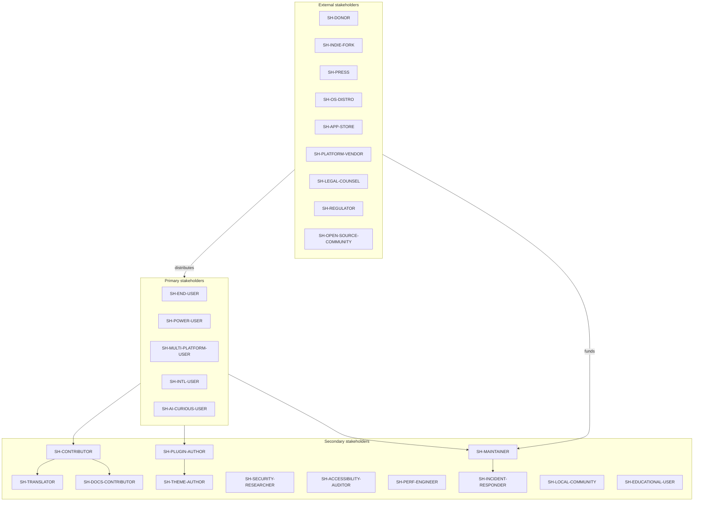

# 04 — Stakeholders

| Field            | Value                                                                                |
|------------------|--------------------------------------------------------------------------------------|
| Document ID      | `PINE-DOC-04-STAKEHOLDERS`                                                           |
| Status           | Draft — pending review                                                               |
| Owner            | Engineering Review Board                                                             |
| Created          | 2026-07-08                                                                           |
| Last Updated     | 2026-07-08                                                                           |
| Specification Standard | IEEE 29148 (stakeholder identification)                                       |
| Glossary         | `PINE-DOC-03-GLOSSARY` (authoritative)                                                |
| Prerequisites    | `00-Vision`, `01-Business-Requirements`, `02-Product-Scope`, `03-Glossary` |
| Decisions closed | None                                                                                 |
| Related Documents| `05-Personas`, `06-Use-Cases`, `24-Contributing`, `25-ADR`, `44-Backlog`, `54-Maintenance` |

---

## 1. Purpose

Identify and classify the human, organisational and institutional
stakeholders of Pine, capture their interests, their influence, the
channels through which the project engages with them, and the
responsibility assignments (RACI) used by the project for decisions
that affect them.

## 2. Scope of this Document

In scope: stakeholder identification (primary, secondary, external),
stakeholder attributes: interest, influence, expectations, conflict
potential, engagement strategy, communication channels and cadences,
RACI matrix for recurring decisions.

Out of scope: detailed personas → `05-Personas`; concrete use cases →
`06-Use-Cases`; code of conduct → `24-Contributing` (deferred BR-D-5);
conflict-of-interest policy → `24-Contributing` (deferred BR-D-3);
sponsorship acceptance criteria → `24-Contributing` (deferred BR-D-4);
trademark policy text → `TRADEMARK.md` (deferred OD-09).

## 3. Definitions and Glossary References

Working definitions used in this document. Authoritative registry in
`PINE-DOC-03-GLOSSARY`.

| Term          | Working definition                                                                                |
|---------------|------------------------------------------------------------------------------------------------------|
| Stakeholder   | Any individual, group or institution that can affect, is affected by, or perceives itself to be affected by Pine. |
| Primary stakeholder | A stakeholder that Pine cannot succeed without (e.g. end users).                                |
| Secondary stakeholder | A stakeholder that Pine depends on for amplification, funding, translation or distribution.       |
| External stakeholder | A stakeholder outside the project team that has legal, regulatory or reputational influence.     |
| Interest      | What the stakeholder wants from Pine.                                                            |
| Influence     | The stakeholder's ability to affect Pine's direction, adoption or reputation.                   |
| Engagement strategy | How the project intends to interact with the stakeholder, on which channel, at which cadence.    |
| RACI         | Responsibility assignment: Responsible, Accountable, Consulted, Informed.                        |

> **Assumption SH-A-1.** Stakeholder interests are *derived* from the
> Vision principles (P-01..P-13) and the business policies (BP-01..BP-11).
> A stakeholder whose interest contradicts the principles is, by
> definition, an anti-stakeholder and is excluded from this registry.

## 4. Stakeholder Identification Strategy

The Engineering Review Board identifies stakeholders by walking the
*product surface* of Pine (modules in `02-Product-Scope` §8) and asking
"who touches this, who depends on it, who is affected by a failure of
it". The result is grouped into the categories in §5.

The identification strategy produces a *living* list. New stakeholders
are added when:

- A new module enters product scope (e.g. a new SCOPE-* item).
- A new platform is added (Windows, Linux, macOS, Android, iOS).
- A new external policy (e.g. App Store rules) materially changes the
  obligations of the project.
- An ADR changes an interface that an external party depends on.

**Rationale.** Walking the product surface (instead of brainstorming
roles) keeps the stakeholder list anchored to the actual SSoT, not to
a generic "users, contributors, sponsors" template.

## 5. Stakeholder Registry

Each stakeholder is given a stable identifier `SH-*` used for
traceability. Anti-stakeholders (entities that Pine *will not* serve
because serving them would violate a principle or policy) are listed
in §6.

### 5.1 Primary Stakeholders

| ID         | Stakeholder         | Interest                                                                                   | Influence | Engagement strategy                                        |
|------------|---------------------|---------------------------------------------------------------------------------------------|-----------|-------------------------------------------------------------|
| `SH-END-USER` | End user (privacy-conscious) | A working, private, multi-platform finance app that never sells their data.                  | High      | Public roadmap, public changelog, in-product opt-in telemetry, public issue tracker. |
| `SH-POWER-USER` | Power user             | A plugin SDK, swappable AI, custom rules, multiple storage backends, scripting.              | High      | Stable Plugin SDK, public ADR process, RFC-style proposals. |
| `SH-MULTI-PLATFORM-USER` | Multi-platform user | One dataset, identical UX on Windows, Linux, macOS, Android, iOS.                            | High      | Cross-platform release matrix, public parity dashboard.    |
| `SH-INTL-USER` | International user   | Full i18n, RTL, regional formats, multi-currency, timezones.                                | High      | Public locale coverage dashboard, translation platform, RTL conformance tests. |
| `SH-AI-CURIOUS-USER` | AI-curious user     | On-device OCR, categorisation, anomaly detection, forecasting, recommendations.             | High      | Local-AI by default, model swap documented, AI transparency page. |

**Rationale.** The five primary stakeholders mirror the user value
proposition in `00-Vision` §7.2. They are *persona seeds*, not full
personas; full personas live in `05-Personas`.

### 5.2 Secondary Stakeholders

| ID         | Stakeholder         | Interest                                                                                   | Influence | Engagement strategy                                        |
|------------|---------------------|---------------------------------------------------------------------------------------------|-----------|-------------------------------------------------------------|
| `SH-PLUGIN-AUTHOR` | Plugin author       | Stable Plugin SDK, predictable release cadence, fair marketplace visibility.                | High      | SemVer Plugin SDK, deprecation policy, public SDK changelog, marketplace analytics. |
| `SH-CONTRIBUTOR` | Contributor (code, docs, design) | A clear contribution process, public roadmap, recognition.                                  | Medium    | `24-Contributing`, public maintainers list, public CoC (deferred BR-D-5). |
| `SH-TRANSLATOR` | Translator / localiser | A well-maintained i18n pipeline, clear locale ownership, glossary.                          | Medium    | Public translation platform, locale-ownership policy, machine-translation review. |
| `SH-DOCS-CONTRIBUTOR` | Documentation contributor | An authoritative SSoT, a clear style guide, low-friction PRs.                              | Medium    | Markdown style guide, SSoT authoring rules, linter for terminology. |
| `SH-THEME-AUTHOR` | Theme author        | A documented theming contract, marketplace visibility.                                       | Low       | Theming contract, marketplace, sample theme.                |
| `SH-SECURITY-RESEARCHER` | Security researcher | Public threat model, responsible disclosure, fair credit.                                   | High      | `38-Threat-Model`, security.txt, public advisories.         |
| `SH-ACCESSIBILITY-AUDITOR` | Accessibility auditor | Conformance evidence, regression protection, public roadmap.                                | High      | `40-Accessibility`, conformance report, public issue tracker tag. |
| `SH-PERF-ENGINEER` | Performance engineer | Benchmarks, regression tests, hardware coverage matrix.                                      | Medium    | `39-Performance`, benchmark dashboards, public numbers.     |
| `SH-MAINTAINER` | Maintainer (current and future) | Clean architecture, ADRs, tests, runbooks, succession plan.                                 | High      | `54-Maintenance`, ADR culture, pair-maintenance, public maintainers list. |
| `SH-INCIDENT-RESPONDER` | Incident responder | Reproducible builds, diagnostic packs, runbooks.                                            | High      | `54-Maintenance`, runbooks, diagnostics build, post-mortem template. |
| `SH-LOCAL-COMMUNITY` | Local community (language, region) | A respectful, well-translated product and a way to organise locally.                       | Low       | Translation platform, CoC, regional ambassadors (TBD).     |
| `SH-EDUCATIONAL-USER` | Educational user (student, teacher) | A tool that can be used in classrooms and self-study.                                       | Low       | Documentation, sample datasets (clearly synthetic), classroom-friendly install guide. |

### 5.3 External Stakeholders

| ID         | Stakeholder         | Interest                                                                                   | Influence | Engagement strategy                                        |
|------------|---------------------|---------------------------------------------------------------------------------------------|-----------|-------------------------------------------------------------|
| `SH-DONOR` | Donor / sponsor     | Visible accountability for funds and outcomes.                                              | Medium    | Public finance report, public roadmap, sponsor logos policy. |
| `SH-INDIE-FORK` | Independent fork maintainer | A clear trademark policy that distinguishes official Pine from forks.                       | Low       | Trademark policy, "official vs. fork" communication rules. |
| `SH-PRESS` | Press / media       | An accurate, non-misleading product story.                                                  | Medium    | Press kit, factual changelog, embargo policy.              |
| `SH-OS-DISTRO` | OS distribution maintainer | Packaging, signing, reproducibility, security disclosures.                                | High      | Reproducible builds, signing, public CVE feed.             |
| `SH-APP-STORE` | App store (Apple, Google) | Compliance with platform rules; offline support, AI labelling, payment policy.              | High      | Platform-specific ADR, public compliance checklist, payment policy compliance. |
| `SH-PLATFORM-VENDOR` | Platform vendor (Apple, Google, Microsoft, Linux vendors) | Platform health, security disclosures, OS-specific behaviour.                                | Medium    | OS-specific bug reports, public security policy.           |
| `SH-LEGAL-COUNSEL` | Legal counsel (GPL, privacy, trademark) | Licence compatibility, privacy posture, trademark defence.                                  | Medium    | Pro-bono counsel network, ADR review for licence-sensitive decisions. |
| `SH-REGULATOR` | Regulator (data protection authority) | Demonstrable privacy compliance.                                                            | Medium    | `15-Security`, `38-Threat-Model`, public DPIA (Data Protection Impact Assessment) when in scope. |
| `SH-OPEN-SOURCE-COMMUNITY` | Open-source community at large | Health, governance and longevity of the project.                                            | Medium    | Public governance, public finance report, public roadmap.   |

**Rationale.** External stakeholders include *platform* and
*distribution* parties that Pine depends on for reach. The list
includes "App Store" as a stakeholder (Pine must comply with their
rules) but **not** as a *customer* (Pine is not a paying customer of
the store; the store is a distribution channel).

## 6. Anti-Stakeholders (Pine will not serve these)

Pine refuses to serve stakeholders whose interest would violate a
principle (P-01..P-13) or a business policy (BP-01..BP-11). The list
mirrors the refusal list in `01-Business-Requirements` §9.2 and
`00-Vision` §9.2.

| Anti-stakeholder        | Why excluded                                                                                |
|-------------------------|----------------------------------------------------------------------------------------------|
| `SH-ANTI-ADVERTISER`    | Wants to embed advertising. Excluded by BP-01.                                                |
| `SH-ANTI-SUBSCRIPTION`  | Wants a paywalled tier. Excluded by BP-02.                                                    |
| `SH-ANTI-OFFLINE`       | Wants Pine to depend on the network. Excluded by P-02 and P-13.                               |
| `SH-DATA-BROKER`        | Wants user data in exchange for value. Excluded by P-01, P-12, BP-03.                         |
| `SH-PAID-AI-VENDOR`     | Wants Pine to default to a paid third-party AI API. Excluded by BP-04.                        |
| `SH-EXCLUSIVE-PARTNER`  | Wants exclusivity on a plugin category, model or sync provider. Excluded by P-08, P-12.      |
| `SH-OPEN-BANKING-AGGREGATOR` | Wants Pine to become a banking aggregator that *requires* Open Banking credentials. Excluded by `02-Product-Scope` §5.2. |
| `SH-PAYMENT-INITIATOR`  | Wants Pine to initiate payments. Excluded by `02-Product-Scope` §5.2.                          |
| `SH-CUSTODIAN`          | Wants Pine to hold user funds. Excluded by `02-Product-Scope` §5.2.                            |
| `SH-REGULATED-ADVISER`  | Wants Pine to act as a regulated investment adviser. Excluded by `02-Product-Scope` §5.2.     |

**Rationale.** A written anti-stakeholder list protects the project
from being negotiated against its own principles. Each row is
traceable to a principle, a business policy or a product-scope rule.

## 7. Stakeholder Attributes Matrix

The matrix below summarises the *interest* and *influence* of each
primary and secondary stakeholder. The full external matrix is in
§5.3.

| Stakeholder (ID)               | Interest   | Influence | Quadrant (PM-style)             |
|--------------------------------|------------|-----------|--------------------------------|
| `SH-END-USER`                  | High       | High      | Manage closely                 |
| `SH-POWER-USER`                | High       | High      | Manage closely                 |
| `SH-MULTI-PLATFORM-USER`       | High       | High      | Manage closely                 |
| `SH-INTL-USER`                 | High       | High      | Manage closely                 |
| `SH-AI-CURIOUS-USER`           | High       | High      | Manage closely                 |
| `SH-PLUGIN-AUTHOR`             | High       | High      | Manage closely                 |
| `SH-MAINTAINER`                | High       | High      | Manage closely                 |
| `SH-SECURITY-RESEARCHER`       | High       | High      | Manage closely                 |
| `SH-ACCESSIBILITY-AUDITOR`     | High       | High      | Manage closely                 |
| `SH-INCIDENT-RESPONDER`        | High       | High      | Manage closely                 |
| `SH-APP-STORE`                 | High       | High      | Manage closely                 |
| `SH-OS-DISTRO`                 | High       | High      | Manage closely                 |
| `SH-CONTRIBUTOR`               | Medium     | Medium    | Keep informed                  |
| `SH-TRANSLATOR`                | Medium     | Medium    | Keep informed                  |
| `SH-DOCS-CONTRIBUTOR`          | Medium     | Medium    | Keep informed                  |
| `SH-PERF-ENGINEER`             | Medium     | High      | Keep satisfied                 |
| `SH-DONOR`                     | Medium     | Medium    | Keep informed                  |
| `SH-PRESS`                     | Medium     | Medium    | Keep informed                  |
| `SH-PLATFORM-VENDOR`           | Medium     | Medium    | Keep informed                  |
| `SH-LEGAL-COUNSEL`             | Medium     | Medium    | Keep informed                  |
| `SH-REGULATOR`                 | Medium     | Medium    | Keep informed                  |
| `SH-OPEN-SOURCE-COMMUNITY`     | Medium     | Medium    | Keep informed                  |
| `SH-INDIE-FORK`                | Low        | Low       | Monitor (minimal effort)       |
| `SH-LOCAL-COMMUNITY`           | Low        | Low       | Monitor (minimal effort)       |
| `SH-EDUCATIONAL-USER`          | Low        | Low       | Monitor (minimal effort)       |
| `SH-THEME-AUTHOR`              | Low        | Low       | Monitor (minimal effort)       |

**Rationale.** A traditional "Power/Interest" grid is included
because it is a well-known tool and works for a project like Pine.
The grid does not replace the engagement strategies in §5; it only
suggests *how much* effort the project should put in.

## 8. Communication Plan

The plan below uses *channels* (where), *cadences* (how often) and
*artefacts* (what). It does not name a specific person; ownership of
each artefact is set in `24-Contributing` and the runbook in
`54-Maintenance`.

| Stakeholder group                  | Channel(s)                            | Cadence        | Artefact(s)                                            |
|------------------------------------|---------------------------------------|----------------|--------------------------------------------------------|
| End users (all five types)         | Public website, in-product release notes, public changelog, in-product opt-in telemetry review. | Per release, plus monthly digest. | Release notes, changelog, opt-in telemetry summary, public roadmap. |
| Plugin authors                     | Public SDK changelog, public ADR feed, plugin-dev mailing list, plugin marketplace. | Per SDK release, plus monthly digest. | SemVer-tagged SDK releases, deprecation policy, marketplace analytics. |
| Contributors                       | Public issue tracker, public discussions, public maintainers list, contributor guide. | Daily triage, weekly maintainer sync. | `24-Contributing`, public CoC (when approved), public good-first-issues. |
| Translators                        | Public translation platform, locale-ownership page. | Weekly.       | Public locale coverage dashboard, glossary updates, style guide. |
| Documentation contributors         | Public docs repository, SSoT authoring rules, public style guide. | Continuous.    | SSoT linter, public style guide, "good first doc" tags. |
| Security researchers               | `security@pine` (to be created), security advisory page, security.txt. | Continuous; disclosure SLA in policy. | `38-Threat-Model`, security advisories, CVE records. |
| Accessibility auditors            | Public accessibility conformance page, public issue tracker tag. | Per release, plus annual audit. | `40-Accessibility`, conformance report, public roadmap items. |
| Performance engineers              | Public benchmark dashboard, performance regression report. | Per release.   | `39-Performance`, benchmark artefacts, hardware coverage matrix. |
| Maintainers                        | Private maintainer channel, public governance page. | Weekly.        | Maintainer rotation, public maintainers list, post-mortem log. |
| Incident responders                | Private incident channel, public status page (post-GA), public post-mortems. | On incident, plus monthly review. | Runbooks, post-mortems, status page updates. |
| Donors / sponsors                  | Public finance report, sponsor page, donor thank-you page. | Quarterly finance report, per-release summary. | Public finance report, sponsor logos policy, public roadmap. |
| Independent fork maintainers       | Trademark policy, "official vs. fork" page. | Continuous.    | Trademark policy, official distribution list. |
| Press / media                      | Press kit, public changelog, embargo policy. | Per release.   | Press kit, public release notes, factual changelog. |
| OS distribution maintainers        | Distribution channel, signing policy, security advisory feed. | Per release, plus on advisory. | Reproducible build artefacts, signed packages, public CVE feed. |
| App stores                         | Platform-specific compliance channel, public compliance checklist, payment-policy compliance. | Per submission, plus on policy change. | Platform compliance checklist, public policy response. |
| Platform vendors                   | OS-specific bug reports, security disclosure channel. | On issue.      | OS bug reports, security advisories. |
| Legal counsel (GPL, privacy, trademark) | Pro-bono counsel network, ADR review for licence-sensitive decisions. | On ADR.        | ADR review, licence-compatibility report, trademark policy review. |
| Regulators (data protection)       | `15-Security`, `38-Threat-Model`, public DPIA when in scope. | On request, plus annual review. | `15-Security`, public DPIA, transparency report. |
| Open-source community              | Public governance, public finance, public roadmap, public maintainers list. | Quarterly governance digest. | Public governance page, public finance report, public roadmap. |

**Rationale.** The plan uses *public* channels as the default and
*private* channels only where necessary (e.g. incident response).
Pine is committed to transparency (P-11), so the cost of "public by
default" is a feature, not a bug.

## 9. RACI Matrix for Recurring Decisions

The matrix below assigns Responsibility, Accountability,
Consultation and Information for the most common decision types in
the project. R = Responsible, A = Accountable, C = Consulted, I = Informed.

| Decision type                                       | Engineering Review Board | Maintainers | Contributors | Plugin authors | Translators | Donors | End users | External (legal, security, platform) |
|-----------------------------------------------------|---------------------------|-------------|---------------|-----------------|--------------|---------|-----------|--------------------------------------|
| Adopt a new ADR (architecture change)               | A                         | R           | C             | C               | I            | I       | I         | C                                    |
| Adopt a new SSoT document                            | A                         | R           | C             | I               | I            | I       | I         | C (legal, security as needed)        |
| Change a Vision principle (P-01..P-13)              | A                         | R           | C             | C               | I            | I       | I         | C (legal)                            |
| Change a business policy (BP-01..BP-11)             | A                         | R           | C             | I               | I            | C       | I         | C (legal)                            |
| Add or remove a SCOPE-* item                         | A                         | R           | C             | C               | I            | I       | I         | I                                    |
| Add a new glossary term                              | A                         | R           | C             | I               | C            | I       | I         | I                                    |
| Add a new locale                                     | I                         | R           | C             | I               | A (locale lead) | I   | I         | I                                    |
| Accept a new plugin in the marketplace              | I                         | A           | C             | R (author)       | I            | I       | I         | C (security)                         |
| Accept a donation / sponsor                          | A                         | C           | I             | I               | I            | R       | I         | C (legal for conflict-of-interest)   |
| Cut a public release                                 | A                         | R           | I             | I               | I            | I       | I         | I                                    |
| Respond to a security advisory (P0/P1)              | A                         | R           | C             | I               | I            | I       | I (post-fix) | C (security researchers)        |
| Take a position on a public policy / press inquiry  | A                         | R           | I             | I               | I            | I       | I         | C (legal)                            |

**Rationale.** RACI is included to make the *decision* surface
explicit, not the *work* surface. Work-level task assignment lives
in the project tracker, not in the SSoT.

## 10. Stakeholder Lifecycle (Onboarding, Engagement, Offboarding)

| Stage        | Activities                                                                              | Owner                              |
|--------------|-------------------------------------------------------------------------------------------|-------------------------------------|
| Onboarding   | Add to relevant channels; publish a public "join us" page; tag a maintainer as the contact. | Maintainers, contributors.          |
| Engagement   | Apply the communication plan in §8; track engagement metrics (where allowed).             | Maintainers, comms.                 |
| Conflict     | Use the Code of Conduct (when approved) and the conflict-of-interest policy (deferred BR-D-3). | Maintainers, legal counsel.         |
| Offboarding  | Public acknowledgement; transition plan; remove from private channels; preserve public credit. | Maintainers.                        |
| Re-entry     | Same path as onboarding, with a re-onboarding note if the contributor was previously active. | Maintainers.                        |

## 11. Stakeholder-Level Assumptions

| ID          | Assumption                                                                                            |
|-------------|--------------------------------------------------------------------------------------------------------|
| SH-A-1      | The five user value propositions in `00-Vision` §7.2 are the basis for the five primary stakeholders. |
| SH-A-2      | Engagement metrics that depend on user-side data (e.g. active users) follow the telemetry policy in `01-Business-Requirements` §5.2 (default off, opt-in). |
| SH-A-3      | "App store" is a distribution channel, not a customer; Pine does not share revenue with app stores in a way that would compromise the donation model. |
| SH-A-4      | Public channels are the default; private channels are exceptions, listed in §8.                       |
| SH-A-5      | Anti-stakeholders are stakeholders we *refuse to serve*; they are not "users we don't have".          |
| SH-A-6      | Conflict-of-interest, CoC and sponsorship acceptance are deferred (BR-D-3, BR-D-5, BR-D-4) and will be added to this document when their owning documents are approved. |

## 12. Deferred Stakeholder Decisions

| ID     | Deferred decision                                                                  | Owning document(s)         |
|--------|------------------------------------------------------------------------------------|----------------------------|
| SH-D-1 | Conflict-of-interest policy text and enforcement path.                             | `24-Contributing`          |
| SH-D-2 | Code of Conduct text and reporting process.                                         | `24-Contributing`          |
| SH-D-3 | Sponsorship acceptance criteria.                                                    | `24-Contributing`          |
| SH-D-4 | Trademark policy text and "official vs. fork" communication rules.                  | `TRADEMARK.md`             |
| SH-D-5 | Press kit and embargo policy.                                                       | `24-Contributing` (or a `PRESS.md` to be created) |
| SH-D-6 | Regional ambassador programme.                                                      | `24-Contributing`          |
| SH-D-7 | Accessibility audit cadence and public conformance report format.                   | `40-Accessibility`         |
| SH-D-8 | Public status page hosting and uptime reporting policy (post-GA).                   | `54-Maintenance`           |
| SH-D-9 | Pro-bono counsel network and legal review SLA for licence-sensitive ADRs.           | `24-Contributing`, `25-ADR` |

> **Assumption SH-A-7.** None of SH-D-1..SH-D-9 contradict this document
> or the upstream SSoT. If resolving any of them reveals a
> contradiction, this document must be amended.

## 13. Relationship to Other Documents

- **Upstream:** `00-Vision` (principles, value propositions),
  `01-Business-Requirements` (policies, refusal list, business
  drivers), `02-Product-Scope` (anti-goals), `03-Glossary` (terms).
- **Downstream:** `05-Personas` (refines primary stakeholders into
  personas), `06-Use-Cases` (uses personas), `24-Contributing`
  (deferred decisions SH-D-1..SH-D-3, SH-D-5, SH-D-6, SH-D-9),
  `25-ADR` (deferred SH-D-9), `40-Accessibility` (deferred SH-D-7),
  `54-Maintenance` (deferred SH-D-8, incident responders), `44-Backlog`
  (uses stakeholder priorities for ordering).

## 14. Document Quality Checklist (Stakeholders-specific)

- [x] Primary, secondary and external stakeholders are identified with
      stable `SH-*` identifiers.
- [x] Each stakeholder has interest, influence and engagement strategy.
- [x] Anti-stakeholders are listed and traced to principles or
      policies.
- [x] Power/Interest matrix is present.
- [x] Communication plan has channel, cadence and artefact.
- [x] RACI matrix for recurring decisions is present.
- [x] Stakeholder lifecycle (onboarding → engagement → conflict →
      offboarding → re-entry) is present.
- [x] Deferred decisions are listed with their owning documents.
- [x] No TODO placeholders.
- [x] No contradiction with `PINE-DOC-00-VISION`,
      `PINE-DOC-01-BUSINESS-REQUIREMENTS`, `PINE-DOC-02-PRODUCT-SCOPE`
      or `PINE-DOC-03-GLOSSARY`.
- [x] IEEE 29148-style structure (Purpose, Scope, Definitions, Body,
      Assumptions, etc.).

## 15. Revision History

| Version | Date       | Author                | Change                                                       |
|---------|------------|-----------------------|--------------------------------------------------------------|
| 0.1     | 2026-07-08 | Engineering Review Board | Initial stakeholder registry.                              |

---

## Appendix A — Mermaid View of the Stakeholder Map

The diagram below is *informative*; the canonical data is the registry
in §5 and §6.

## Appendix B — Cross-Reference Summary

| Concern               | Where it is defined                                              |
|-----------------------|------------------------------------------------------------------|
| Vision principles     | `00-Vision` §6                                                  |
| Business policies     | `01-Business-Requirements` §6                                   |
| Refusal list          | `00-Vision` §9.2, `01-Business-Requirements` §9.2               |
| Anti-goals            | `02-Product-Scope` §5.2                                          |
| Telemetry policy      | `01-Business-Requirements` §5.2, `30-Observability`             |
| Threat model          | `38-Threat-Model`                                                |
| Security posture      | `15-Security`                                                    |
| Accessibility posture | `40-Accessibility`                                               |
| Performance posture   | `39-Performance`                                                 |
| Maintenance posture   | `54-Maintenance`                                                 |
| Glossary              | `03-Glossary`                                                    |
