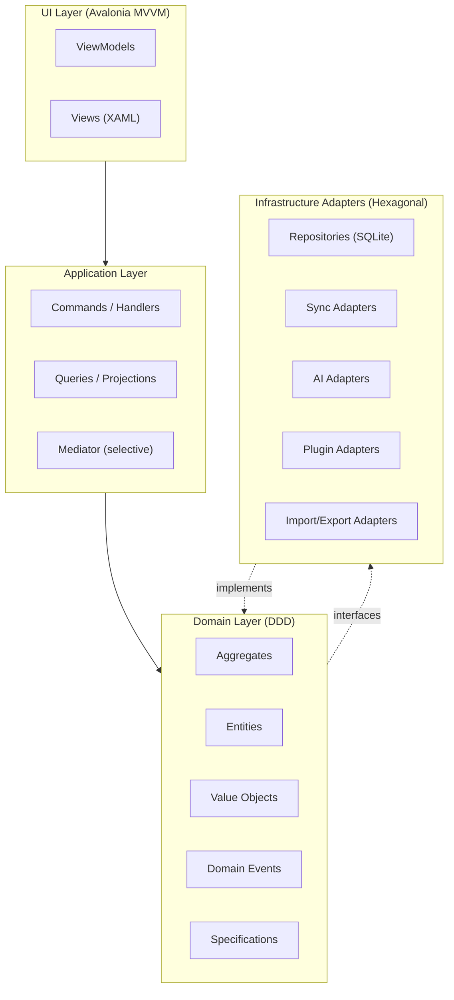
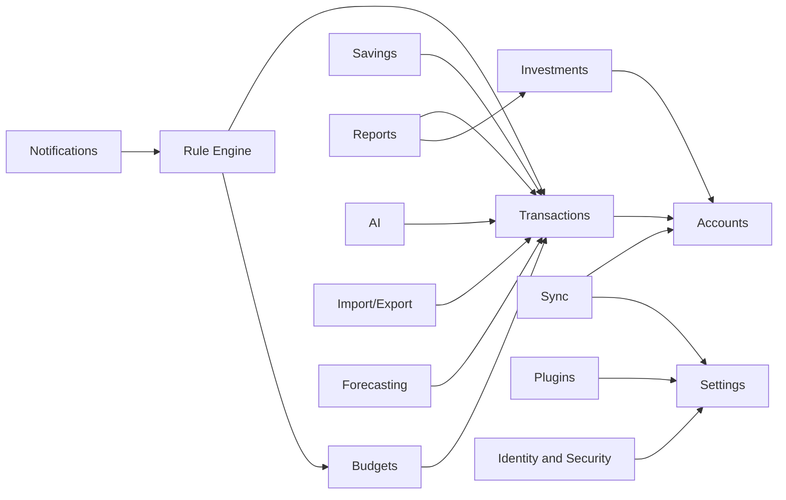
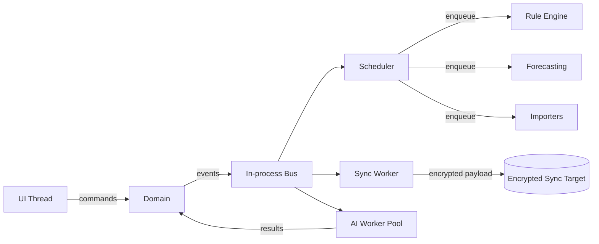
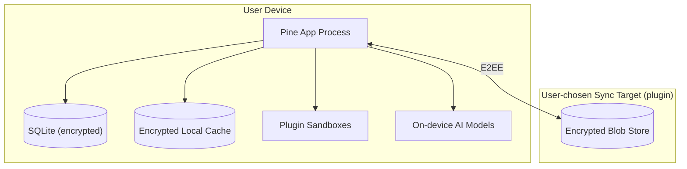
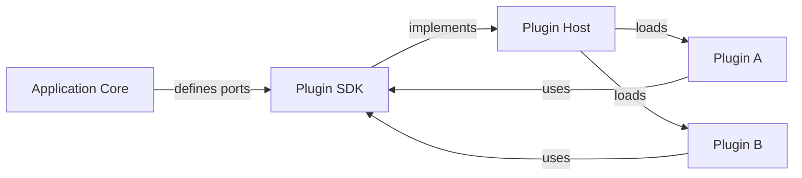
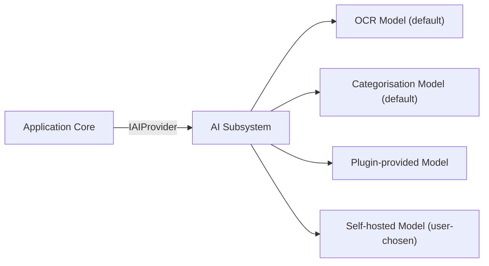
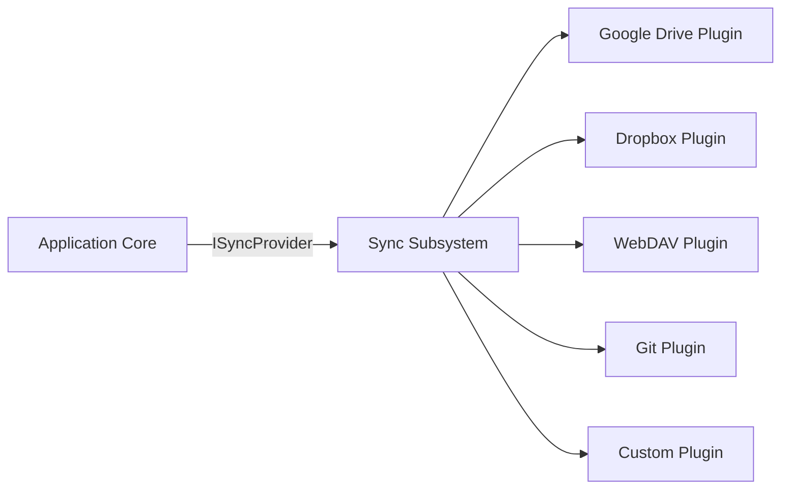

# 09 — System Architecture

| Field            | Value                                                                                |
|------------------|--------------------------------------------------------------------------------------|
| Document ID      | `PINE-DOC-09-SYSTEM-ARCHITECTURE`                                                    |
| Status           | Draft — pending review                                                               |
| Owner            | Engineering Review Board                                                             |
| Created          | 2026-07-08                                                                           |
| Last Updated     | 2026-07-08                                                                           |
| Specification Standard | IEEE 29148 (architecture view)                                                  |
| Glossary         | `PINE-DOC-03-GLOSSARY`                                                               |
| Prerequisites    | `00-Vision`..`08-NFR`                                                                |
| Decisions closed | OD-08 (minimum supported versions)                                                   |
| Decisions deferred | OD-01..OD-04, OD-06, OD-07, OD-10                                                |
| Related Documents| `10-Domain-Model`, `11-Data-Model`, `12-Plugin-Architecture`, `13-AI-Architecture`, `14-Synchronization`, `15-Security`, `25-ADR` |

---

## 1. Purpose

Define the high-level system architecture of Pine, including the
strategic choices (Clean Architecture, DDD, MVVM, plugin host) and
the tactical patterns (DI, Repository, Specification, Factory,
Strategy, Mediator, Domain Events, CQRS, hexagonal boundaries) the
project commits to.

## 2. Scope

In scope: the *system* view, including layers, processes, deployment
units, technology baselines and architectural decisions taken
upstream of this document.

Out of scope: detailed domain model → `10-Domain-Model`; data model
and persistence → `11-Data-Model`; AI internals → `13-AI-Architecture`;
plugin SDK details → `33-Plugin-SDK`; security policies → `15-Security`;
threat model → `38-Threat-Model`; CI/CD → `28-CI-CD`; deployment
artefacts → `29-Deployment`.

## 3. Definitions

| Term                | Working definition                                                                                |
|---------------------|------------------------------------------------------------------------------------------------------|
| Bounded Context     | A DDD strategic unit; a coherent model with its own ubiquitous language and explicit boundary.    |
| Aggregate            | A cluster of domain objects treated as a single unit for writes.                                  |
| Domain Event         | A first-class fact about something that happened in the past.                                       |
| Anti-Corruption Layer (ACL) | A translation layer that protects a bounded context from another context's model.         |
| Hexagonal boundary   | The set of ports and adapters that separate the application core from external concerns.           |
| Port                 | An interface defined by the application core that an adapter implements.                          |
| Adapter              | An implementation of a port that talks to the outside world (DB, network, plugin).                |
| Repository           | A port that abstracts persistence of aggregates.                                                  |
| Specification        | A composable, named predicate used to query a repository.                                          |
| Strategy             | A pluggable algorithm behind a stable interface.                                                   |
| Mediator             | A central dispatcher that decouples senders from receivers (used selectively, see §6).            |
| CQRS                 | Command-Query Responsibility Segregation: a separate model for reads and writes.                   |
| SSoT                 | Single Source of Truth — the Pine documentation tree.                                              |
| ADR                  | Architecture Decision Record.                                                                      |

> **Assumption SA-A-1.** Definitions inlined above are working
> definitions; the authoritative registry is `03-Glossary`.

## 4. Closing OD-08 — Technology Baselines

OD-08 from `00-Vision` §14 is **closed by this document** as follows:

- **.NET version:** latest LTS available at the time of the v1.0
  release decision, plus the two preceding LTS releases are supported
  at any given time. The exact version is recorded in the release
  plan (`22-Release-Plan`) for each release window.
- **Avalonia UI version:** the latest stable release at the time of
  the v1.0 release decision.
- **OS baselines (minimum):**
  - Windows: Windows 10 21H2 (or the OS baseline pinned in the
    release plan, whichever is higher).
  - Linux: glibc 2.31 (Ubuntu 20.04 baseline) or musl 1.2 (Alpine).
  - macOS: macOS 12 (Monterey) or later.
  - Android: Android 9 (API 28) or later.
  - iOS: iOS 15 or later.
- **MVVM is the UI pattern.** Avalonia + .NET + MVVM.
- **Language baseline:** C# 12 (or the version required by the chosen
  .NET LTS). F# is allowed for analytical components; the project
  is polyglot-friendly but C#-first.

**Rationale.** A 5–10 year horizon requires a stable baseline that
lasts. Pinning to LTS .NET and a recent Avalonia release is the
standard open-source way to balance longevity with current features.

## 5. Strategic Architecture Decisions

| ID         | Decision                                                                                  | Rationale                                                                                  |
|------------|--------------------------------------------------------------------------------------------|--------------------------------------------------------------------------------------------|
| SA-01      | Clean Architecture with explicit layer boundaries is the baseline.                         | Prevents drift; aligns with DDD; supports the "replace internals" principle.               |
| SA-02      | DDD is used at strategic and tactical levels, where it helps.                              | Models complex financial behaviour; avoids over-modelling trivial cases.                   |
| SA-03      | MVVM is the UI pattern on every platform.                                                  | Consistent across Avalonia, iOS and Android UI shells.                                      |
| SA-04      | Dependency Injection is mandatory across the application core.                            | Enables testability, plugin isolation and replaceable AI.                                  |
| SA-05      | Repository and Specification patterns are the persistence boundary.                       | Composable, testable, swap storage.                                                       |
| SA-06      | Strategy and Factory patterns are used for replaceable algorithms (e.g. categorisation).  | Aligns with the "swappable AI" principle.                                                  |
| SA-07      | Mediator is used **only where it reduces coupling without hiding flow**.                   | A central dispatcher can hide too much; Pine uses it only for cross-context events.        |
| SA-08      | Domain Events are first-class in the domain layer.                                         | Cross-context integration without tight coupling.                                          |
| SA-09      | CQRS is used **where reads and writes diverge** (e.g. dashboard vs. transactional core).  | Dashboards want denormalised reads; the transactional core wants invariants.                |
| SA-10      | Hexagonal boundaries (ports/adapters) are used at every external concern.                  | Storage, sync, plugins, AI and UI are all adapters.                                       |
| SA-11      | SOLID, GRASP, KISS, YAGNI, DRY, composition over inheritance.                              | Standard engineering practice; documented in `20-Coding-Standards`.                        |
| SA-12      | ADRs are mandatory for every significant decision.                                         | Keeps the SSoT auditable.                                                                  |

## 6. Layered View

**Rationale.** The diagram is the *canonical* layering. Dependencies
flow inward; infrastructure depends on domain, never the reverse.
`09-System-Architecture` tests enforce this direction.

## 7. Bounded Contexts (Strategic Map)

**Rationale.** Bounded contexts prevent the *Big Ball of Mud* that
personal finance projects tend to grow into. Each context has its own
ubiquitous language and its own integration points (events or ACLs).

## 8. Process View

Pine ships as a single user-facing process per device. Internally, the
process hosts:

- A UI thread.
- A domain worker pool.
- A sync worker (per sync provider plugin).
- An AI worker pool (per AI model).
- A background scheduler (rule engine, importers, forecasts, refresh
  of investment prices).

**Rationale.** A single user-facing process matches the user's mental
model and keeps offline operation simple. Background workers are
in-process to avoid IPC overhead and to make offline operation
deterministic.

## 9. Deployment View

**Rationale.** The cloud is a *user-chosen* encrypted blob store. The
app never assumes a specific cloud. The local cache is part of the
product, not an implementation detail (per the user-approved
Cloud Only rule in `00-Vision` §10).

## 10. Plugin Host Architecture

- The plugin host is part of the application core, not an external
  process.
- Plugins are loaded into a documented isolation boundary
  (separate assembly load context + permission set).
- The host exposes a stable, versioned set of ports
  (`IAccountRepository`, `ITransactionRepository`,
  `IRuleEngineContext`, `IDashboardWidget`, etc.) via the Plugin SDK.
- Plugins MUST NOT reach into the application core; they MUST go
  through the SDK ports.
- Plugin trust model (OD-01) is owned by
  `12-Plugin-Architecture` and `33-Plugin-SDK`.

## 11. AI Architecture (high level)

- The AI subsystem is a set of adapters behind a stable port.
- The default model registry ships with on-device models.
- A user MAY add a model through a plugin.
- The AI subsystem never calls a paid third-party API.
- Detailed AI architecture lives in `13-AI-Architecture`.

## 12. Sync Architecture (high level)

- Sync is an adapter behind `ISyncProvider`.
- The payload is encrypted client-side.
- Conflict resolution is owned by `14-Synchronization` (OD-02).
- The user may install any number of sync provider plugins; the
  default uses none.

## 13. Security Architecture (high level)

- All sensitive data is in the encrypted local database.
- The encryption envelope is a project-level decision (OD-03), owned
  by `15-Security`.
- Plugin permissions are enforced by the host.
- The threat model is owned by `38-Threat-Model`.

## 14. Quality Attributes (system view)

| Attribute   | Architectural lever                                                                          |
|-------------|----------------------------------------------------------------------------------------------|
| Performance | Denormalised read models for dashboards; in-process workers; on-device AI.                  |
| Reliability | Crash-safe transactions in SQLite; structured logs; deterministic conflict resolution.      |
| Security    | Encrypted at rest, encrypted in transit, plugin isolation, no telemetry by default.          |
| Accessibility| Avalonia UI bindings + automated a11y tests in CI.                                          |
| i18n        | Externalised strings, locale-aware formatting via CLDR.                                      |
| Testability | Hexagonal boundaries, fake ports, in-memory repository, architecture tests.                  |
| Modularity  | Bounded contexts + plugin SDK.                                                               |
| Portability | Avalonia UI, .NET cross-platform, OS baselines in §4.                                        |
| Observability| Structured logs, metrics, traces; opt-in only.                                              |
| Resilience  | Offline-first, encrypted local cache, queue-based sync.                                   |

## 15. Cross-Cutting Architectural Decisions

| ID    | Decision                                                                                  | Rationale                                                                                  |
|-------|--------------------------------------------------------------------------------------------|--------------------------------------------------------------------------------------------|
| XCD-01| The composition root is the only place where the DI container is built.                    | Avoids DI-in-DI; testable.                                                                  |
| XCD-02| Logging, metrics and tracing are wired at the composition root.                            | No global state inside the domain layer.                                                   |
| XCD-03| Time and clock are abstracted behind an `IClock` port.                                    | Testable; locale-aware.                                                                    |
| XCD-04| Money is a value object; never a floating-point number.                                    | Avoids rounding bugs.                                                                      |
| XCD-05| Locale is a value object threaded through the application core.                            | Locale-aware formatting everywhere.                                                        |
| XCD-06| Money and currency conversion are pure domain functions; FX rates are a port.              | Testable; swappable FX provider.                                                           |
| XCD-07| Concurrency is opt-in per aggregate; the default is single-writer.                         | Predictable; matches SQLite's strengths.                                                    |
| XCD-08| Errors are values, not exceptions, at the application boundary.                            | Forces explicit handling; matches IEEE 29148-style error modelling.                        |
| XCD-09| The domain layer has zero references to the UI, the DB, the network or the AI subsystem.  | Hexagonal purity; testable.                                                                |

## 16. Architecture Decision Log (resolves ADRs referenced above)

| ADR ID | Title                                  | Status   | Linked OD |
|--------|-----------------------------------------|----------|-----------|
| ADR-01 | Use Clean Architecture + DDD            | Accepted | —         |
| ADR-02 | Use Avalonia UI + .NET + MVVM           | Accepted | OD-08     |
| ADR-03 | Use SQLite as the local store           | Accepted | —         |
| ADR-04 | Plugin host inside the process          | Accepted | —         |
| ADR-05 | AI models are swappable adapters        | Accepted | —         |
| ADR-06 | Sync providers are swappable adapters   | Accepted | —         |
| ADR-07 | Money is a value object (decimal)       | Accepted | —         |
| ADR-08 | Time and clock are abstracted           | Accepted | —         |
| ADR-09 | Use mediation selectively               | Accepted | —         |
| ADR-10 | Use CQRS for read-heavy contexts        | Accepted | —         |

**Rationale.** ADRs are stored in `25-ADR`. The list above is the
*system-architecture-relevant* subset. New ADRs that change a
decision in this document MUST update the relevant table here.

## 17. Architectural Constraints for Plugins

- A plugin MUST NOT reference the application core assemblies.
- A plugin MUST NOT call a paid third-party API on the user's behalf
  without an explicit consent flow exposed by the SDK.
- A plugin MUST declare its permissions and trust signals in its
  manifest.
- A plugin MUST NOT bypass the encryption envelope.
- A plugin MUST NOT modify the local database directly; it MUST go
  through SDK ports.

## 18. Deferred Architecture Decisions

| ID     | Decision                                                                                  | Owning document(s)         |
|--------|-------------------------------------------------------------------------------------------|----------------------------|
| SA-D-1 | Plugin trust model (signed plugins, allowlist, sandbox).                                  | `12-Plugin-Architecture`   |
| SA-D-2 | Sync conflict resolution strategy.                                                         | `14-Synchronization`       |
| SA-D-3 | Encryption at rest standard.                                                              | `15-Security`              |
| SA-D-4 | Local AI model packaging and on-device update strategy.                                   | `13-AI-Architecture`       |
| SA-D-5 | Telemetry policy (default-off vs. opt-in vs. opt-out).                                    | `30-Observability`         |

## 19. Quality Checklist

- [x] Strategic and tactical patterns are explicit.
- [x] Layered view, bounded contexts, process view and deployment
      view are present.
- [x] Plugin host, AI, sync and security are positioned.
- [x] Cross-cutting decisions are listed.
- [x] Architectural constraints for plugins are listed.
- [x] ADRs for system-architecture-relevant decisions are recorded.
- [x] OD-08 is closed with technology baselines.
- [x] No TODO placeholders.
- [x] No contradiction with `00-Vision`..`08-NFR`.

## 20. Revision History

| Version | Date       | Author                | Change                                                       |
|---------|------------|-----------------------|--------------------------------------------------------------|
| 0.1     | 2026-07-08 | Engineering Review Board | Initial system architecture; closes OD-08.                |
