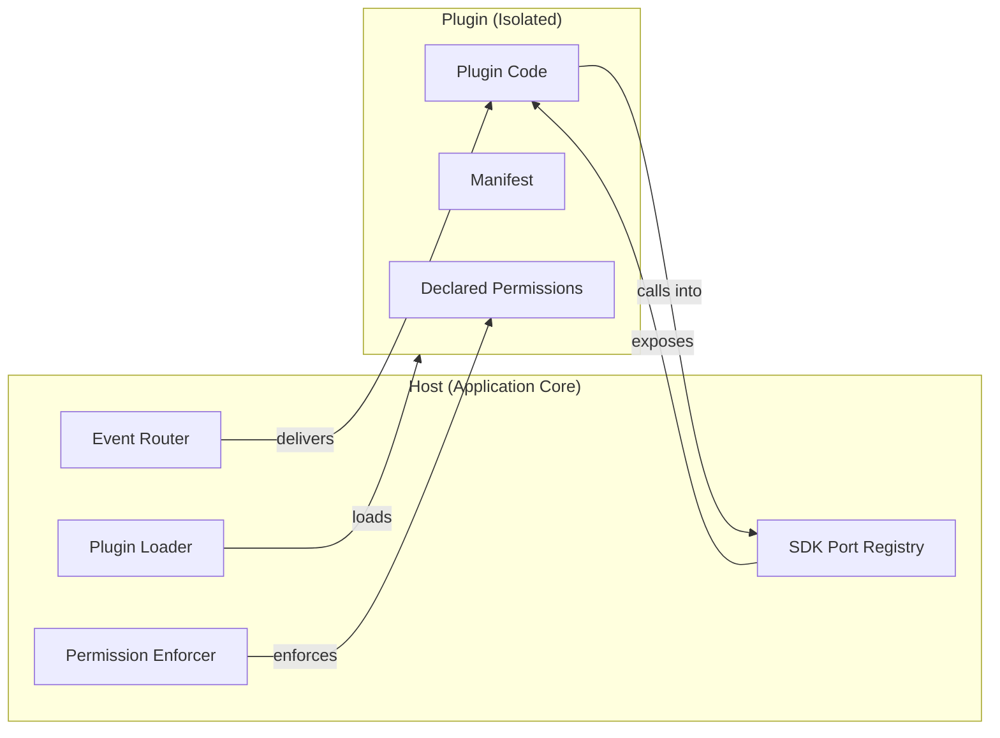
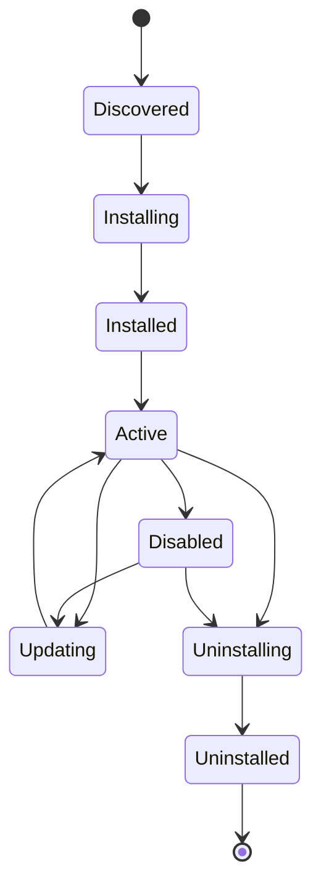

# 12 — Plugin Architecture

| Field            | Value                                                                                |
|------------------|--------------------------------------------------------------------------------------|
| Document ID      | `PINE-DOC-12-PLUGIN-ARCHITECTURE`                                                    |
| Status           | Draft — pending review                                                               |
| Owner            | Engineering Review Board                                                             |
| Created          | 2026-07-08                                                                           |
| Last Updated     | 2026-07-08                                                                           |
| Specification Standard | Internal (plugin host architecture)                                            |
| Glossary         | `PINE-DOC-03-GLOSSARY`                                                               |
| Prerequisites    | `00-Vision`..`11-Data-Model`                                                         |
| Decisions closed | OD-01 (plugin trust model baseline)                                                  |
| Related Documents| `09-System-Architecture`, `13-AI-Architecture`, `14-Synchronization`, `33-Plugin-SDK`, `34-API-Guidelines` |

---

## 1. Purpose

Define how Pine is *extended* through plugins: the categories, the
host architecture, the trust model, the marketplace, the lifecycle
and the constraints. The detailed API surface lives in
`33-Plugin-SDK` and `34-API-Guidelines`; this document fixes the
*shape*.

## 2. Scope

In scope: plugin categories, host architecture, trust model,
manifest, marketplace, lifecycle, isolation, versioning, telemetry
and security.

Out of scope: SDK type signatures → `33-Plugin-SDK`; API style rules
→ `34-API-Guidelines`; example plugins → repository `/samples/`.

## 3. Definitions

| Term                | Working definition                                                                                |
|---------------------|------------------------------------------------------------------------------------------------------|
| Plugin              | A packaged, isolated extension that adds behaviour to Pine through a documented public contract.   |
| Host                | The Pine application core that loads and runs plugins.                                              |
| Manifest            | A signed JSON document that describes a plugin (id, version, permissions, source).                  |
| Permission          | A typed token that grants a plugin a specific capability (e.g. `network.outbound`).                 |
| Isolation boundary  | The runtime and permission boundary that contains a plugin.                                          |
| Marketplace         | The in-app surface that lists, ranks, installs, updates and removes plugins.                        |
| Lifecycle           | The states a plugin moves through: `discovered → installed → active → disabled → updated → uninstalled`. |

> **Assumption PA-A-1.** Plugins are *additions*, not replacements
> for core behaviour. A plugin MAY add a widget, a sync provider, a
> model, etc.; it MUST NOT redefine a SCOPE-* module.

## 4. Plugin Categories

The full list of plugin categories is owned by the marketplace
catalogue. The normative list is:

| Category            | Purpose                                                                                  | Example                                                                 |
|---------------------|------------------------------------------------------------------------------------------|--------------------------------------------------------------------------|
| Sync                | Move encrypted data between the local store and a user-chosen target.                   | Google Drive, Dropbox, OneDrive, NextCloud, WebDAV, Git, custom.         |
| Widget              | Add a tile to the dashboard.                                                             | Cashflow heatmap, custom KPI tile.                                       |
| Theme               | Control visual presentation of built-in UI.                                              | High-contrast theme, seasonal palette.                                   |
| AI Model            | Provide an on-device model (OCR, categorisation, anomaly, recommendation, forecasting). | Self-hosted categoriser, an OCR model variant.                          |
| OCR                 | Provide an OCR engine used by the receipt flow.                                          | Tesseract variant, custom OCR.                                           |
| Financial Provider  | Provide account aggregation via *file* import only (no live Open Banking in scope).      | Bank statement PDF parser.                                               |
| Importer            | Add a new import format.                                                                 | QIF importer.                                                            |
| Exporter            | Add a new export format.                                                                 | Beancount exporter.                                                      |
| Report              | Add a report definition.                                                                 | Year-in-review report.                                                   |
| Analytics           | Add an analysis type.                                                                    | Cohort analysis.                                                         |
| Chart               | Add a chart type usable by reports and dashboards.                                       | Sankey chart.                                                            |
| Notification        | Add a notification channel.                                                              | Email channel, push channel, ntfy channel.                              |
| Recommendation      | Add a recommendation engine.                                                             | "Reduce dining out" recommender.                                         |
| Investment Provider | Add an investment price source.                                                          | A self-hosted market data feed.                                          |
| Language            | Add a locale (translation + regional formatting).                                       | `es-EC` translation.                                                     |

> **Assumption PA-A-2.** A plugin declares *exactly one* primary
> category; it MAY declare secondary categories (e.g. a chart plugin
> that is also a widget).

## 5. Plugin Host Architecture

The host is the part of the application core that loads and runs
plugins. Its responsibilities are:

- Discover plugins in the user's plugin directory and the marketplace
  cache.
- Verify the plugin manifest (signature, version, declared
  permissions).
- Load the plugin assembly in an isolated load context.
- Enforce declared permissions at runtime.
- Provide the SDK ports the plugin needs (`IAccountRepository`,
  `ITransactionRepository`, `IRuleEngineContext`,
  `IDashboardWidgetHost`, etc.).
- Route domain events to plugins that subscribe.
- Surface plugin UI in the host's UI (as widgets, settings pages, etc.).

## 6. Plugin Manifest

Every plugin MUST ship a manifest with the following fields. The
manifest is a JSON document, signed by the plugin author.

| Field        | Type        | Required | Description                                                                       |
|--------------|-------------|----------|-----------------------------------------------------------------------------------|
| `id`         | string      | yes      | Reverse-DNS identifier, stable across versions.                                   |
| `name`       | string      | yes      | Human-readable name.                                                              |
| `version`    | string      | yes      | SemVer 2.0.0.                                                                     |
| `author`     | object      | yes      | Name, contact, optional signing key fingerprint.                                   |
| `license`    | string      | yes      | SPDX licence identifier.                                                          |
| `homepage`   | string      | no       | URL.                                                                              |
| `source`     | object      | yes      | Where the source lives (repo URL, commit, build hash).                            |
| `categories` | array       | yes      | Primary + secondary categories (see §4).                                          |
| `pine_compat`| string      | yes      | SemVer range of compatible Pine versions.                                         |
| `sdk_version`| string      | yes      | SemVer of the Plugin SDK the plugin was built against.                            |
| `permissions`| array       | yes      | Declared permissions (see §7).                                                    |
| `entrypoints` | object     | yes      | Names of the entry-point classes implementing the SDK contracts.                   |
| `signature`  | string      | yes      | Cryptographic signature of the manifest and the package (base64).                  |
| `trust`      | object      | yes      | Trust signals (code review link, audit report, prior versions).                   |

> **Assumption PA-A-3.** A manifest without a valid signature MUST be
> rejected by the loader.

## 7. Permission Model

Permissions are typed tokens. A plugin MUST declare every permission
it needs; the host enforces them at runtime. The default is
*deny-all*; a permission is granted only after the user explicitly
approves it.

### 7.1 Permission Categories

| Permission token             | Grants                                                                                |
|------------------------------|----------------------------------------------------------------------------------------|
| `storage.read.accounts`      | Read accounts from the local store.                                                    |
| `storage.read.transactions`  | Read transactions from the local store.                                                |
| `storage.write.accounts`     | Create, update, close, archive accounts.                                                |
| `storage.write.transactions` | Create, update, delete transactions.                                                    |
| `storage.read.<entity>`      | Read any other entity (e.g. `storage.read.budgets`).                                    |
| `storage.write.<entity>`     | Write any other entity.                                                                |
| `network.outbound`           | Make outbound network calls.                                                            |
| `network.outbound.domains`   | Restrict outbound to a list of domains (declarative).                                   |
| `crypto.access`              | Access the encryption envelope (e.g. decrypt attachments).                              |
| `ai.invoke.<model_type>`     | Invoke a model of a given type.                                                          |
| `ai.provide.<model_type>`    | Provide a model of a given type.                                                         |
| `ui.dashboard.widget`        | Add a widget to the dashboard.                                                            |
| `ui.settings.page`           | Add a settings page.                                                                     |
| `ui.menu.item`               | Add a menu item.                                                                          |
| `event.subscribe.<event>`    | Subscribe to a domain event.                                                              |
| `event.publish.<event>`      | Publish a domain event (allowed only for plugin-defined events; never for core events). |
| `rule.action.<kind>`         | Be selected as an action in a rule.                                                       |
| `notification.send`          | Send a notification.                                                                      |
| `plugin.dependency.<id>`     | Depend on another plugin being installed.                                                  |
| `filesystem.read.user_chosen`| Read a file the user explicitly selected.                                                  |
| `filesystem.write.user_chosen`| Write a file the user explicitly selected.                                                  |

### 7.2 Permission Enforcement

- The host enforces permissions *at the boundary*. A plugin that
  tries to call a port it has not been granted MUST be denied with a
  typed error.
- A plugin MUST NOT use reflection to bypass permission checks.
- A plugin MUST NOT modify the application core assemblies.
- A plugin MUST NOT spawn child processes unless it declares a
  `process.spawn` permission (which is reserved for the host, not for
  third-party plugins by default).

## 8. Closing OD-01 — Plugin Trust Model Baseline

OD-01 from `00-Vision` §14 is **closed by this document** as
follows:

1. **Signed manifests are mandatory.** A plugin without a valid
   signature is not installed.
2. **Permissions are explicit and user-approved.** A plugin cannot
   acquire a permission at runtime; the user grants each permission
   at install time (or at first use, for incremental consent).
3. **A public allow-list is maintained** for plugins distributed
   through the official marketplace. Inclusion in the allow-list is
   not a guarantee of quality; it is a baseline signal that the
   manifest and signature are valid and the declared source is real.
4. **Plugins can be sandboxed** at the platform level where the
   platform supports it (e.g. iOS, Android, Win32). The host declares
   the platform sandbox status in the marketplace listing.
5. **A plugin cannot ship with code that the user has not reviewed**
   in the sense that the manifest declares the source repository and
   commit; the user can audit it before installing.
6. **The host keeps a "plugin risk score"** based on declared
   permissions, source, signature, age and audit history. The score
   is shown in the marketplace UI.

**Rationale.** A trust model that combines *signature*,
*permissions* and *transparency* is the smallest model that
preserves the openness of an open-source plugin ecosystem without
sacrificing user safety.

## 9. Plugin Lifecycle

- A disabled plugin keeps its data; the host stops loading it.
- An uninstalled plugin removes its data after a configurable
  retention window (default 30 days) so the user can recover.
- An update is atomic: either the new version is fully installed
  and active, or the old version remains untouched.

## 10. Plugin Marketplace

- The marketplace is an in-app surface.
- The marketplace MAY cache the catalogue locally for offline
  browsing of previously installed plugins.
- The marketplace exposes: search, categories, sort, filters
  (permissions, platform, language), the plugin page (manifest,
  source, signature, audit, screenshots of UI, ratings, reviews),
  install, update, remove.
- A plugin listing MUST show the declared permissions in plain
  language.
- A plugin listing MUST show the source repository and the signature
  status.
- A plugin MUST be removable at any time; the marketplace MUST NOT
  prevent uninstallation.

## 11. Versioning and Compatibility

- The Plugin SDK is SemVer 2.0.0.
- A breaking change in the SDK requires a major version bump and a
  deprecation window of at least one minor release during which the
  old SDK is still loadable.
- A plugin MUST declare `sdk_version` (exact) and `pine_compat`
  (range).
- A plugin built against an SDK version newer than the host supports
  MUST NOT be loaded.

## 12. Plugin-Side Telemetry

- A plugin MUST NOT send data off-device without a `network.outbound`
  permission *and* the user's explicit consent.
- A plugin MUST declare its own telemetry behaviour in its manifest.
- The marketplace UI shows the plugin's declared telemetry behaviour.

## 13. Cross-Cutting Plugin Constraints

- A plugin MUST NOT include paid third-party AI API calls by default.
- A plugin MUST NOT modify the encryption envelope.
- A plugin MUST NOT bypass the user-consent flow.
- A plugin MUST NOT silently upgrade itself; the host controls the
  update flow.
- A plugin MUST be tested in CI for isolation, declared permissions
  and offline behaviour.

## 14. Deferred Decisions

| ID     | Decision                                                                                  | Owning document(s)         |
|--------|-------------------------------------------------------------------------------------------|----------------------------|
| PA-D-1 | Public allow-list process and SLA.                                                        | `24-Contributing`          |
| PA-D-2 | Plugin risk score formula and update cadence.                                             | `12-Plugin-Architecture` (next rev.) |
| PA-D-3 | Whether the marketplace supports paid listings (currently excluded by P-05, BP-02).         | ADR + Vision revision       |

## 15. Quality Checklist

- [x] Categories, host architecture, manifest, permissions, lifecycle
      and marketplace are all present.
- [x] OD-01 is closed with a six-point trust model.
- [x] Versioning and compatibility rules are explicit.
- [x] Cross-cutting constraints are explicit.
- [x] No TODO placeholders.
- [x] No contradiction with `00-Vision`..`11-Data-Model`.

## 16. Revision History

| Version | Date       | Author                | Change                                                       |
|---------|------------|-----------------------|--------------------------------------------------------------|
| 0.1     | 2026-07-08 | Engineering Review Board | Initial plugin architecture; closes OD-01.               |
