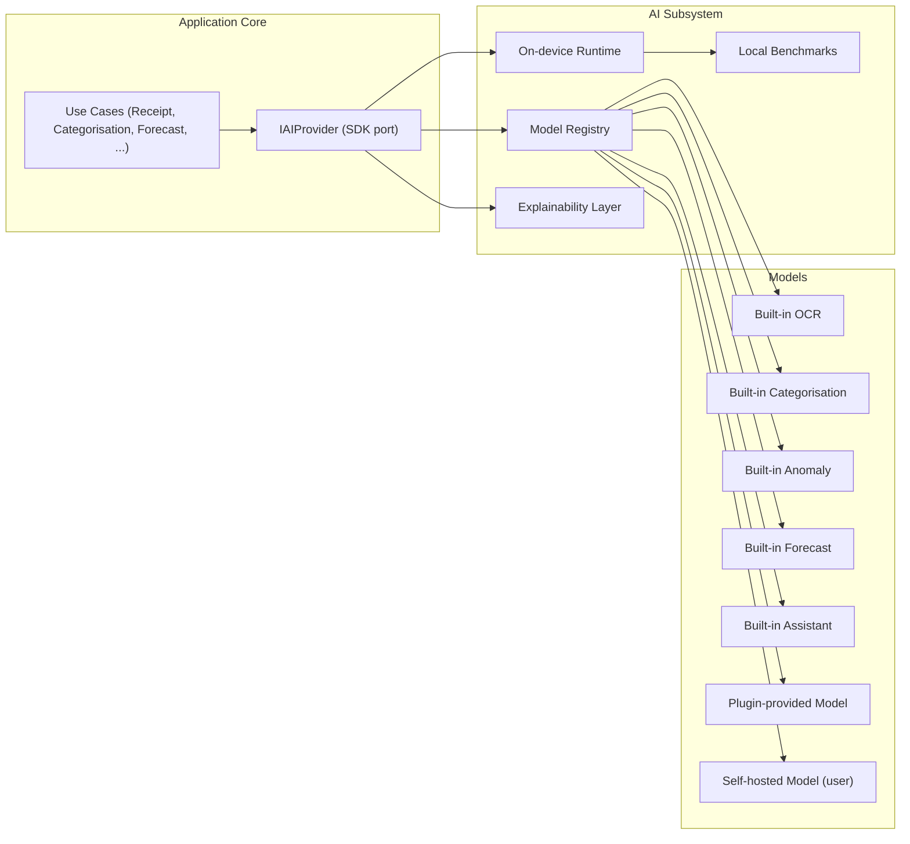
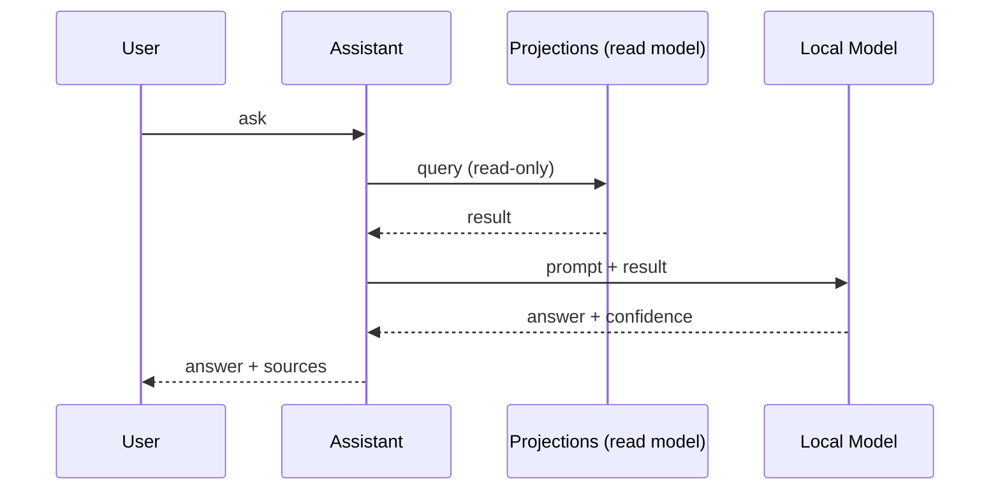

# 13 — AI Architecture

| Field            | Value                                                                                |
|------------------|--------------------------------------------------------------------------------------|
| Document ID      | `PINE-DOC-13-AI-ARCHITECTURE`                                                        |
| Status           | Partially implemented — the receipt pipeline is real; the rest is not                |
| Reconciled       | 2026-08-31 · Detection, OCR, field extraction and the encrypted per-vault categoriser exist (TD-16, TD-20, TD-21, TD-22). The assistant, forecasting, anomaly detection, recommendation engine and model registry do not. |
| Owner            | Engineering Review Board                                                             |
| Created          | 2026-07-08                                                                           |
| Last Updated     | 2026-07-08                                                                           |
| Specification Standard | Internal (ML systems)                                                          |
| Glossary         | `PINE-DOC-03-GLOSSARY`                                                               |
| Prerequisites    | `00-Vision`..`12-Plugin-Architecture`                                                |
| Decisions closed | OD-06 (local AI model packaging and on-device update strategy) — partial baseline    |
| Related Documents| `09-System-Architecture`, `10-Domain-Model`, `11-Data-Model`, `32-AI-Training`        |

---

## 1. Purpose

Define the AI architecture of Pine: the model registry, the on-device
runtime, the receipt scanning pipeline, the assistant, the
forecasting, the anomaly detection, the recommendation engine, and
the model-replacement strategy.

## 2. Scope

In scope: model types, runtime, packaging, update, evaluation,
explainability, on-device guarantees, opt-out, plugin integration.

Out of scope: dataset curation → `32-AI-Training`; domain model →
`10-Domain-Model`; threat model → `38-Threat-Model`; UX rules →
`42-UX-Guidelines`.

## 3. Definitions

| Term                 | Working definition                                                                                |
|----------------------|------------------------------------------------------------------------------------------------------|
| Model                | A self-contained AI model (weights + manifest + entry point) usable by Pine.                       |
| On-device runtime    | The runtime that executes a model locally.                                                           |
| Model registry       | The catalogue of models known to Pine, including their type, version, status and source.            |
| Confidence score     | A per-field and per-document value in [0, 1] expressing the model's certainty.                       |
| Explanation          | A human-readable description of why a model produced a given output.                                 |
| Prompt               | The input fed to a generative or assistant model.                                                    |
| Inference            | A single run of a model on a single input.                                                           |
| Fine-tuning          | A process that adapts a pre-trained model to a user's data, on-device.                               |
| Federated evaluation | On-device evaluation that aggregates metrics without uploading raw data.                         |

> **Assumption AI-A-1.** A model is a *plugin-attachable* component.
> The SDK is defined in `33-Plugin-SDK`; the AI-specific contracts
> are normative here.

## 4. Closing OD-06 (partial) — Local AI Model Packaging and On-Device Update Strategy

OD-06 from `00-Vision` §14 is **partially closed by this document** as
follows:

1. A model is distributed as a *package*: weights + manifest + (optional)
   tokenizer + (optional) inference glue. The package is signed.
2. The package is stored in the user's model directory; the host
   verifies the signature on load.
3. A model is *versioned* with SemVer. A major version bump indicates
   a behaviour change that requires user re-confirmation.
4. Updates are pulled from a *user-chosen* source (built-in catalogue
   or plugin-provided source). The host never auto-updates a model
   silently.
5. The user can keep an older model installed alongside a newer one
   and select which one is active per model type.
6. A model is removable; the host keeps a small retention window so
   the user can recover.

**Rationale (partial).** The remaining open part of OD-06 is the
*training* side (datasets, evaluation, on-device fine-tuning), which
is owned by `32-AI-Training`. OD-06 stays open until that document
is approved.

## 5. Model Types

| Type             | Built-in model | Plugin-replaceable | Inputs                                | Outputs                                                       |
|------------------|----------------|--------------------|---------------------------------------|----------------------------------------------------------------|
| OCR              | yes            | yes                | Image (receipt, statement).            | Plain text + per-token bounding boxes.                          |
| Receipt Detection| yes            | yes                | Image.                                 | Boolean + bounding box.                                         |
| Layout Analysis  | yes            | yes                | Image + OCR output.                    | Zoned text (header, line items, totals, footer).                |
| Field Extraction | yes            | yes                | Zoned text.                            | Structured fields with confidence.                              |
| Categorisation   | yes            | yes                | Transaction (text + amount + account).| Category + confidence + alternative candidates.                  |
| Anomaly Detection| yes            | yes                | Stream of transactions.                | Score + reason.                                                  |
| Recommendation   | yes            | yes                | User's data + recent events.           | Suggestion + explanation + confidence.                           |
| Insights         | yes            | yes                | Aggregated data.                       | Human-readable insight.                                          |
| Forecasting      | yes            | yes                | Time series + scenario.                | Forecast + confidence band + explanation.                        |
| Assistant (chat) | yes            | yes                | User prompt + context (user's data).   | Answer + sources + confidence.                                   |

**Rationale.** Every AI capability is a *model type* with a *contract*.
The built-in default is replaceable by a plugin. The contract does
not change when the model is replaced.

## 6. AI Subsystem Architecture

**Rationale.** The host sees only the `IAIProvider` port. Models are
behind the port. The runtime, the registry, the explainability
layer and the benchmarks are *infrastructure*.

## 7. Receipt Scanning Pipeline (normative)

The flow in `00-Vision` §11 is normative. The pipeline is:

1. **Image capture.** The user takes a picture. The image stays on
   the device.
2. **Receipt Detection.** A binary classifier decides whether the
   image is a receipt. Confidence MUST be exposed.
3. **OCR.** The image is converted to text. Per-token bounding
   boxes MUST be preserved.
4. **Layout Analysis.** The text is zoned (header, line items,
   totals, footer). Per-zone confidence MUST be exposed.
5. **Field Extraction.** Per-field values are extracted with
   confidence:
   merchant, date, time, currency, taxes, subtotal, total, products,
   quantities, payment method, invoice number, location (if
   available).
6. **Validation.** The pipeline runs cross-field checks (e.g. line
   items + tax = total). Failures are surfaced to the user.
7. **Categorisation.** A category is suggested with confidence and
   alternatives.
8. **User Confirmation.** The user reviews the result, edits fields,
   accepts or rejects. Low-confidence fields MUST be highlighted.
9. **Save.** On accept, the transaction and the attachment are
   written to the local encrypted store.

**Rationale.** The pipeline is the *only* path from a receipt photo
to a saved transaction. It is observable, replaceable, and always
under the user's control.

## 8. Assistant Architecture (high level)

- The assistant is a *chat* model with a tool-use interface.
- The assistant has access only to the *projections* the user has
  allowed; it MUST NOT have direct access to the local store.
- Every answer MUST cite the projections it used.
- The assistant MUST NOT call a paid third-party API.
- The assistant MUST allow the user to inspect the data it used.

## 9. Forecasting Architecture (high level)

- A forecast is a `Forecast` aggregate (see `10-Domain-Model` §6.15).
- The forecast is generated by a model of type `forecasting`.
- The forecast MUST include an explanation (model, data window,
  confidence band, key assumptions).
- The forecast MUST NOT silently mutate user data.
- The user MUST be able to reject a forecast.

## 10. Anomaly Detection Architecture (high level)

- Anomaly detection runs as a stream processor over transactions.
- A detected anomaly is a `Prediction` (see `10-Domain-Model` §6.7).
- The rule engine can subscribe to anomalies and emit notifications.
- The user MUST be able to disable anomaly detection.

## 11. Recommendation Architecture (high level)

- A recommendation is generated from the user's data, never from
  external data.
- A recommendation MUST include a confidence and a reason.
- A recommendation MUST be explainable in human-readable form.
- A recommendation MUST NOT be a *purchase* prompt; it MUST be
  educational.

## 12. Confidence and Explainability

- Every prediction has a confidence score.
- Every prediction has an explanation.
- The explanation MUST be in the user's locale.
- The explanation MUST NOT expose personal data to anyone but the
  user.

## 13. On-Device Guarantees

- All inference runs on-device by default.
- A user MAY route inference to a *self-hosted* model on their own
  network. The user controls the URL and the credentials; the host
  enforces the permission.
- The system MUST NOT call a paid third-party API.
- The system MUST NOT send raw financial data to an external model
  without explicit, revocable consent.

## 14. Model Replacement and Sandboxing

- A model runs inside the AI runtime, not in the application core.
- A model has no access to the local store; it receives inputs and
  produces outputs.
- A model is swappable: replacing a model MUST NOT require code
  changes.
- A model update is atomic and auditable.
- A model MAY be disabled by the user.

## 15. Local Evaluation and Monitoring

- The runtime runs *local benchmarks* on the user's device to detect
  performance regressions.
- Federated evaluation MAY be used to collect aggregated metrics;
  raw data MUST NEVER leave the device.
- Telemetry about AI is opt-in only.

## 16. Cross-Cutting AI Constraints

- A model MUST NOT include paid third-party API calls.
- A model MUST NOT include code that bypasses the user's consent.
- A model MUST be signed and MUST be removable.
- A model MUST declare its provenance, training data summary, and
  licence.
- A model MUST be tested in CI for the basic capabilities it
  advertises.

## 17. Deferred Decisions

| ID     | Decision                                                                                  | Owning document(s)         |
|--------|-------------------------------------------------------------------------------------------|----------------------------|
| AI-D-1 | On-device fine-tuning support for end users.                                              | `32-AI-Training`            |
| AI-D-2 | Default model tier for the MVP (CPU-only vs. GPU-accelerated).                            | `32-AI-Training`            |
| AI-D-3 | Federated evaluation protocol and aggregation window.                                     | `32-AI-Training`            |
| AI-D-4 | Format of model explanations (templates, JSON, human-readable).                            | `42-UX-Guidelines`         |

## 18. Quality Checklist

- [x] Model types, runtime, packaging, update, evaluation,
      explainability are all present.
- [x] Receipt pipeline is normative and step-by-step.
- [x] Assistant, forecasting, anomaly and recommendation are
      positioned.
- [x] On-device guarantees are explicit.
- [x] Cross-cutting constraints are explicit.
- [x] OD-06 is partially closed (the rest is in `32-AI-Training`).
- [x] No TODO placeholders.
- [x] No contradiction with `00-Vision`..`12-Plugin-Architecture`.

## 19. Revision History

| Version | Date       | Author                | Change                                                       |
|---------|------------|-----------------------|--------------------------------------------------------------|
| 0.1     | 2026-07-08 | Engineering Review Board | Initial AI architecture; partial close of OD-06.         |
