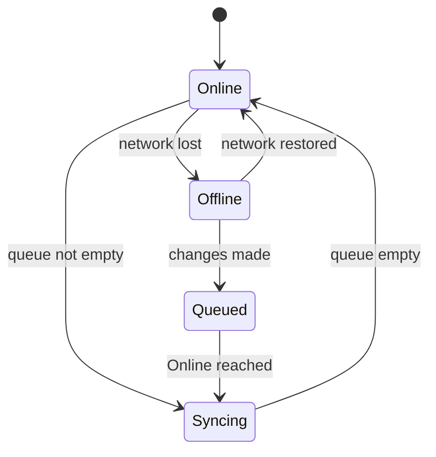

# 14 — Synchronization

| Field            | Value                                                                                |
|------------------|--------------------------------------------------------------------------------------|
| Document ID      | `PINE-DOC-14-SYNCHRONIZATION`                                                        |
| Status           | Draft — pending review                                                               |
| Owner            | Engineering Review Board                                                             |
| Created          | 2026-07-08                                                                           |
| Last Updated     | 2026-07-08                                                                           |
| Specification Standard | Internal (sync algorithms)                                                    |
| Glossary         | `PINE-DOC-03-GLOSSARY`                                                               |
| Prerequisites    | `00-Vision`..`13-AI-Architecture`                                                    |
| Decisions closed | OD-02 (sync conflict resolution strategy baseline)                                   |
| Related Documents| `09-System-Architecture`, `11-Data-Model`, `12-Plugin-Architecture`, `15-Security`   |

---

## 1. Purpose

Define the synchronisation architecture of Pine: the data envelope,
the providers (as plugins), the conflict-resolution strategy, the
offline behaviour, the encryption guarantees, the user controls, and
the audit trail.

## 2. Scope

In scope: sync protocol, envelope, conflict resolution, providers,
offline queue, encryption, UX surface, audit, telemetry, plugin
contract.

Out of scope: storage envelope → `15-Security`; data shapes →
`11-Data-Model`; plugin SDK details → `33-Plugin-SDK`.

## 3. Definitions

| Term                  | Working definition                                                                                |
|-----------------------|------------------------------------------------------------------------------------------------------|
| Provider              | A plugin that implements `ISyncProvider`.                                                            |
| Envelope              | The encrypted payload exchanged with a provider.                                                     |
| Change set            | The set of changes since the last successful sync.                                                  |
| Cursor                | A provider-specific token identifying the last synchronised point.                                  |
| Conflict              | A pair of changes to the same entity on different devices that cannot be auto-merged.                 |
| Resolution            | The action taken to reconcile a conflict (e.g. keep local, keep remote, merge, prompt user).       |
| Tombstone             | A delete marker.                                                                                    |
| CRDT                  | Conflict-free Replicated Data Type.                                                                  |
| LWW                   | Last-writer-wins; a simple conflict resolution that picks the latest timestamp.                     |

> **Assumption SY-A-1.** Encryption is applied *before* the envelope
> leaves the device. The provider sees only ciphertext and an opaque
> cursor.

## 4. Closing OD-02 — Sync Conflict Resolution Strategy

OD-02 from `00-Vision` §14 is **closed by this document** as follows:

Pine uses a **domain-aware, deterministic, auditable merge** with a
**user prompt for irreconcilable cases**.

The strategy has three layers, applied in order:

1. **Idempotent CRDT-friendly primitives** for fields that are safe
   to merge set-wise (tags, attachments, splits within a transaction).
2. **Domain-aware auto-merge** for fields where the domain has a
   well-defined rule (e.g. adding a contribution to a savings goal is
   commutative; changing an account name is last-writer-wins by
   `(device_id, lamport_clock)`).
3. **User prompt** for any change that is *not* covered by (1) or
   (2), with a side-by-side view and a clear "keep local / keep
   remote / merge manually" choice.

**Rationale.** A pure LWW strategy would silently lose user data on
concurrent edits. A pure CRDT strategy would force the entire
domain into a CRDT shape, which is not always appropriate. A pure
user-prompt strategy would be unusable for common cases. The
three-layer strategy balances safety, predictability and UX.

## 5. Sync Envelope (normative)

The envelope is defined in `11-Data-Model` §6.1. The normative
properties of the envelope are:

- The plaintext is a JSON document conforming to
  `pine.sync.v<MAJOR>`.
- The plaintext is encrypted client-side with the user's
  sync key (see `15-Security`).
- The provider sees the ciphertext, the cursor, the size, and the
  creation timestamp.
- The signature is over the ciphertext.

## 6. Change Set Semantics

- A change set is *ordered* by a Lamport clock keyed on the device.
- A change set is *idempotent*: applying the same change set twice
  has the same effect as applying it once.
- A change set MAY contain tombstones.
- A change set MUST NOT contain secrets in plaintext.

## 7. Conflict Resolution Rules

| Field class                                  | Strategy                                                                |
|----------------------------------------------|--------------------------------------------------------------------------|
| Tags, attachments, splits                    | Set-union (idempotent CRDT-style).                                       |
| Numeric contributions, quantities            | Additive merge; the totals are re-derived from the merged set.            |
| Account name, currency, opening balance      | Last-writer-wins by `(device_id, lamport_clock)` with explicit timestamp. |
| Transaction amount, payee, posted_at         | User prompt.                                                              |
| Budget threshold, period                     | User prompt (the user knows their budget).                                |
| Savings goal target, target date             | User prompt.                                                              |
| Holding cost basis, quantity                 | User prompt.                                                              |
| Holding price                                | Most recent valuation wins; older is kept as historical.                   |
| Categorisation                               | Most recent wins with the per-user override flag preserved.               |
| Rule definitions                             | User prompt.                                                              |
| Plugin installations                         | Most recent wins; permissions are re-granted.                             |
| Settings                                     | Most recent wins; telemetry consent is *not* implicitly granted.          |

**Rationale.** The table is normative. A new field class is added
explicitly; "everything is LWW" is rejected.

## 8. Provider Contract (high level)

A provider implements `ISyncProvider` with the following surface:

| Method                                | Purpose                                                                 |
|---------------------------------------|-------------------------------------------------------------------------|
| `Capabilities()`                      | Returns what the provider can do (e.g. partial read, append-only).      |
| `Auth()`                              | Acquires/refreshes credentials; returns a provider session.             |
| `Upload(envelope, cursor)`            | Uploads an envelope and returns the new cursor.                          |
| `Download(sinceCursor, limit)`        | Downloads envelopes since a cursor.                                      |
| `Delete(envelopeId)`                  | Deletes a previously uploaded envelope (GDPR support).                   |
| `Health()`                            | Returns the provider health (reachability, quota).                       |

The contract is owned by `33-Plugin-SDK`; the security rules are
owned by `15-Security`.

## 9. Offline Behaviour

- All sync operations are queued locally.
- The queue is persistent and survives crashes.
- The queue has a configurable size limit; when full, the user is
  asked to free space or change provider.
- The app is fully usable while the queue is non-empty.
- The queue is encrypted at rest.

## 10. Cloud Only Mode

Per `00-Vision` §10 and the user-approved rule: **Cloud Only
requires an encrypted local cache** so the app stays usable
offline.

- The local cache is a subset of the data the user has accessed in
  the last N days, configurable.
- The cache is encrypted with the user's data key.
- The cache is purged on logout or on the user's request.
- The cache is *not* the source of truth; the source of truth is the
  provider. The cache exists to make the app usable offline.

## 11. User Controls

- The user can enable or disable sync per provider.
- The user can pause and resume sync.
- The user can force a full re-sync (destructive; explicit
  confirmation required).
- The user can change the provider at any time; the new provider
  receives the same envelopes.
- The user can delete all envelopes from a provider (right to
  erasure).

## 12. Audit and Telemetry

- Every sync attempt is logged locally with: timestamp, provider,
  envelopes up, envelopes down, conflicts detected, conflicts
  resolved.
- Telemetry about sync is opt-in only.
- The user can inspect the audit log from the Settings module.

## 13. Cross-Cutting Sync Constraints

- A provider MUST NOT require the user to grant the host root
  credentials.
- A provider MUST support deletion of envelopes (right to erasure).
- A provider MUST NOT log plaintext user data.
- A provider MUST be sandboxed; it MUST NOT modify the local store.
- A provider MUST be tested in CI for the conflict matrix of §7.

## 14. Deferred Decisions

| ID     | Decision                                                                                  | Owning document(s)         |
|--------|-------------------------------------------------------------------------------------------|----------------------------|
| SY-D-1 | Default cursor implementation (provider-specific vs. unified).                            | `33-Plugin-SDK`            |
| SY-D-2 | Conflict resolution UI details.                                                           | `42-UX-Guidelines`         |
| SY-D-3 | Cloud Only default cache size and policy.                                                  | `42-UX-Guidelines`         |

## 15. Quality Checklist

- [x] Envelope, providers, conflict resolution, offline behaviour,
      encryption, audit, user controls are all present.
- [x] OD-02 is closed with a three-layer strategy.
- [x] Field-class resolution table is normative.
- [x] Cloud Only keeps an encrypted local cache.
- [x] No TODO placeholders.
- [x] No contradiction with `00-Vision`..`13-AI-Architecture`.

## 16. Revision History

| Version | Date       | Author                | Change                                                       |
|---------|------------|-----------------------|--------------------------------------------------------------|
| 0.1     | 2026-07-08 | Engineering Review Board | Initial sync architecture; closes OD-02.                  |
