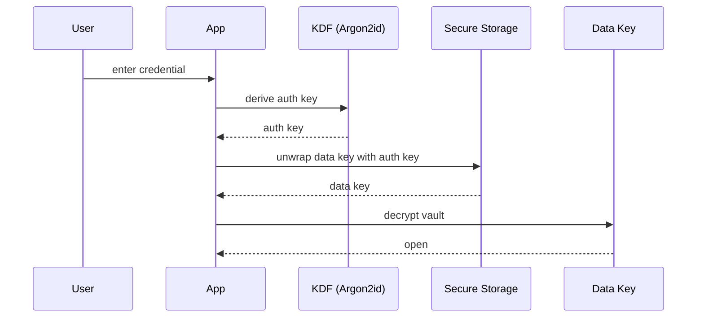

# 15 — Security

| Field            | Value                                                                                |
|------------------|--------------------------------------------------------------------------------------|
| Document ID      | `PINE-DOC-15-SECURITY`                                                               |
| Status           | Draft — pending review                                                               |
| Owner            | Engineering Review Board                                                             |
| Created          | 2026-07-08                                                                           |
| Last Updated     | 2026-08-29                                                                           |
| Specification Standard | Internal (security)                                                            |
| Glossary         | `PINE-DOC-03-GLOSSARY`                                                               |
| Prerequisites    | `00-Vision`..`14-Synchronization`                                                    |
| Decisions closed | OD-03 (encryption at rest baseline) and OD-10 (telemetry policy baseline)          |
| Related Documents| `09-System-Architecture`, `11-Data-Model`, `12-Plugin-Architecture`, `14-Synchronization`, `30-Observability`, `38-Threat-Model` |

---

## 1. Purpose

Define the security posture of Pine: authentication, encryption,
key management, secret handling, secure storage, the plugin trust
model in security terms, telemetry policy, and the security
lifecycle. The threat model lives in `38-Threat-Model`; this
document fixes the *policies*.

## 2. Scope

In scope: authentication, encryption at rest and in transit, key
management, secure storage, secrets handling, plugin security
boundaries, telemetry policy, vulnerability handling, audit, secure
build, secure distribution, role-ready architecture.

Out of scope: threat model → `38-Threat-Model`; performance → `39-Performance`;
accessibility → `40-Accessibility`; UX → `42-UX-Guidelines`.

## 3. Definitions

| Term                 | Working definition                                                                                |
|----------------------|------------------------------------------------------------------------------------------------------|
| Data key             | A symmetric key used to encrypt user data at rest.                                                  |
| Auth key             | A key derived from a user credential used to unlock the data key (KDF).                             |
| KDF                  | Key Derivation Function (Argon2id by default).                                                      |
| Vault                | The encrypted local store (SQLite or an envelope around it).                                        |
| KMS                  | A user-chosen key-management system (local keychain, hardware token, etc.).                          |
| PII                  | Personally Identifiable Information; in Pine, all financial data is treated as sensitive PII.        |

> **Assumption SE-A-1.** "All financial data is sensitive PII" is
> binding. This document does not attempt to separate PII from
> non-PII; instead, every piece of user data is treated as sensitive.

## 4. Closing OD-03 — Encryption at Rest

OD-03 from `00-Vision` §14 is **closed by this document** as follows:

- The local store is encrypted with **AES-256-GCM** (or stronger)
  using a **data key** that is itself wrapped with an **auth key**
  derived from the user's credential via **Argon2id** with parameters
  at or above the OWASP cheat-sheet baseline.
- The data key is held in the platform's secure storage
  (Keychain on Apple, Keystore on Android, DPAPI/Credential Manager
  on Windows, libsecret on Linux) when the user is authenticated.
- The data key is never written to disk in plaintext.
- The data key is rotated when the user changes their credential.
- The encrypted store format is versioned; older versions can be
  opened for read-only access for migration.
- The data key is **not** derived from a user-supplied passphrase
  only; it is *wrapped* by a key derived from a passphrase OR
  stored in the platform secure storage, so that biometric unlock
  can work without weakening the key.

**Rationale.** SQLCipher and application-level envelopes are both
acceptable implementations of this baseline; the choice between
them is a per-platform engineering decision and is owned by
`29-Deployment`. The *policy* is what this document fixes.

> **Implementation status, added 2026-08-29 (TD-06, audit §12.27).** This section is policy, and
> the policy is now **partly** implemented. Stated clause by clause so the section cannot be read
> as closed:
>
> | Clause | Status |
> |---|---|
> | AES-256-GCM, data key wrapped by an Argon2id-derived auth key | ✅ **Implemented.** `pine.vault.json` header version 2 carries a `keyWrap` — algorithm, 12-byte nonce, ciphertext, 16-byte tag — whose AEAD associated data binds every other field of the header. |
> | The data key is never written to disk in plaintext | ✅ **Implemented.** It is drawn from the CSPRNG and exists on disk only as that ciphertext. |
> | The encrypted store format is versioned | ✅ **Implemented**, with one divergence: this document says older versions "can be opened for read-only access for migration", and the code instead **refuses** header version 1 outright (`LegacyVaultFormatException`). That was decided deliberately while no vault existed outside a developer machine; carrying a second, un-enveloped key path was judged the larger risk. |
> | The data key is held in the platform's secure storage (Keychain / Keystore / DPAPI / libsecret) | ❌ **Not implemented.** There is no platform secure-storage integration anywhere in the codebase. The data key is wrapped by the passphrase-derived key only — which this section's own "OR" clause permits, but the keychain half does not exist. **TD-87.** |
> | The data key is rotated when the user changes their credential | ❌ **Not implemented.** Changing the password rotates the **auth key** and the salt and re-wraps the *same* data key. Anyone who already knew the data key still knows it afterwards. Real rotation requires re-encrypting the database. **TD-86.** |
> | Biometric unlock | ❌ **Not implemented.** The envelope makes it a second wrap rather than a redesign; nothing implements that wrap. **TD-87.** |
>
> §18's checklist entry "OD-03 and OD-10 are closed" therefore remains **overstated** for OD-03
> until TD-86 and TD-87 land.

> **Amended 2026-08-29 (TD-16, audit §12.29) — what "the local store" includes.** The clause above
> says *the local store* is encrypted, and until this iteration that was read as *the database*.
> It is now read as **every file Pine derives from the user's data**, because the gap between those
> two readings was a real one: the ML categorisation model, trained on real payees and real amounts,
> was written in plaintext outside every vault and shared between them.
>
> | Artefact | Where | Encrypted under |
> |---|---|---|
> | `pine.db` | the vault directory | the data key, by SQLCipher |
> | `backups/pine-*.db` | the vault directory | the data key, by SQLCipher (`VACUUM INTO` on the keyed connection) |
> | `ai/categorizer.model` | the vault directory | `HKDF-SHA256(data key, "pine:file-cipher:v1:ai.categorizer.model")`, AES-256-GCM |
> | `pine.vault.json` | the vault directory | **not encrypted, by design** — it is the header that makes decryption possible, and it carries no plaintext key |
> | the JSONL logs (TD-14) | outside the vault | **not encrypted. TD-82, still open.** |
>
> The derived key is deliberately *not* the database key: one key with two independent nonce spaces
> is how GCM nonce reuse happens, and a reused nonce is a catastrophic failure rather than a
> degraded one. The seam is `IVaultFileCipher`, and the last row of that table is the remaining
> hole in this clause.

## 5. Closing OD-10 — Telemetry Policy

OD-10 from `00-Vision` §14 is **closed by this document** as follows:

- Telemetry is **off by default** at install time.
- Telemetry requires an **explicit, revocable, in-app opt-in**.
- The opt-in screen shows, in clear language, *exactly* what would
  be sent, *to where*, and *how often*.
- A user who opts in can opt out at any time, with effect from the
  next sync cycle.
- A user who opts out has all locally cached telemetry purged.
- Telemetry is **never** used for advertising, profiling, or sale.
- Telemetry that contains any PII MUST be reviewed by a maintainer
  before any change to its content is shipped.
- The set of telemetry events is published in
  `30-Observability`.

**Rationale.** "Default off, opt-in, revocable" is the only policy
that satisfies the Vision principles P-01 (Privacy First) and P-11
(Transparent) and the business policies BP-03 and BP-05.

## 6. Authentication

- Pine supports PIN, password and biometric authentication.
- On a fresh install, the user chooses a credential.
- A forgotten credential requires a **re-derivation** of the data
  key from a recovery phrase; the recovery phrase is generated at
  setup, shown once, and never stored.
- An authentication failure has exponential backoff and a per-device
  lockout after N consecutive failures.
- A successful authentication unlocks the data key for the duration
  of the session; the session ends on background-after-N-minutes or
  on explicit lock.
- The role-ready architecture allows multiple roles per user; the
  default role is `owner`.

## 7. Key Management

- **Local-only mode.** The data key is held in the platform secure
  storage. The recovery phrase is the only way to re-derive it.
- **Local + cloud sync mode.** A *sync key* is derived from the data
  key and used to encrypt envelopes. The sync key is sent to the
  provider only as ciphertext, and only via the provider's
  authenticated channel.
- **Cloud-only mode.** Same as local + cloud; the local cache is
  encrypted with the data key.

## 8. Encryption in Transit

- All network calls use TLS 1.3 or stronger.
- Certificates are validated against the system trust store; pinning
  is allowed for sync providers but MUST be opt-in per provider.
- HTTP/3 is preferred where supported; HTTP/2 is acceptable.
- Plaintext HTTP is forbidden in production builds.

## 9. Secrets Handling

- No secret, password, recovery phrase, sync key or data key is ever
  logged.
- No secret is included in error messages.
- No secret is included in crash dumps.
- No secret is sent in telemetry (which is opt-in only).
- Secrets are scrubbed from any file the user is encouraged to share
  (logs, support bundles) by an allow-list of fields.

## 10. Plugin Security Boundaries

- A plugin runs in an isolated load context.
- A plugin has no access to the data key.
- A plugin receives only the projections it has been granted.
- A plugin MUST declare every permission it needs; the host enforces
  them at the boundary.
- A plugin MUST NOT call a paid third-party API without an
  explicit user consent flow exposed by the SDK.
- A plugin MUST NOT modify the encryption envelope.
- A plugin MUST be sandboxed at the platform level where supported.

## 11. Secure Build and Distribution

- The build is reproducible (see `29-Deployment`).
- Release artefacts are signed (per platform).
- The release pipeline is hardened (see `28-CI-CD`).
- CodeQL and Dependabot run in CI.
- Static analysis gates reject `BannedApi`, `CA1051`, `CA2100`,
  `CA2300`, `CA2301`, `CA2302` and any explicit security-flagged
  rules (SonarQube-ready).
- The CI build uses a hardened runner image.

## 12. Vulnerability Handling

- Pine publishes a `security.txt` (`/.well-known/security.txt`)
  pointing to a monitored mailbox.
- Pine commits to a **disclosure SLA** of 90 days, coordinated.
- Pine assigns CVEs through a recognised CNA when applicable.
- Pine publishes a security advisory page and a public
  `SECURITY.md`.
- Pine supports the use of `git tag`-signed releases.
- The incident response process is owned by `54-Maintenance`.

## 13. Audit and Logging

- Every security-relevant event is logged locally:
  - Authentication attempts (success and failure).
  - Permission grants and revocations.
  - Plugin install / update / uninstall.
  - Settings changes (storage mode, telemetry consent).
  - Key operations (rotation, recovery).
- Logs are local; the user can export them with secrets redacted.
- A support bundle can be generated locally and shared voluntarily.

## 14. Secure Defaults

| Area            | Default                                                                                  |
|-----------------|------------------------------------------------------------------------------------------|
| Telemetry       | Off.                                                                                      |
| Sync            | Off.                                                                                      |
| Cloud only      | Off.                                                                                      |
| Plugins         | No marketplace connection; previously installed plugins still work.                       |
| Authentication  | Required on first access; biometric where available.                                      |
| Encryption      | On.                                                                                        |
| Auto-update     | Off on desktop; on for mobile app-store updates.                                          |
| Crash reports   | Off.                                                                                      |

**Rationale.** Secure defaults are the simplest expression of
P-01, P-02 and P-12.

## 15. Role-Ready Architecture

- The `User` aggregate (see `10-Domain-Model` §6.11) can hold
  multiple `Role` records.
- A `Role` is an opaque token; the application core ships with the
  `owner` role and a `placeholder: auditor` and `placeholder: child`
  role that activate no additional behaviour in v1.0.
- A future release MAY expand the role set via an ADR.

## 16. Cross-Cutting Security Constraints

- No code path may bypass authentication or encryption.
- No third-party dependency may weaken the encryption envelope.
- No code path may log a secret in plaintext.
- No code path may send data off-device without a user-visible
  consent flow.
- No code path may call a paid third-party AI API.

## 17. Deferred Decisions

| ID     | Decision                                                                                  | Owning document(s)         |
|--------|-------------------------------------------------------------------------------------------|----------------------------|
| SE-D-1 | Cryptographic parameters tuning (Argon2id memory, parallelism, iterations).                | `29-Deployment`            |
| SE-D-2 | Backup file format and integrity footer.                                                  | `11-Data-Model`            |
| SE-D-3 | Independent security audit vendor.                                                        | `01-Business-Requirements` (KR-02-3) |
| SE-D-4 | Key rotation cadence.                                                                      | `54-Maintenance`           |

## 18. Quality Checklist

- [x] Authentication, encryption, key management, secrets, plugin
      boundaries, telemetry, vulnerability handling, audit, secure
      build, secure distribution, role-ready architecture are all
      present.
- [x] OD-03 and OD-10 are closed.
- [x] Secure defaults are listed.
- [x] No TODO placeholders.
- [x] No contradiction with `00-Vision`..`14-Synchronization`.

## 19. Revision History

| Version | Date       | Author                | Change                                                       |
|---------|------------|-----------------------|--------------------------------------------------------------|
| 0.1     | 2026-07-08 | Engineering Review Board | Initial security document; closes OD-03 and OD-10.        |
