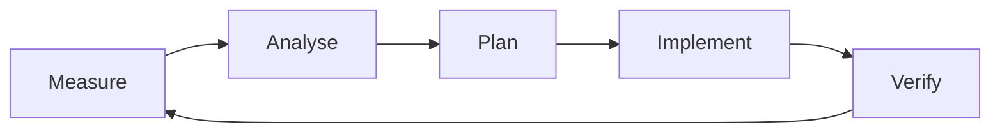

# 16 — Quality Attributes

| Field            | Value                                                                                |
|------------------|--------------------------------------------------------------------------------------|
| Document ID      | `PINE-DOC-16-QUALITY-ATTRIBUTES`                                                     |
| Status           | Draft — pending review                                                               |
| Owner            | Engineering Review Board                                                             |
| Created          | 2026-07-08                                                                           |
| Last Updated     | 2026-07-08                                                                           |
| Specification Standard | ISO/IEC 25010 (quality model)                                                   |
| Glossary         | `PINE-DOC-03-GLOSSARY`                                                               |
| Prerequisites    | `00-Vision`..`15-Security`                                                           |
| Related Documents| `08-NFR`, `18-Test-Strategy`, `20-Coding-Standards`, `21-DoD`, `39-Performance`, `40-Accessibility`, `54-Maintenance` |

---

## 1. Purpose

Define Pine's *quality model*, the quality gates that must hold at
every release, the way quality is measured, and the way quality
regressions are handled. This document is the umbrella for the
quality-attribute-specific documents (`39-Performance`,
`40-Accessibility`, etc.).

## 2. Scope

In scope: quality model, quality gates, measurement, ownership,
regression handling.

Out of scope: NFR targets → `08-NFR`; performance budgets →
`39-Performance`; accessibility conformance → `40-Accessibility`;
test design → `18-Test-Strategy`.

## 3. Quality Model (ISO/IEC 25010)

Pine adopts ISO/IEC 25010's quality model with the following
*characteristic cards*.

| Characteristic | Pine target                                                                              | Owner doc                  |
|----------------|--------------------------------------------------------------------------------------------|----------------------------|
| Functional suitability | Every FR in `07` is implemented, tested and traceable.                        | `07-Functional-Requirements`, `18-Test-Strategy` |
| Performance efficiency | The SLOs in `08-NFR` §17 and the budgets in `39-Performance` hold.              | `08-NFR`, `39-Performance` |
| Compatibility    | All five target platforms are first-class.                                                | `09-System-Architecture`, `29-Deployment` |
| Usability        | WCAG 2.2 AA in built-in UI; first-run is non-blocking.                                    | `40-Accessibility`, `42-UX-Guidelines` |
| Reliability      | 0 data loss on hard kill; recovery to last committed state.                              | `08-NFR`, `54-Maintenance` |
| Security         | Encryption at rest, in transit, plugin isolation, opt-in telemetry.                       | `15-Security`              |
| Maintainability  | Coding standards, ADRs, DoD, DoR, code coverage, mutation testing.                         | `18-Test-Strategy`, `20-Coding-Standards`, `21-DoD` |
| Portability      | Reproducible builds on all five platforms; OS baselines in `09`.                          | `09-System-Architecture`, `29-Deployment` |
| Testability      | Architecture tests, in-memory fakes, deterministic time, deterministic AI.                | `18-Test-Strategy`         |
| Modularity       | Bounded contexts, plugin SDK, swappable AI.                                               | `09-System-Architecture`, `12-Plugin-Architecture` |
| Observability    | Structured logs, metrics, traces; opt-in only.                                            | `30-Observability`         |
| Resilience       | Offline-first, encrypted local cache, queue-based sync.                                   | `08-NFR`, `14-Synchronization` |

**Rationale.** ISO/IEC 25010 is the most widely used quality model
in the industry. Adopting it makes the SSoT legible to any
organisation Pine might partner with.

## 4. Quality Gates (release-blocking)

A release is blocked if any of the following is violated.

| Gate ID    | Gate                                                                                  | Source                              |
|------------|----------------------------------------------------------------------------------------|--------------------------------------|
| QG-01      | 0 compiler warnings with warnings-as-errors.                                            | `20-Coding-Standards`               |
| QG-02      | ≥ 90 % line + branch coverage on the core packages.                                    | `08-NFR` §11                         |
| QG-03      | ≥ 70 % mutation score on the domain layer.                                              | `08-NFR` §11                         |
| QG-04      | 0 architecture-test violations.                                                         | `09-System-Architecture`             |
| QG-05      | 0 critical / serious accessibility violations.                                          | `40-Accessibility`                  |
| QG-06      | 0 high-severity security findings open at release time.                                 | `15-Security`                       |
| QG-07      | All NFR-PERF-* benchmarks within budget.                                                | `39-Performance`                    |
| QG-08      | 100 % of FR-* have at least one acceptance criterion and one test case.                | `19-Traceability-Matrix`            |
| QG-09      | 100 % of user-visible strings externalised.                                            | `41-Localization`                   |
| QG-10      | Conventional Commits enforced.                                                          | `35-Git-Workflow`                   |
| QG-11      | SemVer tagging enforced.                                                                | `22-Release-Plan`                   |
| QG-12      | Public changelog and release notes present.                                            | `22-Release-Plan`                   |
| QG-13      | Public threat model current.                                                            | `38-Threat-Model`                   |
| QG-14      | Public ADRs current.                                                                    | `25-ADR`                            |
| QG-15      | SonarQube gate (if configured) green.                                                    | `20-Coding-Standards`               |

**Rationale.** The gates are the executable form of the Vision
principles. A release that violates a gate is, by definition, not
production-grade.

## 5. Measurement Plan

| Metric                     | Source                                   | Cadence     | Owner           |
|----------------------------|-------------------------------------------|-------------|-----------------|
| Coverage                   | CI report                                 | Per PR      | QA              |
| Mutation score             | Mutation report                           | Per night   | QA              |
| Static analysis violations | Lint + SonarQube                           | Per PR      | Engineering     |
| Architecture test violations | Architecture tests                      | Per PR      | Architecture    |
| Performance budget         | Benchmark                                 | Per night   | Performance     |
| Accessibility findings     | A11y audit                                 | Per release | A11y            |
| Security findings           | Security audit + advisories               | Continuous  | Security        |
| Telemetry events inventory | `30-Observability`                         | Per release | Observability   |
| Plugin count                | Marketplace                                | Monthly     | Ecosystem       |
| Locale coverage             | Translation platform                       | Per release | i18n            |
| SLO compliance              | Opt-in telemetry or CI                     | Per release | SRE             |

## 6. Regression Handling

- Any quality-gate regression is a *release blocker*.
- A regression is triaged within one business day.
- A regression is fixed in the same release unless explicitly
  accepted by an ADR (with a documented rationale).
- A regression is added to the next release's Definition of Done
  so it does not silently recur.

## 7. Quality Ownership

| Quality area            | Primary owner role                          | Secondary owner          |
|-------------------------|----------------------------------------------|--------------------------|
| Functional suitability  | Product + Engineering                        | QA                       |
| Performance             | Engineering (Performance)                    | QA                       |
| Compatibility           | Engineering (Platform)                        | QA                       |
| Usability               | Design + Engineering                          | A11y                     |
| Reliability             | Engineering (Reliability)                    | SRE                      |
| Security                | Engineering (Security)                        | Legal                    |
| Maintainability         | Engineering (Architecture)                    | All                      |
| Portability             | Engineering (Build & Release)                 | QA                       |
| Testability             | QA + Engineering                              | All                      |
| Modularity              | Engineering (Architecture)                    | All                      |
| Observability           | Engineering (Observability)                   | SRE                      |
| Resilience              | Engineering (Reliability + SRE)               | QA                       |

## 8. Quality Improvement Loop

- **Measure.** Run the measurement plan of §5.
- **Analyse.** Identify the highest-impact regressions and
  opportunities.
- **Plan.** Add backlog items with explicit success criteria.
- **Implement.** Land the changes behind a feature flag if user-
  visible.
- **Verify.** Re-run the measurement and confirm improvement.

## 9. Cross-Project Quality

- A regression in any *related* upstream dependency is treated as a
  Pine regression and is triaged with the same SLA.
- Dependabot is enabled and the project responds to Dependabot PRs
  within the SLA in `28-CI-CD`.

## 10. Quality Anti-Patterns

- Skipping a gate because "we'll fix it next release".
- Treating coverage as a goal rather than a side-effect of testing.
- Adding tests that exist only to flip a coverage line.
- Disabling architecture tests to make a feature "fit".
- Using code coverage as a KPI for individual engineers.

## 11. Deferred Decisions

| ID     | Decision                                                                                  | Owning document(s)         |
|--------|-------------------------------------------------------------------------------------------|----------------------------|
| QA-D-1 | SonarQube server host and SLA.                                                            | `28-CI-CD`                 |
| QA-D-2 | Mutation testing tool choice.                                                              | `18-Test-Strategy`         |
| QA-D-3 | Whether the quality gates are also enforced on PRs from forks.                            | `28-CI-CD`                 |

## 12. Quality Checklist

- [x] Quality model, gates, measurement, ownership, regression
      handling are all present.
- [x] 15 release-blocking gates.
- [x] Quality improvement loop is defined.
- [x] Quality anti-patterns are explicit.
- [x] No TODO placeholders.
- [x] No contradiction with `00-Vision`..`15-Security`.

## 13. Revision History

| Version | Date       | Author                | Change                                                       |
|---------|------------|-----------------------|--------------------------------------------------------------|
| 0.1     | 2026-07-08 | Engineering Review Board | Initial quality-attributes umbrella.                      |
