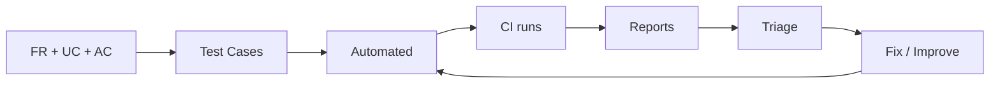

# 18 — Test Strategy

| Field            | Value                                                                                |
|------------------|--------------------------------------------------------------------------------------|
| Document ID      | `PINE-DOC-18-TEST-STRATEGY`                                                          |
| Status           | Partially implemented — the suite is real; none of the named toolchain is            |
| Reconciled       | 2026-09-07 · 1054 automated tests exist (855 unit + 199 integration) against the 28 this document was written beside. But FsCheck, Stryker, Testcontainers, Appium, SpecFlow, k6, ZAP and axe have zero references in the repository, and the accessibility, performance and mutation projects were **deleted in iteration 27** (TD-38) — each had held one empty template test that CI compiled and refused to run. Mutation testing is performed by hand, per iteration, and recorded in the audit. |
| Owner            | Engineering Review Board                                                             |
| Created          | 2026-07-08                                                                           |
| Last Updated     | 2026-07-08                                                                           |
| Specification Standard | ISTQB Advanced Level (Test Manager)                                            |
| Glossary         | `PINE-DOC-03-GLOSSARY`                                                               |
| Prerequisites    | `00-Vision`..`17-Risk-Analysis`                                                      |
| Related Documents| `19-Traceability-Matrix`, `21-Definition-of-Done`, `39-Performance`, `40-Accessibility`, `43-Testing-Artifacts`, `49-Test-Cases`, `50-Test-Scenarios`, `51-Test-Data` |

---

## 1. Purpose

Define the *test strategy* of Pine: the ISTQB-aligned test levels,
test types, test design techniques, risk-based testing, automation
strategy, test data strategy, environment strategy, exit criteria
and the toolchain. The plan and the schedule live in
`22-Release-Plan`; the artefacts (test cases, scenarios, data) live
in `43-Testing-Artifacts`.

## 2. Scope

In scope: test levels, types, design, automation, environment, data,
exit criteria, ownership, metrics.

Out of scope: specific test cases → `49-Test-Cases`; test scenarios
→ `50-Test-Scenarios`; test data → `51-Test-Data`; release plan →
`22-Release-Plan`; quality gates → `16-Quality-Attributes`.

## 3. Definitions

| Term                 | Working definition                                                                                |
|----------------------|------------------------------------------------------------------------------------------------------|
| Test level           | A group of test activities organised by *who* runs them (component, integration, system, acceptance).|
| Test type            | A group of test activities organised by *what* they target (functional, performance, security, etc.). |
| Test design technique| A technique used to derive test cases (e.g. equivalence partitioning, decision table, state transition). |
| Risk-based testing   | A strategy that prioritises test effort by the product of likelihood and impact of failure.          |
| Test oracle          | A mechanism that decides whether a test passed (e.g. spec, model, heuristic).                        |
| Test pyramid         | A shape where unit tests are the most numerous, integration tests fewer, and end-to-end tests the fewest. |
| Mutation testing     | A technique that introduces small code mutations to assess the strength of the test suite.            |
| Architecture test    | A test that asserts the *structure* of the codebase (e.g. dependency direction).                       |
| Coverage             | The percentage of code (line, branch) executed by the test suite.                                     |
| SUT                  | System Under Test.                                                                                    |

> **Assumption TS-A-1.** ISTQB terminology is authoritative for
> this document. Pine-specific extensions are explicitly tagged.

## 4. Test Levels

| Level               | What it covers                                                       | Owner            | Tooling                    |
|---------------------|-----------------------------------------------------------------------|------------------|----------------------------|
| Component (unit)    | A single class, function or value object.                              | Engineering      | xUnit + FsCheck + NSubstitute |
| Component (mutation)| Same scope, but with mutations introduced.                            | Engineering      | Stryker.NET (or equivalent) |
| Integration         | A bounded context or a vertical slice.                                 | Engineering      | xUnit + Testcontainers (where needed) |
| System              | The full app on a reference device, with a synthetic dataset.         | QA              | xUnit + Avalonia headless, Appium (mobile) |
| Acceptance          | A user story, traced back to its `FR-*` and `AC-*`.                    | Product + QA     | SpecFlow (or equivalent)  |
| Non-functional      | Performance, security, accessibility, reliability, i18n.               | QA + Specialists | k6, OWASP ZAP, axe, MAUI/XCUITest, Playwright (where applicable) |
| Architecture        | The codebase structure, dependency direction, layering.                | Architecture     | NetArchTest (or equivalent) |
| Plugin              | The plugin SDK contract; an external plugin run against the host.      | Ecosystem        | SDK conformance suite       |
| Sync                | A multi-device sync scenario, with conflict.                            | Sync             | Custom harness              |
| AI                  | A model run on a labelled dataset.                                     | AI              | AI validation suite         |

**Rationale.** The levels match ISTQB. The *plugin*, *sync* and
*AI* levels are Pine-specific extensions because they are
first-class concerns of the product surface.

## 5. Test Types

| Type             | What it covers                                                                            |
|------------------|---------------------------------------------------------------------------------------------|
| Functional       | Every FR in `07` is covered.                                                                |
| Performance      | Every NFR-PERF-* in `08` is covered.                                                        |
| Security         | Every NFR-SEC-* in `08` is covered.                                                          |
| Accessibility    | Every NFR-A11Y-* in `08` is covered.                                                        |
| i18n             | Every NFR-I18N-* in `08` is covered.                                                        |
| Compatibility    | Per-platform test matrix.                                                                   |
| Reliability      | Crash-injection, recovery, RPO/RTO drills.                                                  |
| Usability        | First-run, undo, keyboard, screen reader.                                                   |
| Maintainability  | Architecture tests, lint, style.                                                            |
| Portability      | Reproducible builds, signing, per-platform smoke tests.                                     |
| Observability    | Logs, metrics, traces are emitted as expected.                                              |
| Resilience       | Offline behaviour, queueing, conflict resolution.                                            |
| Data protection  | Export, deletion, privacy posture.                                                           |
| AI validation    | Per-model tests; regression on model swap.                                                    |
| Sync             | Multi-device scenarios, conflict matrix.                                                     |
| Plugin           | Plugin contract conformance; isolation; permission enforcement.                              |

## 6. Test Design Techniques

| Technique                  | Where used                                                                          |
|----------------------------|--------------------------------------------------------------------------------------|
| Equivalence partitioning    | Inputs, categories, currencies, locales.                                            |
| Boundary value analysis     | Numeric ranges, date boundaries, threshold edges.                                    |
| Decision tables             | Categorisation rules, conflict resolution, sync strategies.                          |
| State transition testing    | Plugin lifecycle, sync state, rule engine.                                          |
| Use case testing            | `06-Use-Cases` driven acceptance tests.                                              |
| Specification-based         | `07-Functional-Requirements` driven tests.                                          |
| Structure-based (coverage)  | Unit + integration.                                                                  |
| Experience-based            | Error guessing, exploratory.                                                          |
| Property-based              | Money arithmetic, currency conversion, idempotency.                                  |
| Mutation                    | Domain layer.                                                                         |
| AI-specific                 | Labelled datasets, regression sets, explanation checks.                              |

## 7. Risk-Based Testing

- Tests are prioritised using the inherent risk score from `17`.
- A risk of `>= 12` is treated as *high-priority* and MUST have at
  least one test case per FR in the affected area.
- A risk of `>= 15` MUST have at least one integration test, one
  system test, and one acceptance test in addition to the unit
  tests.
- A risk of `< 7` MAY be covered by unit tests only.

## 8. Test Automation Strategy

- Unit tests: 100 % automated.
- Integration tests: 100 % automated.
- System tests: 100 % automated, where feasible.
- Performance benchmarks: 100 % automated, run nightly + per PR.
- Accessibility audits: 100 % automated for the critical paths, plus
  manual audit per release.
- Security scans: 100 % automated, plus manual review for findings.
- AI validation: 100 % automated against labelled datasets.
- Sync tests: 100 % automated, with a multi-device harness.
- Plugin tests: 100 % automated for the SDK conformance suite.
- UI automation: smoke tests per platform, plus exploratory manual
  testing.

**Rationale.** The test pyramid is enforced. Manual testing is used
for the things automation cannot judge: usability, accessibility in
context, AI explanation quality, threat model coverage.

## 9. Test Environment Strategy

- **Local dev.** Developer's machine; unit + integration.
- **CI.** Hosted runners; per PR.
- **Nightly.** Larger integration + system + performance + mutation.
- **Pre-release.** Full system + acceptance + manual exploratory.
- **Reference devices.** A small, documented set per platform in
  `09-System-Architecture` (OD-08 closed in §4).

## 10. Test Data Strategy

- Test data is **synthetic**. Real user data MUST NOT enter the test
  pipeline.
- Test data is **versioned** alongside the schema.
- Test data is **deterministic** for CI (seeded random).
- Test data is **comprehensive**: it covers edge cases, locales,
  currencies, and the §16 scalability targets.
- Test data is **isolated** per test; no leakage between tests.
- The detailed test data is owned by `51-Test-Data`.

## 11. Test Tooling

| Concern                | Tool (default)                                            |
|------------------------|------------------------------------------------------------|
| Unit testing           | xUnit + FsCheck + NSubstitute                              |
| Mutation               | Stryker.NET                                                |
| Architecture           | NetArchTest                                                |
| Integration            | xUnit + Testcontainers                                      |
| System                 | xUnit + Avalonia headless + Appium                          |
| Acceptance             | SpecFlow (or equivalent)                                    |
| Performance            | k6, BenchmarkDotNet                                         |
| Security               | OWASP ZAP, CodeQL, Semgrep                                   |
| Accessibility          | axe, Accessibility Insights, manual audit                    |
| i18n                   | ICU MessageFormat, snapshot tests                            |
| AI validation          | Custom harness + labelled datasets                           |
| Sync                   | Custom multi-device harness                                  |
| Plugin                 | SDK conformance suite                                        |
| Coverage               | Coverlet + CI report                                         |
| Reporting              | Allure + CI artefacts                                        |

## 12. Exit Criteria per Level

| Level      | Exit criterion                                                                       |
|------------|---------------------------------------------------------------------------------------|
| Component  | All tests pass; coverage ≥ 90 % for the package; mutation ≥ 70 % for the domain.    |
| Integration| All tests pass; contract tests pass; architecture tests pass.                          |
| System     | All tests pass; performance budgets hold; a11y gate passes; security gate passes.      |
| Acceptance | All acceptance criteria pass; all use cases have at least one passing test.           |
| NFR        | All NFR targets are met; the SLOs in `08` are met or an ADR is filed.                  |
| AI         | All model regressions are explained; the per-model KPIs meet the targets.             |
| Sync      | The conflict matrix is green; the offline matrix is green.                            |
| Plugin     | The SDK conformance suite is green; the marketplace allow-list criteria hold.         |

## 13. Test Metrics

| Metric                         | Target                              |
|--------------------------------|--------------------------------------|
| Coverage (line + branch)       | ≥ 90 % on core packages.             |
| Mutation score                 | ≥ 70 % on the domain layer.          |
| Escaped defects per release    | ≤ 1 critical / serious.              |
| Test reliability (flakiness)   | ≤ 1 % of CI runs.                    |
| Mean time to detect (MTTD)     | ≤ 1 business day for CI-detected.    |
| Mean time to repair (MTTR)     | ≤ 1 business day for CI-detected.    |

## 14. Test Independence

- Component tests are owned by the engineer writing the code.
- Integration tests are reviewed by a second engineer.
- System tests are owned by QA.
- Acceptance tests are owned by Product + QA.
- AI validation is owned by the AI team.
- The threat model review is owned by Security.

## 15. Test Process

## 16. Test Strategy-Level Assumptions

| ID          | Assumption                                                                                            |
|-------------|--------------------------------------------------------------------------------------------------------|
| TS-A-1      | ISTQB terminology is authoritative.                                                                   |
| TS-A-2      | Test data is synthetic; real user data never enters the test pipeline.                                |
| TS-A-3      | The reference devices in `09-System-Architecture` §4 are the *minimum* test targets.                   |
| TS-A-4      | Manual testing is reserved for things automation cannot judge.                                        |

## 17. Deferred Decisions

| ID     | Decision                                                                                  | Owning document(s)         |
|--------|-------------------------------------------------------------------------------------------|----------------------------|
| TS-D-1 | Mutation testing tool final choice (Stryker.NET vs. equivalent).                          | `16-Quality-Attributes`    |
| TS-D-2 | Test data set size and shape for performance benchmarks.                                  | `39-Performance`           |
| TS-D-3 | Per-platform smoke test cadence.                                                            | `28-CI-CD`                 |

## 18. Quality Checklist

- [x] Test levels, types, design, automation, environment, data, exit
      criteria and toolchain are all present.
- [x] Risk-based testing is wired to `17`.
- [x] Test pyramid is enforced.
- [x] No TODO placeholders.
- [x] No contradiction with `00-Vision`..`17-Risk-Analysis`.

## 19. Revision History

| Version | Date       | Author                | Change                                                       |
|---------|------------|-----------------------|--------------------------------------------------------------|
| 0.1     | 2026-07-08 | Engineering Review Board | Initial test strategy.                                     |
