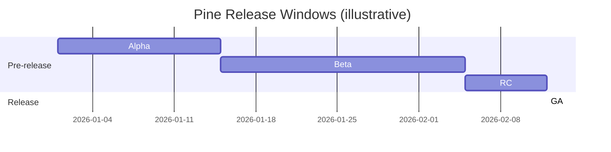

# 22 — Release Plan

| Field            | Value                                                                                |
|------------------|--------------------------------------------------------------------------------------|
| Document ID      | `PINE-DOC-22-RELEASE-PLAN`                                                           |
| Status           | Draft — pending review                                                               |
| Owner            | Engineering Review Board                                                             |
| Created          | 2026-07-08                                                                           |
| Last Updated     | 2026-07-08                                                                           |
| Specification Standard | Internal (release management)                                                  |
| Glossary         | `PINE-DOC-03-GLOSSARY`                                                               |
| Prerequisites    | `00-Vision`..`21-Definition-of-Done`                                                 |
| Related Documents| `23-Roadmap`, `29-Deployment`, `44-Backlog`, `45-Epics`, `46-Features`, `53-Release-Checklist`, `54-Maintenance` |

---

## 1. Purpose

Define the release *cadence*, *windows*, *channels*, *versioning*,
*support* and *rollback* strategy of Pine. The release plan is the
bridge between `02-Product-Scope` (what the product is) and
`29-Deployment` (how artefacts are produced). It does **not** define
the feature roadmap; that lives in `23-Roadmap`.

## 2. Scope

In scope: release cadence, channels, versioning, support matrix,
rollback, sign-off, communication, deprecation policy.

Out of scope: feature roadmap → `23-Roadmap`; backlog ordering →
`44-Backlog`; deployment artefacts → `29-Deployment`; release
checklist → `53-Release-Checklist`.

## 3. Definitions

| Term             | Working definition                                                                                |
|------------------|------------------------------------------------------------------------------------------------------|
| Release          | A versioned artefact made available to a channel.                                                   |
| Channel          | A distribution tier (alpha, beta, stable).                                                         |
| Pre-release      | An alpha or beta release.                                                                            |
| LTS              | Long-Term Support.                                                                                   |
| SemVer           | Semantic Versioning 2.0.0.                                                                          |
| RC               | Release Candidate.                                                                                   |
| Hotfix           | A patch release addressing a critical issue.                                                         |
| Rollback         | A user-initiated or maintainer-initiated return to a previous version.                              |

> **Assumption RP-A-1.** SemVer is authoritative. CalVer is rejected
> for the core; release notes may include a calendar date for
> communication.

## 4. Release Cadence

- **Major (X.0.0).** Approximately every 12–18 months. Driven by
  architectural or platform changes.
- **Minor (0.Y.0).** Approximately every 6–8 weeks. Driven by
  features and by the closure of deferred decisions.
- **Patch (0.0.Z).** As needed, for non-breaking fixes.
- **Hotfix.** As needed, for security or data-loss issues. Hotfix
  cadence is *days*, not weeks.

**Rationale.** A 6–8 week minor cadence gives the team room to
land a meaningful feature set while keeping the public
distribution loop short. Major releases are reserved for changes
that would otherwise force an SDK break.

## 5. Channels

| Channel   | Audience                                | Stability                | Source                                          |
|-----------|------------------------------------------|---------------------------|--------------------------------------------------|
| Nightly   | Maintainers, CI, plugin authors.         | Unstable; expected to break. | `main` after a green nightly.                    |
| Alpha     | Internal maintainers + invited testers.  | Unstable; data loss possible. | `release/alpha`; tagged `0.Y.0-alpha.N`.       |
| Beta      | Public; opt-in.                          | Mostly stable; some features incomplete. | `release/beta`; tagged `0.Y.0-beta.N`.         |
| RC        | Public; opt-in.                          | Stable-by-intent; last-mile fixes only. | `release/rc`; tagged `0.Y.0-rc.N`.            |
| Stable    | Public; default.                          | Stable; LTS for the last two minor lines. | `release/stable`; tagged `X.Y.Z`.            |

**Rationale.** A staged channel strategy matches the open-source
norm. The Stable channel is the only one that auto-updates by
default on desktop; the others are opt-in.

## 6. Versioning

- **Core.** SemVer 2.0.0.
- **Plugin SDK.** SemVer 2.0.0, versioned independently of the core.
- **AI model registry.** SemVer per model, with a *behaviour* flag
  when a major version bump changes outputs.
- **Data model.** Schema version inside the database, plus a SemVer
  for the JSON contracts.
- **Sync envelope.** `pine.sync.v<MAJOR>` with backward-compatible
  minors.
- **Importer/Exporter profiles.** SemVer per profile, embedded in
  the file.

## 7. Support Matrix

- A *minor* line is supported for the **last two minor releases**
  plus the current one (i.e. `X.Y` and `X.Y-1` are supported).
- A *major* line is supported for **18 months** after GA, or until
  the next major + 6 months, whichever is shorter.
- LTS releases are supported for **24 months** after GA.
- Security fixes are backported to the supported lines.
- Data-loss fixes are backported to the supported lines.

## 8. Release Sign-Off

A release is signed off when:

- All quality gates in `16-Quality-Attributes` are green.
- The release checklist in `53-Release-Checklist` is complete.
- The release notes are published.
- The threat model is current.
- The public changelog is current.
- At least two maintainers have approved the release.

## 9. Release Notes and Changelog

- A *public changelog* is published per release on the website and in
  the repository.
- A *release notes* document is published per release, with: summary,
  highlights, breaking changes, deprecations, upgrade notes, known
  issues.
- A *security advisory* is published per security release.

## 10. Deprecation Policy

- A public API, a public surface or a JSON contract that is
  deprecated is announced in the release notes and in the
  documentation at least **one minor release** before removal.
- The deprecated surface continues to work and is covered by tests
  during the deprecation window.
- A removal is a *breaking change* and is therefore a major version
  bump (or a documented ADR if the surface is plugin-side only).

## 11. Rollback

- A user can roll back to a previous version within the current
  minor line at any time, with their data preserved.
- A rollback across a major line requires a *migration* path; the
  user is informed of the path before confirming.
- A maintainer-initiated rollback (for a critical issue) is
  published as a hotfix and as a security advisory.
- A rollback MUST NOT silently lose user data.

## 12. Communication

- A release is announced on:
  - The public website.
  - The in-product "What’s new" surface.
  - The public mailing list / discussion forum.
  - The public changelog.
  - The release RSS feed.
- The announcement is in the user’s locale where possible.
- A security advisory is published (if applicable).
- A blog post is published (for major releases).

## 13. Pre-Release Windows (per release)

> The gantt is illustrative; the actual dates live in `23-Roadmap`.

## 14. Cross-Cutting Release Constraints

- A release MUST NOT violate a Vision principle.
- A release MUST NOT ship with a quality gate failure.
- A release MUST NOT ship with a banned pattern.
- A release MUST NOT remove a public API without a deprecation
  window.

## 15. Deferred Decisions

| ID     | Decision                                                                                  | Owning document(s)         |
|--------|-------------------------------------------------------------------------------------------|----------------------------|
| RP-D-1 | Exact minor cadence (6 vs. 8 weeks).                                                      | `22-Release-Plan` (next rev.) |
| RP-D-2 | Whether the App Store release track is locked to a particular cadence.                   | `29-Deployment`            |
| RP-D-3 | Public status page host and SLA (post-GA).                                                | `54-Maintenance`           |

## 16. Quality Checklist

- [x] Cadence, channels, versioning, support, sign-off, notes,
      deprecation, rollback, communication are all present.
- [x] Pre-release windows are illustrated.
- [x] Cross-cutting constraints are explicit.
- [x] No TODO placeholders.
- [x] No contradiction with `00-Vision`..`21-Definition-of-Done`.

## 17. Revision History

| Version | Date       | Author                | Change                                                       |
|---------|------------|-----------------------|--------------------------------------------------------------|
| 0.1     | 2026-07-08 | Engineering Review Board | Initial release plan.                                       |
