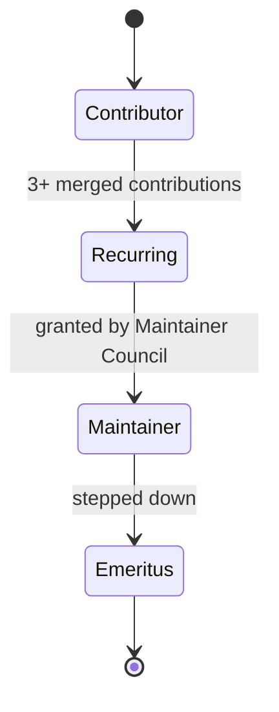

# 24 — Contributing

| Field            | Value                                                                                |
|------------------|--------------------------------------------------------------------------------------|
| Document ID      | `PINE-DOC-24-CONTRIBUTING`                                                           |
| Status           | Aspirational — describes a multi-contributor process that is not in use              |
| Reconciled       | 2026-08-31 · No `CODEOWNERS`, no pull-request template, no locale leads; `.github/` contains only `workflows/`. The roles this and `04-Stakeholders` assign do not exist for a repository with one contributor. |
| Owner            | Engineering Review Board                                                             |
| Created          | 2026-07-08                                                                           |
| Last Updated     | 2026-10-12                                                                           |
| Specification Standard | Internal (contribution model)                                                  |
| Glossary         | `PINE-DOC-03-GLOSSARY`                                                               |
| Prerequisites    | `00-Vision`..`23-Roadmap`                                                            |
| Decisions closed | None (BR-D-3, BR-D-4, BR-D-5 remain deferred)                                       |
| Related Documents| `15-Security`, `25-ADR`, `27-Development-Guidelines`, `35-Git-Workflow`, `37-Code-Review`, `54-Maintenance` |

---

## 1. Purpose

Define how a person or an organisation *contributes* to Pine: the
contribution paths, the governance, the donation and sponsorship
model, the trademark policy pointer, the conflict-of-interest and
Code of Conduct placeholders, and the contribution lifecycle. This
document is the *human* counterpart to the engineering documents.

## 2. Scope

In scope: contribution paths, governance, recognition, donations and
sponsorships, security disclosure, contribution lifecycle.

Out of scope: code review → `37-Code-Review`; coding standards →
`20-Coding-Standards`; release mechanics → `22-Release-Plan`;
detailed trademark text → `TRADEMARK.md` (deferred OD-09).

## 3. Definitions

| Term             | Working definition                                                                                |
|------------------|------------------------------------------------------------------------------------------------------|
| Maintainer       | A person with merge rights to one or more Pine repositories.                                       |
| Contributor      | Any person or organisation that submits a change to a Pine repository.                              |
| Donation         | A voluntary, untargeted contribution of money.                                                      |
| Sponsorship      | A contribution of money that is tied to a *named* outcome or surface.                                |
| CoC              | Code of Conduct (deferred BR-D-5).                                                                   |
| CoI              | Conflict of Interest (deferred BR-D-3).                                                              |
| CLA              | Contributor Licence Agreement.                                                                       |
| DCO              | Developer Certificate of Origin.                                                                     |

> **Assumption CO-A-1.** A contribution is *any* change: code,
> documentation, translation, design, model, plugin, infrastructure,
> security review, or community work.

## 4. Contribution Paths

A person can contribute to Pine in any of the following ways. Each
path has its own entry point, its own expectations and its own
recognition model.

| Path                  | Entry point                                  | Expectations                                                                                  |
|-----------------------|-----------------------------------------------|-----------------------------------------------------------------------------------------------|
| Code                  | Public issue tracker → "good first issue"    | Follow `20-Coding-Standards` and `37-Code-Review`. Sign the DCO.                                |
| Documentation         | Public docs repository                       | Follow `03-Glossary` and the SSoT authoring rules in `27-Development-Guidelines`.              |
| Translation           | Public translation platform                   | Follow the translation style guide; coordinate with locale owners.                             |
| Design                | Design tracker                                | Follow `42-UX-Guidelines` and the design tokens in the design system.                            |
| AI model              | Model registry PR                              | Follow `32-AI-Training` and `13-AI-Architecture`.                                              |
| Plugin                | Plugin repository                              | Follow `33-Plugin-SDK` and `12-Plugin-Architecture`.                                          |
| Security              | `security@pine`                                | Follow responsible disclosure; coordinated disclosure SLA of 90 days.                          |
| Infrastructure        | Infrastructure repository                      | Follow `29-Deployment` and `28-CI-CD`.                                                        |
| Community             | Community channels                            | Follow the (future) CoC; respect the community norms.                                          |
| Donation / sponsorship| Sponsor page / OpenCollective                  | See §8.                                                                                       |

## 5. Developer Certificate of Origin (DCO)

Pine uses the DCO, not a CLA. Every commit MUST be signed off
(`Signed-off-by:`). The DCO is in the
`CONTRIBUTING.md` of the repository. The DCO is a lighter mechanism
than a CLA and is the standard in the open-source community for
projects that want a clear licence trail without complex legal
machinery.

## 6. Governance

- The project is governed by a **Maintainer Council** of 3–7 people.
- Membership is public.
- Membership changes are public and recorded in `25-ADR`.
- Decisions are made by lazy consensus; contested decisions go to a
  vote.
- The Engineering Review Board is the *technical* governance; the
  Maintainer Council is the *project* governance.
- The two are linked: the Maintainer Council includes the leads of
  the Engineering Review Board.

**Rationale.** Splitting technical and project governance is the
norm in mature open-source projects; it lets the engineering
cadence stay fast and the project-level decisions stay deliberate.

## 7. Recognition

- A contributor is credited in the release notes for their change.
- A contributor is credited in the public maintainers list when they
  reach merge rights.
- A contributor is credited in the public finance report when their
  contribution is funded.
- A contributor can opt out of public credit at any time.

## 8. Donations and Sponsorship

### 8.1 Posture

Pine accepts voluntary community donations and sponsorships. Pine
does **not** accept:

- Exclusive commercial partnerships (would bias plugin neutrality,
  AI model selection or storage backends).
- Donations tied to a feature that would violate a Vision principle.
- Donations tied to a feature that would compromise privacy,
  security or accessibility.

### 8.2 Platforms

- OpenCollective (or equivalent) for transparent accounting.
- GitHub Sponsors for individual maintainers.
- Direct bank transfer for institutional sponsors (with a public
  receipt).

### 8.3 Finance Report

- A public finance report is published at least annually.
- The report covers: income, expenses, balances, planned use of
  funds, and any conflict-of-interest disclosures.

### 8.4 Use of Funds

Funds are used for:

- Hosting and infrastructure.
- Security audits and legal review.
- Translations and accessibility work.
- Maintenance work that is not funded by other means.
- Community events and outreach.

Funds are **not** used for:

- Paying maintainers to prioritise a sponsor’s feature over the
  roadmap.
- Paying for advertising.
- Any purpose that violates a Vision principle.

## 9. Conflict of Interest (deferred BR-D-3)

A conflict-of-interest policy is *deferred* (BR-D-3 in
`01-Business-Requirements` §12). When published, it will cover:

- Maintainer affiliations that could bias decisions.
- Sponsorship arrangements that could create a conflict.
- Disclosure obligations.
- Recusal procedures.

## 10. Code of Conduct (deferred BR-D-5)

A Code of Conduct is *deferred* (BR-D-5 in
`01-Business-Requirements` §12). When published, it will cover:

- Expected behaviour.
- Unacceptable behaviour.
- Reporting channels.
- Enforcement path.

## 11. Security Disclosure

- Responsible disclosure via `security@pine` (mailbox to be created).
- Disclosure SLA of 90 days, coordinated.
- Public security advisory page.
- CVE assignment through a recognised CNA when applicable.
- Hall of fame for reporters (with consent).

## 12. Contribution Lifecycle

## 13. Trademark Policy Pointer

The Pine name and logo are protected by trademark. The full
trademark policy is in `TRADEMARK.md` (deferred OD-09). The
placeholder rules are:

- Forks MUST NOT use the Pine name or logo in a way that suggests
  endorsement.
- Forks MAY use the Pine name in a descriptive way (e.g. "fork of
  Pine v0.5") provided the description is accurate.
- Plugins distributed through the official marketplace MUST follow
  the marketplace branding rules.
- Press and media MUST use the official name and logo.

## 14. Documentation Contribution Rules

- A documentation change is reviewed like a code change.
- A documentation change is traced to the SSoT document it updates.
- A documentation change updates the revision history of the
  affected document.
- A documentation change is consistent with the upstream documents
  it references.
- **Scope of the status rule (TD-112).** The `Status` / `Reconciled`
  header rule applies to design, product and architecture documents:
  every top-level `docs/*.md` file, plus the root documents a reader
  meets first (`README.md`, `STATUS.md`, `PRODUCT.md`, `CHANGELOG.md`).
  GitHub and AI-assistant meta-files are formally **exempt**:
  `CONTRIBUTING.md`, `CODE_OF_CONDUCT.md`, `TRADEMARK.md`, `GEMINI.md`
  and anything under `docs/superpowers/`. They configure tooling or
  repository conventions; they do not describe what the software does,
  so they cannot be implemented or unimplemented. The exemption list
  is pinned in `DocumentStatusTests` — a new root markdown file must
  be added to the covered list or to the exempt list, or the suite
  fails.

## 15. Translation Contribution Rules

- A translation is owned by a *locale lead* per locale.
- The locale lead is the *final* reviewer for that locale.
- A translation change is reviewed by the locale lead or by a
  delegate.
- A translation change is consistent with the glossary
  (`03-Glossary`).
- A new locale is added by adding a translation platform entry and
  the locale lead.

## 16. Deferred Decisions

| ID     | Decision                                                                                  | Owning document(s)         |
|--------|-------------------------------------------------------------------------------------------|----------------------------|
| CO-D-1 | Conflict-of-interest policy text and enforcement.                                          | `24-Contributing` (next rev.) |
| CO-D-2 | Code of Conduct text and reporting.                                                       | `24-Contributing` (next rev.) |
| CO-D-3 | Sponsorship acceptance criteria.                                                            | `24-Contributing` (next rev.) |
| CO-D-4 | Maintainer Council size and election process.                                              | `24-Contributing` (next rev.) |

## 17. Quality Checklist

- [x] Contribution paths, governance, recognition, donations,
      sponsorship, security disclosure, lifecycle, trademark
      pointer are all present.
- [x] Deferred decisions are listed with their owning documents.
- [x] No TODO placeholders.
- [x] No contradiction with `00-Vision`..`23-Roadmap`.

## 18. Revision History

| Version | Date       | Author                | Change                                                       |
|---------|------------|-----------------------|--------------------------------------------------------------|
| 0.1     | 2026-07-08 | Engineering Review Board | Initial contributing document.                              |
