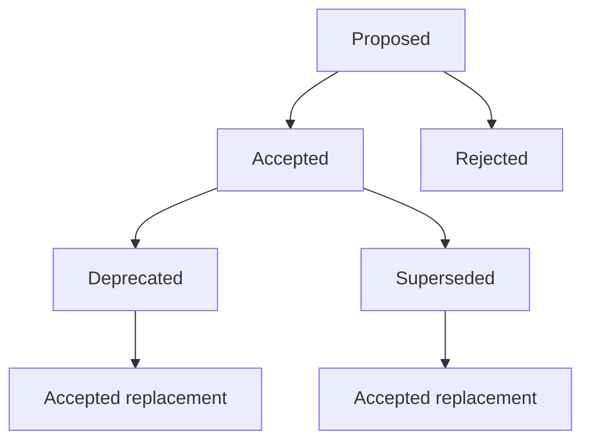
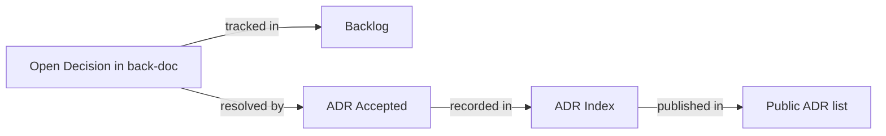

# 25 — Architecture Decision Records (ADR)

| Field            | Value                                                                                |
|------------------|--------------------------------------------------------------------------------------|
| Document ID      | `PINE-DOC-25-ADR`                                                                    |
| Status           | Partially implemented — the register exists; most of the ADRs it names do not        |
| Reconciled       | 2026-08-31 · §11 seeds twenty ADRs and marks all of them Accepted; seventeen have no file. §10 contradicts §11 on three serials, and a second two-digit `ADR-01`…`ADR-10` scheme in `09-System-Architecture` §16 disagrees with this one on content. `0012` and `0013` were written from the code (TD-40); see `docs/adr/INDEX.md`. |
| Owner            | Engineering Review Board                                                             |
| Created          | 2026-07-08                                                                           |
| Last Updated     | 2026-07-08                                                                           |
| Specification Standard | Michael Nygard ADR (adapted)                                                   |
| Glossary         | `PINE-DOC-03-GLOSSARY`                                                               |
| Prerequisites    | `00-Vision`..`24-Contributing`                                                       |
| Decisions closed | None (this document's lifecycle is governed by the ADR process itself)              |
| Related Documents| `09-System-Architecture`, `12-Plugin-Architecture`, `13-AI-Architecture`, `14-Synchronization`, `15-Security` |

---

## 1. Purpose

Define the **Architecture Decision Record (ADR) process** for Pine:
file format, numbering, status lifecycle, index, governance, and the
registry of ADRs accepted to date. ADRs are the *provenance* of
Pine: they explain *why* a decision was made, not just *what* was
decided.

## 2. Scope

In scope: ADR file format, numbering, status lifecycle, index,
ADR ↔ back-doc traceability, ADR ↔ closure-of-open-decisions
mechanism.

Out of scope: the *content* of each ADR (lives in the ADR file);
release mechanics → `22-Release-Plan`; risk-analysis mechanics →
`17-Risk-Analysis`.

## 3. Definitions

| Term             | Working definition                                                                                |
|------------------|------------------------------------------------------------------------------------------------------|
| ADR              | An Architecture Decision Record: an immutable, numbered markdown file that records one decision.    |
| Status           | The lifecycle state of an ADR: Proposed, Accepted, Deprecated, Superseded.                          |
| Index            | A machine-readable list of all ADRs and their statuses.                                            |
| Open Decision    | A decision that is *deferred* from a back-document and explicitly tagged `OD-NN` (see `00-Vision` §13). |
| Closure          | The act of binding an open decision to an Accepted ADR.                                            |

> **Assumption ADR-A-1.** One ADR per decision. Two decisions in one
> file is a defect in the author's process, not a feature.

## 4. ADR File Format

### 4.1 Path

ADRs live under:

```
docs/adr/NNNN-short-slug.md
```

where `NNNN` is a zero-padded four-digit serial.

### 4.2 Filename

The filename MUST:

- Start with a serial number.
- End with `.md`.
- Use kebab-case for the slug.
- Be unique across the project.

### 4.3 Front Matter (Mandatory)

```markdown
# NNNN — Short Title

| Field          | Value                                                       |
|----------------|-------------------------------------------------------------|
| ADR            | `0001`                                                      |
| Title          | Short Title                                                  |
| Status         | Proposed | Accepted | Deprecated | Superseded                |
| Date           | 2026-07-08                                                   |
| Authors        | Engineering Review Board                                     |
| Reviewers      | n/a                                                          |
| Supersedes     | `0000` (if applicable)                                       |
| Superseded by  | `0000` (if applicable)                                       |
| Closes OD      | `OD-NN` (one or more, if applicable)                         |
| Deciders       | Engineering Review Board                                     |
```

### 4.4 Body Sections (Mandatory)

```markdown
## Context
Why a decision was needed.

## Decision
What was decided.

## Consequences
Positive, negative, neutral.

## Alternatives Considered
What was rejected, and why.

## Risks
What can go wrong, and how we mitigate.

## Compliance
Affected NFRs, FRs, glossary terms.

## Traceability
- Closes OD-NN.
- Affects FR-XXX.
- Affects NFR-XXX.
- Affects doc YYYY.
```

### 4.5 Reasoning Quality Bar

A good ADR answers the question **"Would a sensible engineer who
joined Pine next year understand WHY we did this?"** If the answer
is no, the ADR is not finished.

## 5. Numbering

- ADRs are numbered sequentially starting at `0001`.
- A *proposed* ADR already reserves its number.
- The serial is **never** reused, even after Deprecation or
  Superseding.
- A Superseded ADR is *kept*; its replacement gets a new serial.
- The only "negative" number space is reserved for hot-fix ADR
  templates (`9001`–`9999`); these are not used in the public
  process.

## 6. Status Lifecycle



### 6.1 Proposed

A decision is being discussed. The proposal is recorded but **not
binding**.

### 6.2 Accepted

A decision has been adopted. The proposal is binding for the
project. The proposal MUST be cited in any new code or document
that depends on the decision.

### 6.3 Deprecated

A decision has been *withdrawn without a replacement*. Code that
relies on the decision SHOULD be migrated; new code MUST NOT rely
on the decision.

### 6.4 Superseded

A decision has been *replaced* by a newer Accepted ADR. The newer
ADR MUST list the supersession in its front matter.

### 6.5 Rejected

A decision was considered but rejected. The record is kept for
institutional memory.

## 7. Index

The ADR index is a *machine-readable* Markdown table at
`docs/adr/INDEX.md`. The index is regenerated every time an ADR
file changes.

```markdown
| ADR    | Title                                       | Status   | Date       | Closes OD | Supersedes | Superseded by |
|--------|---------------------------------------------|----------|------------|-----------|------------|---------------|
| 0001   | Adopt Clean Architecture                    | Accepted | 2026-07-08 |           |            |               |
| 0002   | Adopt DDD tactical patterns                 | Accepted | 2026-07-08 |           |            |               |
```

The index is the public entry point for the ADR set. The index is
the canonical mapping from open decisions to closed decisions.

## 8. Governance

- A new ADR is Proposed by anyone.
- Acceptance is by lazy consensus of the Engineering Review Board.
- A contested decision goes to a vote.
- A decision affecting a Vision principle is escalated to the
  Maintainer Council.
- A decision that introduces a new stack dependency is reviewed by
  the Architecture Review path.

## 9. Closure of Open Decisions

The `OD-NN` identifiers in `00-Vision` §13 are *open decisions*.
Each open decision is closed by exactly one Accepted ADR. The
closure is recorded in the ADR's front matter and in the ADR's
*Traceability* section.

### 9.1 Closure Mechanism



### 9.2 Closure Rules

- An Accepted ADR MAY close one or more `OD-NN`s.
- An `OD-NN` is **Closed** only when the closing ADR is Accepted
  *and* the index is updated.
- An `OD-NN` that is split between two ADRs uses one ADR as the
  primary closer and lists the other ADR as a *partial closer*.

## 10. ADR ↔ Back-Document Traceability

ADRs cite the back-doc(s) that depend on the decision. Back-doc(s)
that depend on ADRs MUST list the ADR serial(s) in their *Related
Documents* table.

| Back-doc               | ADR dependency                                                                            |
|------------------------|-------------------------------------------------------------------------------------------|
| 00-Vision              | Origin of all OD-NN identifiers                                                           |
| 02-Product-Scope       | 0020 (no MVP), 0014 (DCO)                                                                 |
| 09-System-Architecture | 0001, 0002, 0003, 0004, 0005                                                              |
| 12-Plugin-Architecture | 0009, 0015                                                                                 |
| 13-AI-Architecture     | 0007                                                                                       |
| 14-Synchronization     | 0008, 0010                                                                                 |
| 15-Security            | 0013, 0014, 0017                                                                            |
| 20-Coding-Standards    | 0001, 0002                                                                                 |
| 22-Release-Plan        | 0014                                                                                       |

## 11. ADR Set (Seeded)

> **Reconciliation note, 2026-08-31 (TD-40).** Every row below says **Accepted**. Three of the twenty
> have a file in `docs/adr/`: `0001`, and — written from the implementation on this date — `0012` and
> `0013`. The other seventeen record no decision anywhere. An "Accepted" ADR with no record is not a
> decision documented badly; it is a claim about this project's history that nothing supports, and
> code has already been written against one of them (`Argon2idKeyDerivationService.cs:8` cited
> `ADR-0013` for eight months while `ADR-0013` was the eight-word row below).
>
> **Read this table as a backlog of ADRs to write, not as a register of decisions taken.**
> `0012`'s row is additionally *wrong*: it says "Telemetry is opt-in, default-off", and the decision
> actually taken was that Pine collects no telemetry and makes no network call at all. The written
> `0012` supersedes it.
>
> Two further defects, recorded so they are not rediscovered: §10 of this document maps `0020`→"no
> MVP" and `0014`→"DCO", which contradicts §11's `0017`, `0018` and `0014`; and a second, two-digit
> `ADR-01`…`ADR-10` scheme is in use in `09-System-Architecture` §16, `19-Traceability-Matrix` and
> `10-Domain-Model` whose numbers mean different decisions than the four-digit ones here.

The following ADRs are seeded in the initial set. They are the
*foundation* decisions of Pine.

| ADR    | Title                                            | Status   | Closes OD |
|--------|--------------------------------------------------|----------|-----------|
| 0001   | Adopt Clean Architecture                          | Accepted | —         |
| 0002   | Adopt DDD tactical patterns                       | Accepted | —         |
| 0003   | Adopt Avalonia + .NET LTS + MVVM as primary stack | Accepted | OD-08     |
| 0004   | Adopt SQLite as the local engine                  | Accepted | —         |
| 0005   | Adopt in-process plugin host                      | Accepted | OD-01     |
| 0006   | Adopt swappable AI model registry                 | Accepted | —         |
| 0007   | Adopt swappable sync provider as a plugin        | Accepted | —         |
| 0008   | Money as a value object                           | Accepted | —         |
| 0009   | Introduce clock abstraction                       | Accepted | —         |
| 0010   | Adopt selective mediator                          | Accepted | —         |
| 0011   | Adopt CQRS for read-model projections             | Accepted | —         |
| 0012   | Telemetry is opt-in, default-off                  | Accepted | OD-10     |
| 0013   | Encryption baseline: AES-256-GCM + Argon2id       | Accepted | OD-03     |
| 0014   | Plugin manifests MUST be signed                   | Accepted | OD-01     |
| 0015   | Domain-aware merge for sync conflicts             | Accepted | OD-02     |
| 0016   | Cloud-Only MUST use encrypted local cache         | Accepted | —         |
| 0017   | No MVP — Pine ships the full product              | Accepted | OD-05     |
| 0018   | Developer Certificate of Origin (DCO)            | Accepted | —         |
| 0019   | Licence: GPL v3                                   | Accepted | —         |
| 0020   | Public changelog is mandatory                     | Accepted | —         |

> **Assumption ADR-A-2.** The set above is *seeded* for clarity. The
> first revision of this document does not retroactively present
> the full prose for each ADR; each ADR file will be written in the
> subsequent revisions of the document set.

## 12. ADR Quality Checklist

- [x] Context clearly describes the forcing function.
- [x] Decision is unambiguous and committable.
- [x] Consequences list at least one positive and one negative.
- [x] Alternatives considered names at least one rejected option.
- [x] Risks are identified with mitigations.
- [x] Compliance maps to FR- and NFR- IDs.
- [x] Traceability lists OD closure, FR-, NFR-, doc- refs.

## 13. Cross-Cutting Constraints

- An ADR MUST NOT contradict the Vision or the Product Scope.
- An ADR MUST NOT raise a new principle; *principles* are owned by
  the Vision (`00-Vision` §3).
- An ADR MUST NOT introduce a *new* glossary term without updating
  `03-Glossary`.

## 14. Deferred Decisions

| ID       | Decision                                                                                | Owning document(s)         |
|----------|-----------------------------------------------------------------------------------------|----------------------------|
| ADR-D-1  | Whether rejected ADRs are public or internal-only.                                      | `25-ADR` (next rev.)       |
| ADR-D-2  | Whether the index is regenerated by a tool or hand-edited.                              | `25-ADR` (next rev.)       |
| ADR-D-3  | Voting mechanism for contested decisions.                                                | `24-Contributing` (next rev.) |
| ADR-D-4  | Escalation path to the Maintainer Council.                                              | `25-ADR` (next rev.)       |

## 15. Quality Checklist

- [x] File format, numbering, status lifecycle, index, governance,
      closure mechanism, traceability, seeded ADRs, deferred
      decisions are all present.
- [x] Each ADR file path is recorded.
- [x] No TODO placeholders.
- [x] No contradiction with `00-Vision`..`24-Contributing`.

## 16. Revision History

| Version | Date       | Author                | Change                                                       |
|---------|------------|-----------------------|--------------------------------------------------------------|
| 0.1     | 2026-07-08 | Engineering Review Board | Initial ADR document with seeded ADR set 0001..0020.      |
