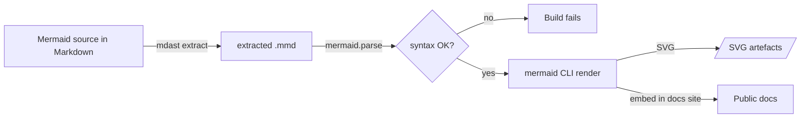

# 26 — Diagrams

| Field            | Value                                                                                |
|------------------|--------------------------------------------------------------------------------------|
| Document ID      | `PINE-DOC-26-DIAGRAMS`                                                               |
| Status           | Draft — pending review                                                               |
| Owner            | Engineering Review Board                                                             |
| Created          | 2026-07-08                                                                           |
| Last Updated     | 2026-07-08                                                                           |
| Specification Standard | Internal (diagram conventions)                                                |
| Glossary         | `PINE-DOC-03-GLOSSARY`                                                               |
| Prerequisites    | `00-Vision`..`25-ADR`                                                                |
| Related Documents| `09-System-Architecture`, `13-AI-Architecture`, `14-Synchronization`, `15-Security`, `38-Threat-Model`, `44-Backlog` |

---

## 1. Purpose

Define the *diagram conventions* of Pine: the format (Mermaid only),
the style (palette, typography, line types), the maintenance rules,
and the **canonical diagram inventory**. The diagrams document is
the *visual SSoT* companion to the rest of the SSoT.

## 2. Scope

In scope: format constraints, style tokens, naming, inventory,
maintenance rules, validator pipeline, deferred decisions.

Out of scope: the *content* of individual diagrams (lives in their
owning document); user-facing UI/UX mocks → `42-UX-Guidelines`;
threat-model graphs (use the conventions here, live in
`38-Threat-Model`).

## 3. Definitions

| Term             | Working definition                                                                                |
|------------------|------------------------------------------------------------------------------------------------------|
| Diagram          | A graphical representation authored in Mermaid and embedded in a Markdown document.                |
| Style token      | A named visual variable (palette, typography, line type).                                          |
| Palette          | A coherent set of colours for diagrams.                                                            |
| Inventory        | The list of every diagram in the document set, with location and type.                              |
| Render           | The act of converting a Mermaid source to SVG by a renderer.                                        |
| Validate         | The act of checking the Mermaid source for syntactic validity (`mermaid.parse`).                   |

> **Assumption DIA-A-1.** A diagram is a *first-class artefact*. A
> diagram that cannot be parsed is a defect; a diagram that is out
> of sync with its document is a defect.

## 4. Format Constraints

### 4.1 Mermaid Only

- All diagrams use Mermaid in fenced code blocks.
- Pine MUST NOT depend on external image files (PNG, JPG, SVG) for
  diagrams.
- Pine MUST NOT depend on binary diagram formats (PlantUML `.puml`,
  Graphviz `.dot`, draw.io `.drawio`) for *content* diagrams.
- Binary or external images MAY be used for *illustrations* that
  cannot be Mermaid (e.g. mockups); these are out of scope for
  this document and live in `42-UX-Guidelines`.

### 4.2 Engine Compatibility

- Pine targets Mermaid **v8+**.
- Diagrams MUST use the `graph` keyword in code fences for
  flowcharts; `flowchart` is v9.3+.
- Diagrams MUST use only Mermaid syntax that is supported by v8.0.
- Diagrams MUST NOT use features that require non-default renderers
  (e.g. external state diagrams).

### 4.3 Renderers Used In-Pipeline

- **Mermaid v10 parser** is used to *validate* syntax (offline).
- **Mermaid CLI** is used to *render* SVGs for release artefacts
  and for the public docs site (in CI).
- The docs site MAY use a JS bundle for interactive diagrams.

## 5. Style Tokens

### 5.1 Palette

| Token       | Use                            | Default (light) |
|-------------|--------------------------------|-----------------|
| `primary`   | Primary nodes, default text    | `#2C5282`       |
| `secondary` | Secondary nodes, supporting    | `#4A5568`       |
| `accent`    | Callouts, highlights           | `#D69E2E`       |
| `success`   | Positive states, acceptance     | `#2F855A`       |
| `danger`    | Negative states, risk, denial   | `#C53030`       |
| `neutral`   | Borders, lines, frames         | `#A0AEC0`       |
| `bg`        | Background fills               | `#FFFFFF`       |
| `muted`     | Subdued text, de-emphasis      | `#718096`       |

A dark-theme variant exists but is **not** required for the SSoT
documents (the docs site handles dark mode).

### 5.2 Typography

- Diagram labels are **sans-serif** (Mermaid default).
- Diagram labels are short; long sentences are written in the body
  of the document, not in the diagram.
- Diagram labels are sentence case.

### 5.3 Line Types

- **Solid**: synchronous flow.
- **Dashed**: asynchronous or best-effort flow.
- **Bold**: critical, must-pass, or P0 path.
- **Dotted**: optional or future.

### 5.4 Edge Labels

- Edge labels are nouns, not verbs.
- Edge labels are short (≤ 24 characters preferred).

### 5.5 Node Shapes

- Rectangles: services, components, modules.
- Rounded rectangles: processors, handlers.
- Cylinders: persistent storage.
- Diamonds: decision points.
- Ovals: actors, personas.
- Hexagons: external systems (third party).
- Parallelograms: I/O devices, network boundaries.

> **Assumption DIA-A-2.** A node MAY use a shape semantic different
> from the default if the diagram type does not support it
> (Mermaid limits state diagrams and sequence diagrams).

## 6. Naming

### 6.1 Diagram Identity

- Every diagram has a *Block number* (within its owning document).
- Every diagram is referenced by `Figure N — Title` in prose.
- A `Figure N` reference MUST be unique within the document.

### 6.2 Code Fence Labels

- Each Mermaid block declares a title as the first line:

  ```
  graph TD
      %% Figure N — Title
      A[Node A] --> B[Node B]
  ```

- The Mermaid source MAY include a `%% Title` comment to provide a
  caption to the renderer.

### 6.3 Cross-Referencing

- A diagram is referenced from prose by `Figure N`.
- A diagram is referenced *between* documents by
  `Figure N — Title` plus the owning document ID
  (e.g. `see 09-System-Architecture § 5, Figure 3`).

## 7. Inventory (Initial)

The inventory below lists every diagram currently authored in the
SSoT. The inventory is updated on every document change that adds
or removes a diagram.

| Doc ID | Block | Title                                                       | Type           |
|--------|-------|-------------------------------------------------------------|----------------|
| 09     | 1     | System-of-systems view                                      | `graph TD`     |
| 09     | 2     | Layered Clean Architecture view                             | `graph TD`     |
| 09     | 3     | Container / process view                                    | `graph TD`     |
| 09     | 4     | Component / module view                                     | `graph TD`     |
| 09     | 5     | UI and worker process view                                  | `graph TD`     |
| 09     | 6     | Plugin runtime view                                         | `graph TD`     |
| 09     | 7     | Deployment view (single device)                             | `graph TD`     |
| 13     | 1     | AI pipeline stages                                          | `sequenceDiagram` |
| 13     | 2     | Model registry swap                                         | `sequenceDiagram` |
| 14     | 1     | Sync run states                                             | `stateDiagram-v2` |
| 14     | 2     | Sync run actors                                             | `sequenceDiagram` |
| 14     | 3     | Conflict resolution ladder                                  | `flowchart`→`graph` |
| 15     | 1     | Encryption layering                                         | `sequenceDiagram` |
| 17     | 1     | Risk management loop                                        | `graph LR`     |
| 22     | 1     | Release windows timeline                                    | `gantt`        |
| 24     | 1     | Contribution lifecycle                                      | `stateDiagram-v2` |
| 25     | 1     | ADR status lifecycle                                         | `graph TD`     |
| 25     | 2     | Closure of open decisions                                   | `graph LR`     |

**Note on `flowchart`→`graph`.** Per §4.2, every diagram MUST use
the `graph` keyword for forward-compatibility with Mermaid v8. The
table above records the *engine-level* type the renderer sees; for
flowcharts the keyword is `graph TD` / `graph LR` as the engine-
level type.

## 8. Maintenance Rules

- A diagram is regenerated whenever its source changes.
- A diagram is included in the build pipeline as a *test artefact*;
  a diagram that fails to parse fails the build.
- A diagram that changes meaning is recorded in the owning
  document's revision history.
- A diagram that conflicts with text is fixed; the diagram is
  treated as the visual SSoT only when the *visual* detail is the
  point.
- A diagram is removed when the capability it represents is
  removed.

## 9. Diagram Validation Pipeline



### 9.1 Pre-Commit Hook

- A pre-commit hook validates every Mermaid block in the staged
  files.
- A failed parse aborts the commit.

### 9.2 CI Step

- A CI step regenerates the SVG artefacts.
- A diagram that renders to an empty SVG is treated as a failure.
- The CI step is non-optional; it is part of the gate per
  `28-CI-CD`.

## 10. Accessibility for Diagrams

- A diagram MUST have a *caption* in prose (the `Figure N — Title`
  reference).
- A diagram MAY have an *alt-text* description in the Mermaid
  source via `%% alt: ...` if the diagram conveys information that
  prose can substitute.
- A diagram MUST be navigable in a screen reader via the doc
  site's table-of-contents reference.

## 11. Cross-Cutting Constraints

- A diagram MUST NOT introduce terminology outside the glossary.
- A diagram MUST NOT contradict a back-document.
- A diagram MUST use the style tokens in §5.
- A diagram MUST cite its provenance (the ADR it depends on, if
  any).

## 12. Deferred Decisions

| ID       | Decision                                                                                  | Owning document(s)         |
|----------|-------------------------------------------------------------------------------------------|----------------------------|
| DIA-D-1  | Roadmap visualisation tool (Mermaid vs. off-the-shelf; *carried from RM-D-2*).           | `23-Roadmap` (next rev.)   |
| DIA-D-2  | Dark-theme variant adoption for SSoT diagrams.                                            | `26-Diagrams` (next rev.)  |
| DIA-D-3  | Whether to publish interactive JS-rendered diagrams in the docs site.                    | `26-Diagrams` (next rev.)  |

## 13. Quality Checklist

- [x] Format constraints, style tokens, naming, inventory,
      maintenance rules, validation pipeline, accessibility,
      cross-cutting constraints are all present.
- [x] Inventory lists every diagram currently authored in the
      SSoT.
- [x] No TODO placeholders.
- [x] No contradiction with `00-Vision`..`25-ADR`.

## 14. Revision History

| Version | Date       | Author                | Change                                                       |
|---------|------------|-----------------------|--------------------------------------------------------------|
| 0.1     | 2026-07-08 | Engineering Review Board | Initial diagrams conventions and inventory.                |
