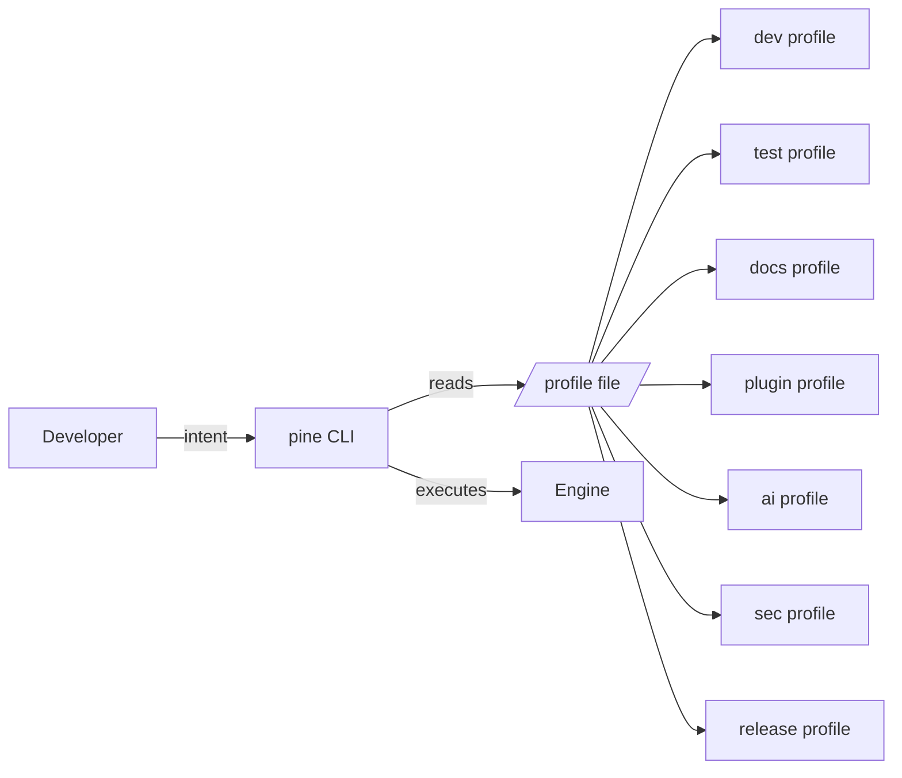
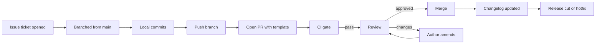

# 27 — Development Guidelines

| Field            | Value                                                                                |
|------------------|--------------------------------------------------------------------------------------|
| Document ID      | `PINE-DOC-27-DEV-GUIDELINES`                                                         |
| Status           | Draft — pending review                                                               |
| Owner            | Engineering Review Board                                                             |
| Created          | 2026-07-08                                                                           |
| Last Updated     | 2026-07-08                                                                           |
| Specification Standard | Internal (development practices)                                              |
| Glossary         | `PINE-DOC-03-GLOSSARY`                                                               |
| Prerequisites    | `00-Vision`..`26-Diagrams`                                                           |
| Related Documents| `20-Coding-Standards`, `21-Definition-of-Done`, `25-ADR`, `28-CI-CD`, `33-Plugin-SDK`, `35-Git-Workflow`, `36-Branching-Strategy`, `37-Code-Review` |

---

## 1. Purpose

Define the *how* of working on Pine: how a developer,
documentation author, designer or model author sets up their
environment, picks an issue, branches, writes, reviews, ships. This
document is the *practical* counterpart to the *strategic*
documents (`00-Vision`..`23-Roadmap`).

## 2. Scope

In scope: environment setup, source layout, branching, commit
hygiene, changelog, issue tracker conventions, review process,
release tagging, environment parity, documentation authoring.

Out of scope: coding standards → `20-Coding-Standards`;
definition of done → `21-Definition-of-Done`; CI/CD pipeline →
`28-CI-CD`; deployment → `29-Deployment`; plugin authoring →
`33-Plugin-SDK`.

## 3. Definitions

| Term             | Working definition                                                                                |
|------------------|------------------------------------------------------------------------------------------------------|
| Repository       | A version-controlled unit of storage.                                                              |
| Workspace        | A local clone with configuration and editor settings.                                              |
| Profile          | A named configuration of the Pine CLI suitable for a specific purpose.                              |
| Slash command    | A CLI command exposed via a profile shortcut (e.g. `pine dev test`).                              |
| Issue ticket    | A unit of work tracked in the issue tracker.                                                       |
| Pull request    | A code or document change proposal.                                                                 |
| Reviewer         | A person who reviews a pull request.                                                                |
| Author           | A person who opens a pull request.                                                                  |
| Changelog        | A file recording notable user-visible changes per release.                                          |

> **Assumption DG-A-1.** A developer uses a *profile-aware* CLI;
> the CLI is a `dotnet` global tool named `pine`, exposing
> profile-scoped slash commands.

## 4. Environment Setup

### 4.1 Required Tooling

| Tool              | Version           | Purpose                                                  |
|-------------------|-------------------|----------------------------------------------------------|
| .NET SDK          | 8 LTS or 9 LTS    | Build, test, tooling                                      |
| Node.js           | 20 LTS            | Docs site, Mermaid CLI                                    |
| Git               | 2.40+             | Version control                                           |
| SQLite CLI        | 3.45+             | Local DB inspection                                       |
| Shell             | PowerShell 7 / bash | Day-to-day scripts                                       |
| Editor            | Any LSP-aware     | Editing, debugging                                        |
| OS                | Linux, macOS, Windows | Cross-platform parity                                 |

### 4.2 First Run

```bash
# Clone the repository
git clone git@github.com:pine/pine.git

# Install the CLI as a dotnet global tool
dotnet tool install --global Pine.CLI

# Initialise the workspace
pine dev init
```

### 4.3 Initialisation Steps

`pine dev init` performs:

- Restore of NuGet and npm dependencies.
- Build of the solution in `Release` configuration.
- Run of the unit and integration tests on a temporary profile.
- Validation of every Mermaid block in the SSoT.
- Generation of an editor-friendly `omnisharp.json` / `pyright.json` /
  editor config.
- Registration of a profile prefix `.pine/`.

### 4.4 Profile-Aware CLI

The CLI uses profiles to keep *intent* and *configuration* separate:



## 5. Source Layout

The repository is a *monorepo*:

```
pine/
├── src/
│   ├── Pine.Core/                  # Domain core
│   ├── Pine.Application/          # Use cases, mediators
│   ├── Pine.Infrastructure/       # Adapters (SQLite, OS, network)
│   ├── Pine.Cli/                  # Global tool
│   ├── Pine.Plugins.Sdk/          # Plugin SDK
│   ├── Pine.Plugins.Host/         # Plugin host
│   ├── Pine.Ai.Default/           # Default AI model artefact
│   ├── Pine.Ai.Explainer/         # Default explainer
│   ├── Pine.Ui.Avalonia/          # Avalonia UI shell
│   ├── Pine.Ui.Ios/               # iOS shell
│   ├── Pine.Ui.Android/           # Android shell
│   ├── Pine.Ui.Macos/             # macOS shell
│   ├── Pine.Ui.Windows/           # Windows shell
│   ├── Pine.Ui.Web/               # Web shell
│   └── Pine.Docs/                 # Docs site (Mermaid, Astro)
├── tests/
│   ├── Pine.Tests.Unit/
│   ├── Pine.Tests.Integration/
│   ├── Pine.Tests.Mutation/
│   ├── Pine.Tests.Performance/
│   └── Pine.Tests.Accessibility/
├── tools/
│   ├── MermaidValidator/
│   └── PineCliScripts/
├── docs/
│   ├── 00-Vision.md .. 55-Future-Vision.md
│   └── adr/NNNN-slug.md
└── README.md
```

### 5.1 Repository Topology

Pine uses a *single monorepo* for all five platforms; the build
artefacts are partitioned per platform via `dotnet publish` with
Runtime Identifiers (RIDs) per `09-System-Architecture`. Splitting
the monorepo later is *not* anticipated; the trade-off is
explicit (deferred OD-11 in `00-Vision` §13).

## 6. Branching and Commit Hygiene

- Branching model lives in `36-Branching-Strategy`.
- Commit messages follow Conventional Commits (see §6.2).
- Every commit MUST include a `Signed-off-by:` trailer (DCO via
  ADR-0018, see `25-ADR`).
- Commits MUST be small and bisectable.
- A commit MUST NOT contain code that breaks a public test.

### 6.1 Author Identity

- A developer MUST configure `user.name` and `user.email` to match
  their commit-tracked identity.
- A developer MUST sign off the commit (`git commit -s`).

### 6.2 Conventional Commits

```
<type>(<scope>): <subject>

<body>

<footer>
```

Types:

| Type     | Use                                                              |
|----------|------------------------------------------------------------------|
| feat     | New user-visible feature                                          |
| fix      | Bug fix                                                           |
| docs     | Documentation change                                              |
| style    | Formatting-only                                                   |
| refactor | Code change with no behaviour change                              |
| perf     | Performance improvement                                           |
| test     | Test addition or correction                                       |
| build    | Build system or dependency change                                 |
| ci       | CI configuration change                                           |
| chore    | Maintenance, tooling                                              |
| revert   | Revert of a previous commit                                       |
| ai       | AI model artefact change                                           |
| plugin   | Plugin SDK or example change                                      |

Scope examples: `core`, `infra`, `ui`, `cli`, `ai`, `plugin`,
`sync`, `docs`.

## 7. Pull Request Workflow



### 7.1 PR Template

A PR MUST include:

- Linked issue ticket (or close reason).
- ADR reference (if it depends on one).
- Test results (unit, integration, mutation).
- Screenshots or diagrams (if UI/UX change).
- Changelog entry.
- Reviewers assigned.

### 7.2 Review Process

Review rules live in `37-Code-Review`. The minimum requirements are:

- Two reviewers for any change to a *policy* document (`00`,
  `01`, `02`).
- One reviewer with domain expertise for any other document or
  code change.
- The reviewer MUST confirm that diagrams render.
- The reviewer MUST confirm that the changelog entry is present.

### 7.3 Merge Mechanics

- Squash-merge is the default.
- Linear history is enforced.
- Merge commits are allowed only for the agreed release flow
  (`36-Branching-Strategy` §6).
- A merge MUST NOT bypass `require-review` branch protection.

## 8. Changelog

### 8.1 File

The public changelog lives at `CHANGELOG.md` in the repo root.

### 8.2 Format

The changelog follows *Keep a Changelog*:

```markdown
## [Unreleased]

### Added
- New capability description.

### Changed
- Behaviour change description.

### Fixed
- Bug fix description.

### Removed
- Removed capability description.

### Security
- Security fix or note (no CVE in public log until coordinated).
```

### 8.3 Per-Release Conventions

- The `## [Unreleased]` section is updated continuously.
- The release flow promotes `Unreleased` to a dated section per
  `22-Release-Plan`.
- Each dated section MUST cite the ADR(s) that justify *breaking*
  changes.

## 9. Issue Tracker Conventions

### 9.1 Labels

The issue tracker uses labels in three groups:

| Group     | Examples                                                                                   |
|-----------|--------------------------------------------------------------------------------------------|
| Type      | `bug`, `feature`, `task`, `docs`, `question`                                               |
| Area      | `core`, `infra`, `ui`, `cli`, `ai`, `plugin`, `sync`, `security`, `i18n`, `a11y`, `docs` |
| Priority  | `P0`, `P1`, `P2`, `P3`                                                                     |
| State     | `triage`, `ready`, `in-progress`, `blocked`, `done`                                         |
| Special   | `good first issue`, `help wanted`, `needs-design`, `needs-ADR`                            |

### 9.2 Templates

The issue tracker ships templates for: bug report, feature
request, security report, ADR proposal, translation request.

### 9.3 Closing an Issue

- An issue is closed by a PR that references it (`Closes #NN`).
- An issue may be closed with a *won't fix* reason in the
  resolution field; the reason is cited.

## 10. Documentation Authoring

### 10.1 Style

- Author in English.
- Use sentence case for headings.
- Use short paragraphs, ≤ 6 lines.
- Use lists for sequences or enumerations; use prose for arguments.
- Use Mermaid for diagrams (see `26-Diagrams`).
- Use `MUST` / `MUST NOT` / `SHOULD` / `MAY` per RFC 2119 in any
  normative statement.
- Use the glossary IDs (`TERM-*`) for any cross-document term.

### 10.2 Cross-References

- Reference an external document by its ID (`09-System-
  Architecture`).
- Reference a section by `§ N`.
- Reference a figure by `Figure N`.
- Reference an FR by `FR-XXX`.
- Reference an NFR by `NFR-XXX`.
- Reference an ADR by `ADR-NNNN`.

### 10.3 Source of Truth Discipline

- A claim in one document that is contradicted by an authoritative
  document is a defect.
- A claim in a non-authoritative document (e.g. a tutorial) MAY be
  looser, provided it does not contradict an authoritative
  document.

## 11. Environment Parity

The dev profile, the CI runner, and the production binary MUST
agree on:

- The .NET SDK version.
- The pinned Mermaid CLI version.
- The pinned SQLite CLI version.
- The pinned Node.js version.

The parity is enforced by:

- `global.json` pinning the .NET SDK.
- A CI step that fails on Node version drift.
- A CI step that fails on Mermaid CLI version drift.

## 12. Local-First Practices

- The local SQLite store is the source of truth in dev mode.
- Developers MUST NOT use a remote database.
- Developers MUST NOT use a cloud sync provider unless explicitly
  testing the sync code path.
- A developer PIN or hardware key is required to unlock the local
  store (per ADR-0013).

## 13. Cross-Cutting Constraints

- A commit MUST NOT include private material (keys, secrets).
- A commit MUST NOT include a vendored dependency outside the
  policy (`09-System-Architecture`).
- A change MUST be traceable to an issue ticket or ADR.

## 14. Deferred Decisions

| ID       | Decision                                                                                  | Owning document(s)         |
|----------|-------------------------------------------------------------------------------------------|----------------------------|
| DG-D-1   | Editor canonical recommendation (Rider, VS Code, Visual Studio).                           | `27-Dev-Guidelines` (next rev.) |
| DG-D-2   | Whether squash-merge is mandatory, or whether linear rebases are allowed.                | `36-Branching-Strategy`    |
| DG-D-3   | Whether to publish an internal handbook outside the SSoT.                                 | `27-Dev-Guidelines` (next rev.) |
| DG-D-4   | Tools for mutation testing selection (e.g. Stryker for .NET).                              | `18-Test-Strategy`         |

## 15. Quality Checklist

- [x] Environment, source layout, branching/commit hygiene, PR
      workflow, changelog, issue tracker, documentation authoring,
      environment parity, local-first practices are all present.
- [x] Conventional Commits, DCO, glossary IDs, RFC 2119 keywords
      are referenced.
- [x] No TODO placeholders.
- [x] No contradiction with `00-Vision`..`26-Diagrams`.

## 16. Revision History

| Version | Date       | Author                | Change                                                       |
|---------|------------|-----------------------|--------------------------------------------------------------|
| 0.1     | 2026-07-08 | Engineering Review Board | Initial development guidelines.                             |
