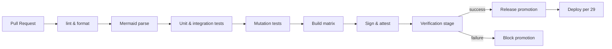
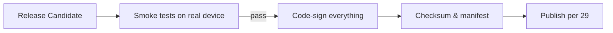

# 28 — CI/CD

| Field            | Value                                                                                |
|------------------|--------------------------------------------------------------------------------------|
| Document ID      | `PINE-DOC-28-CI-CD`                                                                 |
| Status           | Aspirational — the pipeline described is not the pipeline that exists                |
| Reconciled       | 2026-08-31 · One workflow exists and it builds and tests. There is no sign-and-attest stage (§9), no SBOM, no provenance, no reproducibility check, and no automatic trigger at all (`dotnet-ci.yml`:20-21, TD-07). |
| Owner            | Engineering Review Board                                                             |
| Created          | 2026-07-08                                                                           |
| Last Updated     | 2026-07-08                                                                           |
| Specification Standard | Internal (CI/CD pipeline)                                                     |
| Glossary         | `PINE-DOC-03-GLOSSARY`                                                               |
| Prerequisites    | `00-Vision`..`27-Development-Guidelines`                                            |
| Related Documents| `20-Coding-Standards`, `21-Definition-of-Done`, `22-Release-Plan`, `27-Development-Guidelines`, `29-Deployment`, `35-Git-Workflow`, `36-Branching-Strategy`, `37-Code-Review` |

---

## 1. Purpose

Define the **continuous integration** and **continuous delivery**
pipeline of Pine: stages, gates, runners, secrets, signing,
artifacts, and the relationship between CI and release. The CI is
the *engine* of quality; this document is its specification.

## 2. Scope

In scope: pipeline stages, branch protection, runners, secrets,
matrix, signing, artifact retention, release promotion,
verification stage.

Out of scope: deployment topology → `29-Deployment`; release
mechanics → `22-Release-Plan`; coding standards → `20-Coding-
Standards`; branch model → `36-Branching-Strategy`.

## 3. Definitions

| Term             | Working definition                                                                                |
|------------------|------------------------------------------------------------------------------------------------------|
| Pipeline         | A sequence of stages executed by the CI/CD system.                                                 |
| Gate             | A condition that MUST pass for the pipeline to proceed.                                              |
| Runner           | An execution host for a pipeline.                                                                   |
| Matrix           | A cross-product of dimensions (e.g. OS × configuration) that the pipeline runs.                      |
| Artefact         | A binary or bundle produced by a stage (e.g. signed installer, container image).                    |
| Promotion        | The act of moving a build from one environment to the next (dev → staging → production).            |
| Verification     | A stage that asserts the pipeline works (e.g. dry-run install, smoke).                              |
| Supply chain      | The end-to-end chain from source to binary, including signing and attestation.                       |

> **Assumption CI-A-1.** The pipeline is reproducible: given the
> same source, hash, environment and secrets, it produces the same
> artefacts bit-for-bit.

## 4. Pipeline Overview

### 4.1 Stages

| Stage                | Purpose                                                                | Gate?            |
|----------------------|------------------------------------------------------------------------|------------------|
| lint & format         | Enforce style; fail-fast on formatting drift                           | Yes              |
| Mermaid parse         | Validate every diagram in the SSoT                                    | Yes              |
| Unit tests            | Domain and application behaviour                                       | Yes              |
| Integration tests     | End-to-end flows in a fresh profile                                     | Yes              |
| Mutation tests        | Test quality (subset, daily on main)                                    | Daily, not PR    |
| Build matrix          | Produce platform binaries                                              | Yes              |
| Sign & attest         | Code signature, plugin signature, SBOM, SLSA provenance                  | Yes              |
| Verification          | Smoke install, content integrity                                       | Yes              |
| Release promotion     | Publish to distribution channels                                       | Manual approve   |

## 5. Lint & Format

- .NET: `dotnet format` (with `.editorconfig`).
- Markdown: `markdownlint` with the project config
  (`.markdownlint.json`).
- Shell: `shellcheck` for shell scripts in `tools/`.
- TOML/YAML: `taplo`, `yamllint`.

## 6. Mermaid Parse

- The `MermaidValidator` tool (under `tools/`) extracts every
  fenced `mermaid` block in the SSoT and submits each to
  `mermaid.parse()`.
- A single failure aborts the build.
- The tool is pinned to Mermaid CLI v10.x and exposed via the
  `pine dev mermaid` slash command.

## 7. Test Stages

### 7.1 Unit Tests

- `Pine.Tests.Unit` covers `Pine.Core`, `Pine.Application`.
- Tests run in a no-network sandbox.
- Coverage threshold: ≥ 80% lines and ≥ 75% branches *on the core
  package*. The threshold is enforced for new code only.

### 7.2 Integration Tests

- `Pine.Tests.Integration` runs on a hermetic runner with a
  temporary profile.
- Integration tests cover SQLite, plugin host, sync plugin, import
  flows.
- The integration sandbox has no real network and no real cloud
  credentials.

### 7.3 Mutation Tests

- A mutation suite runs *daily* on `main`, not per PR (per
  `DG-D-4`).
- The mutation suite uses a .NET-native mutator.
- A regression in mutation score is *not* a hard fail on `main`,
  but is recorded as a *signal* and surfaced in the Engineering
  Review Board's weekly summary.
- A mutation regression on `main` blocks the next *release*.

### 7.4 Performance Tests

- A performance suite runs *nightly*.
- Performance budgets per NFR-PERF-*.
- A regression of > 10% on a budgeted metric is a hard fail and
  blocks the next release.

### 7.5 Accessibility Tests

- Automated accessibility tests (axe-core for Avalonia equivalent)
  run on every UI PR.
- Manual audits are scheduled per `22-Release-Plan`.

### 7.6 Security Tests

- SAST (static analysis) per language.
- Dependency scan (Dependabot-style, but pinned to *advisory*
  database, not the default GitHub pool).
- SBOM generated per release.
- CycloneDX format.

## 8. Build Matrix

The build matrix is *platform × configuration × component*:

| Platform | Component                    | Configuration |
|----------|------------------------------|---------------|
| linux-x64 | `Pine.Ui.Avalonia`          | `Release`     |
| linux-arm64| `Pine.Ui.Avalonia`         | `Release`     |
| macOS-x64  | `Pine.Ui.Macos`           | `Release`     |
| macOS-arm64| `Pine.Ui.Macos`           | `Release`     |
| Windows-x64| `Pine.Ui.Windows`         | `Release`     |
| Windows-arm64| `Pine.Ui.Windows`       | `Release`     |
| iOS       | `Pine.Ui.Ios`                | `Release`     |
| Android   | `Pine.Ui.Android`            | `Release`     |

> **There is no Web row, and there was one until the Phase 3 platform review.** `Pine.Ui.Web` and
> the `browser-wasm` leg of `.github/workflows/dotnet-ci.yml` were both deleted: it was the only
> job in this pipeline that compiled a head which could never run the product, and a green light
> over that is worse than no light. See `60-Production-Readiness-Audit` §12.64.

### 8.1 Docker Images

- The container images are signed and attested.
- The platform bins are not built into Docker images for ordinary
  users; Docker is reserved for the server-side optional
  components (e.g. the AI training harness).

## 9. Signing and Attestation

- Binaries are signed with project-controlled keys on:
  - macOS: Apple Notarisation Service.
  - Windows: Azure Code Signing (or an HSM).
  - Linux: GPG + per-distribution signing (e.g. .deb, .rpm).
- Plugin manifests are signed with the same project-controlled key
  (ADR-0014).
- SBOM is generated per release.
- SLSA Level 3 provenance is generated per release.
- The provenance is published next to the binary.

### 9.1 Key Custody

- Signing keys are stored in a hardware-backed vault.
- No developer ever holds a signing key in cleartext.
- Key rotation follows a documented procedure.

## 10. Verification Stage

The verification stage runs the produced binary in a sandbox and
asserts:

- It launches.
- It opens a fresh profile.
- It creates a sample transaction.
- It renders the dashboard.
- It exports a portable archive.
- It generates a SBOM that matches the one produced by the build.

A failure in the verification stage blocks promotion.

## 11. Release Promotion

Release promotion is *manual*, gated by a named approver from the
Engineering Review Board. The promotion flow is:

- A release MUST be triggered by a tag (`vX.Y.Z`).
- A release MUST be promoted by a named person.
- A release MUST NOT be promoted by the same person who built it.

## 12. Branch Protection

Default branch (`main`):

- Require ≥ 1 reviewer for code, ≥ 2 for `00-`, `01-`, `02-`.
- Require CI green (all gates in §4.1 to the level of the
  protected branch).
- Require signed commits.
- Require linear history.
- Disallow force-pushes.
- Disallow direct pushes (PR-only).

## 13. Required Checks per Branch

| Branch       | Required gates                                                                |
|--------------|--------------------------------------------------------------------------------|
| main         | lint, mermaid, unit, integration, build matrix, sign, verification             |
| release/*    | lint, mermaid, unit, integration, mutation (current score), performance, verify |
| feat/*       | lint, mermaid, unit, integration                                              |
| fix/*        | lint, mermaid, unit, integration                                              |
| hotfix/*     | lint, mermaid, unit, integration, verify (minimum)                            |
| docs/*       | mermaid, lint                                                                 |

## 14. Secrets

- CI secrets are stored in the platform secret manager (e.g. GitHub
  Actions Secrets or the equivalent).
- A developer MUST NOT commit a secret.
- A pre-commit hook blocks obvious secrets (gitleaks).
- A secret rotation procedure is documented in the internal runbook.

### 14.1 Secret Categories

| Category            | Examples                                                                                |
|---------------------|------------------------------------------------------------------------------------------|
| Cloud deployment    | Distribution channel credentials                                                       |
| Signing             | Code-signing certificate handle                                                         |
| App analytics       | Optional, opt-in, never identifies a user                                                |
| Build               | Cache credentials, NuGet API keys                                                        |

## 15. Artefact Retention

| Artefact            | Retention                                                                            |
|---------------------|---------------------------------------------------------------------------------------|
| Build logs          | 90 days                                                                              |
| Test results        | 90 days                                                                              |
| Signed binaries     | indefinite (in the distribution channel)                                              |
| SBOM                | 5 years (auditable)                                                                  |
| SLSA provenance     | 5 years (auditable)                                                                  |

## 16. Reproducibility

- The pipeline pins every dependency it can: SDK, runtime, Mermaid
  CLI, SQLite CLI, Node version.
- The pipeline generates a reproducibility manifest per build
  (hashes of every tool, env var list, command list).
- The manifest is published next to the binary.

## 17. Cross-Cutting Constraints

- A gate that fails MUST halt the pipeline; no `--force` flag.
- A pipeline MUST NOT depend on a developer's local tools
  directly; everything is run on a runner.
- A pipeline MUST NOT include a vendor-specific lock-in; runners
  are interchangeable across at least two providers.

## 18. Deferred Decisions

| ID       | Decision                                                                                  | Owning document(s)         |
|----------|-------------------------------------------------------------------------------------------|----------------------------|
| CI-D-1   | Self-hosted runners vs. managed runners.                                                   | `28-CI-CD` (next rev.)     |
| CI-D-2   | Mutation tool (per `DG-D-4`).                                                              | `18-Test-Strategy`         |
| CI-D-3   | Whether the Web build is published as a PWA only, also as a static bundle, or both.       | `22-Release-Plan`          |
| CI-D-4   | Reproducibility manifest format.                                                           | `28-CI-CD` (next rev.)     |

## 19. Quality Checklist

- [x] Stages, branch protection, matrix, signing, verification,
      release promotion, secrets, retention, reproducibility are
      all present.
- [x] All gates in §4.1 are named.
- [x] Required checks per branch are explicit.
- [x] No TODO placeholders.
- [x] No contradiction with `00-Vision`..`27-Development-Guidelines`.

## 20. Revision History

| Version | Date       | Author                | Change                                                       |
|---------|------------|-----------------------|--------------------------------------------------------------|
| 0.1     | 2026-07-08 | Engineering Review Board | Initial CI/CD document.                                    |
