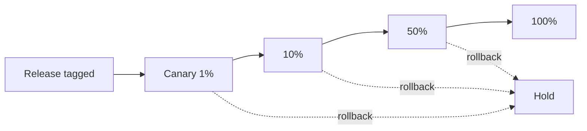
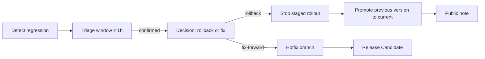

# 29 — Deployment

| Field            | Value                                                                                |
|------------------|--------------------------------------------------------------------------------------|
| Document ID      | `PINE-DOC-29-DEPLOYMENT`                                                              |
| Status           | Aspirational — one artefact exists; none of the six channels does                    |
| Reconciled       | 2026-08-31 · Iteration 20 built `packaging/package.sh`, which produces a checksummed win-x64 archive and a manifest in this document's §5.3 shape. Nothing hosts it; there is no store listing, no installer, and no updater - Pine performs no network I/O at all. See audit §12.42 and TD-49. |
| Owner            | Engineering Review Board                                                             |
| Created          | 2026-07-08                                                                           |
| Last Updated     | 2026-07-08                                                                           |
| Specification Standard | Internal (deployment topology)                                                |
| Glossary         | `PINE-DOC-03-GLOSSARY`                                                               |
| Prerequisites    | `00-Vision`..`28-CI-CD`                                                              |
| Related Documents| `12-Plugin-Architecture`, `14-Synchronization`, `22-Release-Plan`, `26-Diagrams`, `28-CI-CD` |

---

## 1. Purpose

Define *how* Pine ships: the distribution channels per platform,
the update mechanism, the rollout strategy, the rollback
procedure, the feature-flag model, and the deployment of optional
server-side components.

## 2. Scope

In scope: distribution channels, update mechanism, staged rollout,
rollback, feature flags, server-side components (Pine Cloud,
deferred), edge cases (store rejection, signing failure).

Out of scope: CI/CD pipeline → `28-CI-CD`; release mechanics →
`22-Release-Plan`; plugin hosting model → `12-Plugin-Architecture`;
sync transport pluggability → `14-Synchronization`.

## 3. Definitions

| Term             | Working definition                                                                                |
|------------------|------------------------------------------------------------------------------------------------------|
| Distribution     | A channel that delivers Pine binaries to users (a store, a package manager, a website).             |
| Update           | The act of delivering a newer binary to an existing install.                                         |
| Rollout          | A *progressive* release schedule (e.g. 1%, 10%, 50%, 100%).                                          |
| Rollback         | The act of returning a percentage of users to a previous binary.                                    |
| Feature flag     | A runtime switch that enables or disables a capability.                                              |
| Kill switch      | A feature flag that disables a capability without needing a binary update.                          |
| Canary           | A small cohort exposed to a new binary to detect regressions.                                       |
| Cohort           | A subset of installs selected by attribute (region, locale, install date).                           |

> **Assumption DEP-A-1.** A *rollback* is a user-visible operation;
> the Engineering Review Board publishes a note when it triggers
> one.

## 4. Distribution Channels

The five platforms each have their primary distribution:

| Platform        | Primary channel                                                      | Secondary                                   |
|-----------------|----------------------------------------------------------------------|----------------------------------------------|
| iOS             | App Store                                                             | TestFlight (beta), `manifest.json` for sideload |
| macOS           | Mac App Store                                                         | Direct download (signed `.dmg`), Homebrew    |
| Android         | Google Play                                                           | APK (signed), F-Droid (proposal deferred)     |
| Windows         | Microsoft Store                                                       | Direct download (signed `.exe`, `.msi`)       |
| Linux           | Direct download (signed `.deb`, `.rpm`, AppImage)                     | Snap (Flatpak deferred)                       |
| Web             | Pine website                                                          | PWA install                                  |

> **Assumption DEP-A-2.** Pine does not depend on a *single*
> distribution channel for its core releases. If a primary channel
> rejects a release, the secondary channel ships the build.

## 5. Update Mechanism

### 5.1 Same-Channel Updates

- App Store / Google Play / Microsoft Store: native update.
- Direct download (Linux, macOS, Windows):
  - The application checks for updates on launch (opt-in,
    config-default off).
  - The application uses an update manifest signed by the project
    signing key.
  - Updates are *deltas* where the binary differs significantly
    from the previous; full bundles otherwise.
  - The update mechanism respects the user's *silent-update*
    preference.

### 5.2 Cross-Channel Updates

- A user moving from TestFlight to App Store re-installs.
- A user moving from direct download to Microsoft Store re-
  installs.
- Pine does not auto-migrate the user's data; the data store is
  portable per `14-Synchronization`.

### 5.3 Update Manifest

The update manifest is signed by the project key:

```jsonc
{
  "version": "1.0.0",
  "release_notes_url": "https://pine.org/release/1.0.0",
  "critical": false,
  "platforms": {
    "linux-x64": {
      "url": "https://pine.org/dl/1.0.0/linux-x64.deb",
      "size": 12345678,
      "sha256": "…"
    }
  },
  "signature": "…"
}
```

A client MUST verify the signature before fetching the binary.

## 6. Staged Rollout



### 6.1 Schedule

A staged rollout applies to:

- App Store updates (Apple's native staged release).
- Google Play updates (native staged rollout).
- Direct downloads, when the user has opted into auto-update.

Pine does not enforce a *single* staged schedule; the schedule is
per channel. The Engineering Review Board publishes the schedule
in the changelog.

### 6.2 Canary Cohort

The canary cohort is selected by:

- Install date (the most recent 1%).
- Locale (a representative slice).
- Region (per region bucket).

A cohort with zero telemetry opt-in is *not* selected, even if
otherwise eligible (since the cohort is otherwise unobservable).

## 7. Rollback

Rollback is the act of returning a percentage of users to a
previous binary. Rollback is allowed when:

- A regression exceeds a SLO budget (per `08-NonFunctional-
  Requirements` §11).
- A crash rate exceeds 0.5% over a 24-hour window.
- A security advisory requires a rollback.

Rollback procedure:



## 8. Feature Flags

### 8.1 Posture

- Feature flags are *runtime* switches held in a JSON file inside
  the data directory.
- Feature flags are *off by default* for new capabilities in a
  *minor* release; they are *on by default* for capabilities in a
  *major* release.
- A feature flag is *short-lived* (≤ 3 minor releases). After
  three minor releases, the flag is removed.

### 8.2 Kinds of Flags

| Kind             | Lifetime        | Use                                                                  |
|------------------|-----------------|----------------------------------------------------------------------|
| Release flag      | Until GA         | Gate a capability behind a flag until it is generally available.    |
| Ops flag          | Indefinite       | Disable a path that is known to misbehave under specific conditions. |
| Kill switch       | Indefinite       | Disable a path entirely without a binary update.                     |
| Experiment flag  | ≤ 3 minor        | Run an A/B test; the flag is removed after the experiment ends.      |

### 8.3 Server-Side Flags (Pine Cloud, deferred)

When Pine Cloud is introduced (deferred OD-D-3 in `00-Vision`
§13), a server-side flag set exists *only* for:

- Free → paid transition (one binary).
- Region-specific default (e.g. feature preferences per market).

Server-side flags are *never* used for advertising, profiling
or behaviour nudging.

## 9. Rollout of Server-Side Components

Pine Cloud (deferred OD-D-3) is the only server-side component
envisioned. When introduced, deployment will be:

- Region-pinned, with at least two regions for HA.
- Blue-green for stateless control plane; rolling for stateful
  data plane.
- Backups encrypted at rest with the same library as the client
  (per `15-Security`).

## 10. Edge Cases

### 10.1 Store Rejection

- A store rejection is recorded in the release notes as a *store-
  timing* event.
- A rejected binary is replaced via the *secondary* channel.
- A store rejection does not delay the public release; the public
  release proceeds on the secondary channel.

### 10.2 Signing Failure

- A signing failure blocks the release.
- The Engineering Review Board names a successor.
- Key rotation per `15-Security` is initiated if the failure
  points at a compromised key.

### 10.3 Lost Update Manifest

- The application falls back to the embedded version.
- The application surfaces a warning on first launch.

### 10.4 Unsigned Plugin

- The plugin host refuses to load an unsigned plugin (per
  ADR-0014).
- The user is informed.

## 11. Deployment Telemetry

- Deployment signals are *aggregate* (e.g. "0.5% crash rate over
  the last 24 hours").
- Deployment signals do *not* identify a user.
- Deployment signals are *opt-in* (`12-Telemetry` flag in the user
  settings), and *default-off* (ADR-0012).
- Pine does not sell or share deployment signals with third
  parties without user consent.

## 12. Cross-Cutting Constraints

- A release MUST be reproducible from the same signed artefacts.
- A release MUST pass the verification stage per `28-CI-CD` §10.
- A release MUST be traceable to a tag and an ADR (if there is a
  breaking change).
- A release MUST have a *public* notes entry.

## 13. Deferred Decisions

| ID       | Decision                                                                                  | Owning document(s)         |
|----------|-------------------------------------------------------------------------------------------|----------------------------|
| DEP-D-1  | Delta vs. full bundles on direct-download updates.                                       | `29-Deployment` (next rev.) |
| DEP-D-2  | Flatpak publication.                                                                       | `29-Deployment` (next rev.) |
| DEP-D-3  | F-Droid publication acceptance criteria.                                                   | `29-Deployment` (next rev.) |
| DEP-D-4  | Region allocation for Pine Cloud.                                                          | `29-Deployment` (next rev.) |
| DEP-D-5  | Whether to ship an OTA-only build for embedded partners (deferred OD-D-7).                | `29-Deployment` (next rev.) |

## 14. Quality Checklist

- [x] Distribution channels, update mechanism, staged rollout,
      rollback, feature flags, server-side components, edge cases
      are all present.
- [x] Update manifest signature is described.
- [x] Telemetry posture is consistent with ADR-0012.
- [x] No TODO placeholders.
- [x] No contradiction with `00-Vision`..`28-CI-CD`.

## 15. Revision History

| Version | Date       | Author                | Change                                                       |
|---------|------------|-----------------------|--------------------------------------------------------------|
| 0.1     | 2026-07-08 | Engineering Review Board | Initial deployment document.                                 |
