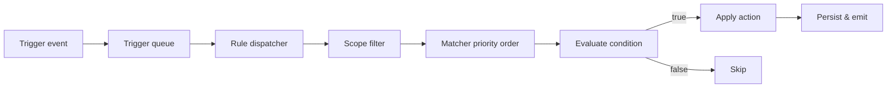
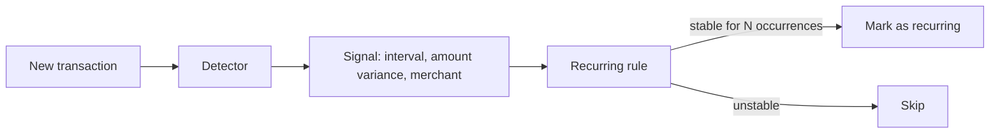

# 31 — Rule Engine

| Field            | Value                                                                                |
|------------------|--------------------------------------------------------------------------------------|
| Document ID      | `PINE-DOC-31-RULE-ENGINE`                                                            |
| Status           | **Partially implemented** — a rule is evaluated on every import and manual entry     |
| Reconciled       | 2026-09-09 · **The engine exists.** `Rule`, `RuleCondition` and a pure `RuleEvaluator` are in `src/Pine.Core/Rules/`, with a `Rules` table, a rules screen, and evaluation on both the import and manual-entry paths — a matching rule beats the ML classifier outright. What is built is §5.1's shape reduced: six of §5.2's fourteen operators, conditions ANDed rather than a boolean tree, and one action (`set category`). §6.2's priority ordering and idempotence are implemented and tested; §6.3's sandbox, §7's recurring detection, §8's notifications, §9's plugin extension and §12's conflict surfacing are NOT. The action's value is a category NAME, not a `CategoryId`: §10 Phase 3 of the audit called for "the now-real `CategoryId` relationship" and there is no such relationship (TD-32, TD-132) — and since 2026-09-13 there is no `Categories` table for one to point at: plan item 2.3 made the label the model everywhere. See `60-Production-Readiness-Audit` §12.70. |
| Owner            | Engineering Review Board                                                             |
| Created          | 2026-07-08                                                                           |
| Last Updated     | 2026-07-08                                                                           |
| Specification Standard | Internal (rule engine architecture)                                          |
| Glossary         | `PINE-DOC-03-GLOSSARY`                                                               |
| Prerequisites    | `00-Vision`..`30-Observability`                                                      |
| Related Documents| `13-AI-Architecture`, `12-Plugin-Architecture`, `33-Plugin-SDK`, `40-Accessibility` |

---

## 1. Purpose

Define Pine's *rule engine*: the declarative mechanism by which
the application categorises transactions, detects recurring
patterns, surfaces nudges (budget alerts, goal milestones), and
allows plugins to extend the rule set. The rule engine is the
*declared* counterpart to the AI model registry.

## 2. Scope

In scope: rule grammar, evaluation model, ordering, sandboxing,
plugin extension, persistence, observability of rule evaluation.

Out of scope: AI categorisation → `13-AI-Architecture`; plugin
trust model → `12-Plugin-Architecture`; plugin SDK → `33-Plugin-SDK`;
budgets → `07-Functional-Requirements` (FR-BDG).

## 3. Definitions

| Term             | Working definition                                                                                |
|------------------|------------------------------------------------------------------------------------------------------|
| Rule             | A declarative statement that maps input events to actions.                                          |
| Trigger          | An input event (e.g. a new transaction, a date crossing).                                            |
| Condition        | A predicate that MUST hold for the rule to fire.                                                     |
| Action           | The outcome of a firing rule (e.g. set category, fire notification).                                 |
| Trigger set      | The list of triggers a rule subscribes to.                                                           |
| Rule pack        | A bundle of rules shipped by Pine or a plugin.                                                       |
| Rule sandbox     | An evaluated rule's isolation boundary.                                                              |
| Pattern          | A reusable predicate signature (e.g. "merchant contains 'STARBUCKS'").                               |
| Run              | One evaluation pass of the rule engine for a given trigger.                                          |

> **Assumption RE-A-1.** A rule is *deterministic* and *local*. A
> rule MAY call a plugin-provided function for an external
> classification, but it MUST NOT block on network.

## 4. Posture

- The rule engine is *declarative*: rules are statements, not code.
- The rule engine is *on-device*: every evaluation runs locally.
- The rule engine is *transparent*: the user sees which rules fired
  and why.
- The rule engine is *extensible*: plugins MAY contribute rule
  packs, subject to the trust model per `12-Plugin-Architecture`.

## 5. Rule Grammar

### 5.1 Surface

The rule grammar is a YAML/JSON document. A rule consists of:

```yaml
id: "rule.cat.starbucks"
title: "Starbucks → Coffee"
enabled: true
priority: 100
triggers:
  - transaction.created
  - transaction.updated
conditions:
  - field: payee
    op: matches
    value: "(?i)\\bstarbucks\\b"
actions:
  - field: category
    op: set
    value: "Coffee"
explain:
  - field: payee
    template: "Payee matched the Starbucks pattern"
```

### 5.2 Operators

| Op          | Meaning                                                                  | Fields                             |
|-------------|--------------------------------------------------------------------------|------------------------------------|
| eq          | Equality                                                                  | string, number, money, date        |
| ne          | Inequality                                                                | same                                |
| matches     | Regex match                                                              | string                              |
| contains    | Substring                                                                  | string                              |
| startsWith  | String prefix                                                             | string                              |
| gt / lt     | Numeric comparison                                                        | number, money, date                |
| in          | Set membership                                                            | string, number                     |
| between     | Range                                                                     | number, money, date                |
| and         | Conjunction                                                               | boolean                            |
| or          | Disjunction                                                                | boolean                            |
| not         | Negation                                                                  | boolean                            |
| hasField    | Field is non-null                                                          | any                                 |
| accountIs   | Account membership                                                        | account                             |

### 5.3 Actions

| Action       | Effect                                                                   |
|--------------|--------------------------------------------------------------------------|
| set          | Set a field on the entity                                                |
| clear        | Clear a field                                                            |
| setMeta      | Set a metadata key                                                       |
| notify       | Trigger a user notification                                              |
| addTag       | Add a tag                                                                |
| split        | Split a transaction into N sub-transactions (advanced)                   |
| runOther     | Trigger another rule by id                                               |
| runPlugin    | Ask a plugin to classify (advanced; see §10)                            |

### 5.4 Rule Pack Manifest

A rule pack (whether Pine-shipped or plugin-provided) declares:

```yaml
pack:
  id: "pine.rules.core"
  version: "1.0.0"
  author: "Pine"
  signed_by: "pine-core"
  rules:
    - rule.cat.starbucks
    - rule.recurring.detect
    - rule.budget.alert
```

The manifest is signed (per ADR-0014).

## 6. Evaluation Model

### 6.1 Trigger → Run Flow



### 6.2 Priority and Ordering

- A rule has a `priority` (integer).
- Rules with higher priority evaluate first.
- A rule is *idempotent*: re-evaluating the same trigger yields the
  same actions in the same order.

### 6.3 Concurrency

- Rule evaluation is single-threaded per trigger.
- Multiple triggers are dispatched in parallel.
- A rule MUST NOT block on external I/O beyond the documented
  bounded functions (e.g. the inline plugin ask).

### 6.4 Transactional Behaviour

- A rule run is *transactional* against the data store.
- If an action fails, the rule run is rolled back.
- A rule run that touches a sync-pending entity is recorded as a
  sync-eligible change.

## 7. Built-In Rule Packs

| Pack ID                | Purpose                                                                   |
|------------------------|-----------------------------------------------------------------------------|
| `pine.rules.core`      | Default categorisation patterns (merchants → categories).                  |
| `pine.rules.recurring` | Recurring transaction detection.                                            |
| `pine.rules.budget`    | Budget alert rules.                                                         |
| `pine.rules.goal`      | Goal progress rules.                                                        |
| `pine.rules.invest`    | Investment drift / rebalance alerts.                                       |
| `pine.rules.access`    | Accessibility-driven rules (e.g. high-contrast cues for large amount).    |

Each pack is shipped with `Release` notes and a public test corpus.

## 8. Recurring Detection

Recurring detection is a *rule* with a *signal* behind it:



### 8.1 Signals

- Interval (e.g. monthly).
- Amount variance (stddev / mean ≤ threshold).
- Merchant identity (overlap with prior).
- Account identity (stable account).
- Cadence (weekday or day-of-month).

### 8.2 Stability Threshold

- A transaction is marked recurring after 3 occurrences with
  consistent signals.
- A transaction is un-marked when 2 cycles elapse without an
  occurrence.

## 9. Nudges and Notifications

A rule action of type `notify` produces a *user notification*:

| Property        | Allowed                                                   |
|-----------------|-----------------------------------------------------------|
| Channel         | in-app, mobile notification, email (if configured), webhook (plugin) |
| Frequency cap   | per-rule, per-day                                           |
| Snooze support  | yes                                                        |
| Quiet hours     | yes                                                        |
| Accessibility   | screen-reader friendly per `40-Accessibility`              |

### 9.1 Accessibility Discipline

A nudge:

- Has a textual body (the headline).
- Has a long description (verb-explanation).
- Has a take-action affordance (e.g. "View details").
- Has a dismiss affordance.
- Has a snooze affordance.
- Has a settings link.

## 10. Plugin-Provided Rules

A plugin MAY contribute rule packs. The plugin trust model
(`12-Plugin-Architecture`) requires:

- Signed packs.
- Per-pack permission scopes (e.g. `read:transactions`).
- Risk score published.
- Allow-list / block-list per user.

### 10.1 Plugin Ask

A `runPlugin` action MUST be a *bounded* ask:

- The plugin returns a classification within 1 second (timeout).
- The plugin receives a *sanitised* view of the entity (e.g.
  merchant, amount, date).
- The plugin MUST NOT see unrelated entities.

## 11. Persistence and Auditability

- A rule pack is versioned and signed.
- A rule run is recorded in the audit log (`17-Risk-Analysis` §5).
- A user can disable a rule pack at any time.
- A user can disable a single rule at any time.
- A user can see the *firing history* of a rule in the rule
  detail panel.

## 12. Conflict Resolution

- Multiple rules MAY match the same trigger.
- Rules with higher priority win.
- Conflicting actions on the same field are surfaced in the
  diagnostics panel as *conflicts*.
- A user can resolve a conflict manually; resolution becomes a
  rule itself (or an override).

## 13. Observability of Rule Runs

A rule run emits:

- `pine.rule.run.count{rule_id, outcome}` counter.
- `pine.rule.run.duration_ms{rule_id}` histogram.
- A log entry per fired rule at `info` level.

## 14. Cross-Cutting Constraints

- A rule MUST be deterministic.
- A rule MUST NOT include PII by default.
- A rule MUST be examinable by the user.
- A rule action MUST respect user notification preferences.

## 15. Deferred Decisions

| ID       | Decision                                                                                  | Owning document(s)         |
|----------|-------------------------------------------------------------------------------------------|----------------------------|
| RE-D-1   | Whether the rule grammar allows expression in a JS-like language for advanced users.       | `31-Rule-Engine` (next rev.) |
| RE-D-2   | Whether rules can subscribe to *cross-account* correlations.                              | `31-Rule-Engine` (next rev.) |
| RE-D-3   | Whether to allow cloud-side rules in Pine Cloud (deferred OD-D-3).                         | `31-Rule-Engine` (next rev.) |
| RE-D-4   | Whether to ship a "rule editor" in the UI, or restrict rules to packs.                     | `31-Rule-Engine` (next rev.) |

## 16. Quality Checklist

- [x] Posture, grammar, evaluation model, ordering, sandbox,
      built-in packs, recurring detection, notifications,
      plugin extension, persistence, conflict resolution,
      observability are all present.
- [x] No TODO placeholders.
- [x] No contradiction with `00-Vision`..`30-Observability`.

## 17. Revision History

| Version | Date       | Author                | Change                                                       |
|---------|------------|-----------------------|--------------------------------------------------------------|
| 0.1     | 2026-07-08 | Engineering Review Board | Initial rule engine document.                                |
