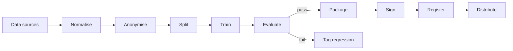

# 32 — AI Training

| Field            | Value                                                                                |
|------------------|--------------------------------------------------------------------------------------|
| Document ID      | `PINE-DOC-32-AI-TRAINING`                                                            |
| Status           | Draft — pending review                                                               |
| Owner            | Engineering Review Board                                                             |
| Created          | 2026-07-08                                                                           |
| Last Updated     | 2026-07-08                                                                           |
| Specification Standard | Internal (training pipeline)                                                   |
| Glossary         | `PINE-DOC-03-GLOSSARY`                                                               |
| Prerequisites    | `00-Vision`..`31-Rule-Engine`                                                        |
| Related Documents| `13-AI-Architecture`, `15-Security`, `17-Risk-Analysis`, `30-Observability`, `33-Plugin-SDK` |

---

## 1. Purpose

Define Pine's **AI training discipline**: where training data
comes from, how the model is built, evaluated, packaged, shipped
and updated, and how user feedback loops back into model
improvement. Pine ships with a *default* model and a *registry* of
swappable models per ADR-0006.

## 2. Scope

In scope: training data sources, training pipeline, model
evaluation, packaging, distribution, updates, user feedback loops,
model licence posture, dataset licence posture.

Out of scope: AI inference / runtime → `13-AI-Architecture`;
plugin SDK for model contributions → `33-Plugin-SDK`; security
posture for AI data → `15-Security`.

## 3. Definitions

| Term             | Working definition                                                                                |
|------------------|------------------------------------------------------------------------------------------------------|
| Model            | A versioned artefact that maps inputs to outputs.                                                  |
| Registry         | The Pine-maintained catalogue of available models.                                                 |
| Training data    | A corpus of labelled examples used to fit a model.                                                 |
| Evaluation set   | A held-out corpus used to measure model quality.                                                   |
| Fine-tune        | Adjusting a model on user data (only on the user's device, only with consent, only opt-in).          |
| Distillation     | Compressing a larger model into a smaller one for on-device use.                                   |
| Open weights     | Model weights published under an open licence.                                                      |
| Open data        | Training data with a documented, permissive licence.                                               |
| Card             | A documented profile (capabilities, limits, evaluation, licence).                                  |
| Quantisation     | Reducing the precision of weights to reduce size and latency.                                      |
| Adapter          | A small parameter delta applied to a base model for a task.                                        |

> **Assumption AI-A-1.** Pine does *not* train models on data
> shipped from third-party cloud APIs. Training runs *locally* or
> on project-controlled infrastructure; cloud training APIs are
> forbidden.

## 4. Posture

- The default model is shipped *inside* the application bundle.
- The default model is *open* in weight or in evaluation, depending
  on the family (see §6).
- Pine does *not* call paid third-party AI APIs (per `00-Vision`
  §10).
- Fine-tuning on user data is *opt-in*, *on-device*, and
  *isolated* per user (no cross-user sharing without explicit
  consent).

## 5. Training Data

### 5.1 Categories

| Category            | Source                                                                  | Licence posture                       |
|---------------------|-------------------------------------------------------------------------|---------------------------------------|
| Synthetic base      | Project-generated synthetic transactions                                | Permissive                             |
| Open public         | Open datasets (e.g. anonymised public expense lists)                    | Permissive / ODbL / CC-BY-SA          |
| Community donated   | Community-contributed datasets, anonymised at ingestion                 | DCO + per-dataset licence              |
| Vendor-supplied     | Vendor partnerships (where the vendor's licence permits)                 | Per-contract; never exclusive          |
| User fine-tune      | The user's own data, opt-in                                              | Local-only                             |

### 5.2 Anonymisation Discipline

- A training datum MUST NOT contain user-identifying fields.
- A training datum MUST NOT contain the raw merchant or payee name
  unless the field is hashed.
- A training datum MUST NOT include a date that pinpoints the
  user (e.g. a transaction timestamp is bucketed into a calendar
  quarter for privacy).
- A training datum MUST NOT include amount values below 1 unit of
  the smallest currency; amounts above that are bucketed into
  bands (e.g. 0–10, 10–50, 50–100).

### 5.3 Opt-In Corpus

- A user MAY opt in to *donate* anonymised data to the corpus.
- The user sees exactly which fields are donated.
- The user MAY revoke at any time; the user's data is purged from
  the corpus within 30 days of revocation.
- The corpus ingestion pipeline tags each datum with the donor
  pseudonymous ID, retained for the audit chain.

### 5.4 Card Discipline

A dataset card (per `13-AI-Architecture` §13) MUST include:

- Source description.
- Licence and licence URL.
- Anonymisation method.
- Known biases.
- Known gaps.
- Version and reproducibility instructions.

## 6. Model Families

### 6.1 Default Family

Pine ships a default categoriser and explainer. The default is
either:

- Open weights (preferred when quality is sufficient).
- Distilled open weights (when the open model is too large for
  on-device use).

The default family is selected per ADR-0006.

### 6.2 Selection Criteria

- On-device runtime (≤ N GB, ≤ N ms p95 latency per category).
- Acceptable accuracy on the open evaluation set.
- Acceptable licence (commercial-use permitted).
- Documented evaluation card.

### 6.3 Model Card

Each model shipped has a `model-card.md` with:

- Architecture summary (no weight disclosure when proprietary).
- Input/output spec.
- Intended use.
- Out-of-scope use.
- Evaluation results.
- Licence.
- Provenance.
- Known limitations.

## 7. Training Pipeline

### 7.1 Stages

### 7.2 Reproducibility

- Every training run produces a manifest with:
  - Code commit hash.
  - Data commit hash(es).
  - Hyperparameter set.
  - Environment hash.
  - Random seed.
- The manifest is published with the model.
- An external reviewer can re-run the training and obtain the same
  weights within tolerance.

### 7.3 Compute

- Training runs on project-controlled infrastructure (when
  off-device).
- Pine does NOT use third-party training APIs.
- Training compute usage is published in the finance report per
  `24-Contributing` §8.3.

## 8. Evaluation

### 8.1 Evaluation Sets

- An *internal* evaluation set exists for each model.
- A *public* evaluation set is published when feasible.
- The evaluation set is versioned and reproducible.

### 8.2 Metrics

| Metric                              | Used for                                          |
|-------------------------------------|---------------------------------------------------|
| Top-1 accuracy (categorisation)     | Categorisation model                              |
| Top-3 accuracy                       | Fallback evaluation                                |
| Macro F1                             | Imbalance-aware evaluation                         |
| Calibration (Brier score)           | Confidence calibration                             |
| Latency p95                          | On-device inference latency                       |
| Size                                 | On-device memory budget                            |
| Robustness gap                       | Drift detection on adversarial inputs             |
| Privacy leakage score                | Differential privacy test (where used)            |

### 8.3 Acceptance Gate

A model is promoted to ship only if:

- Top-1 accuracy ≥ baseline + delta on the public evaluation set.
- Macro F1 ≥ baseline + delta.
- Calibration error within budget.
- Latency p95 within the on-device budget per `08-NonFunctional-
  Requirements`.
- Memory within the on-device budget per `08-NonFunctional-
  Requirements`.
- Privacy leakage score within budget.

## 9. Packaging and Signing

- A model artefact is a `.pineai` (named in the SDK) signed by the
  project signing key.
- The artefact contains: weights, configuration, model card,
  reproducibility manifest, evaluation summary.
- The artefact is reproducible from the manifest: replaying the
  pipeline yields the same weights within tolerance.

## 10. Distribution

- Default model: bundled in the application installer.
- Optional alternative models: downloaded through the AI registry.
- AI registry entries are signed and verifiable.
- A user MAY disable model downloads; the default is used.
- A user MAY set a "no network" mode that disables the model
  registry entirely (categorisation uses rules + local model).

## 11. Updates

- Updates follow the staged rollout per `29-Deployment`.
- An update may be a *full* model or a *delta* (adapter).
- A user may opt to receive *stable* models only.
- A user may opt to receive *preview* models.
- An opt-out of model updates does not affect the application
  features; the bundled model continues to work.

## 12. User Feedback Loop

### 12.1 In-App Feedback

- A user MAY correct a categorisation in-app.
- The correction is recorded in the user's local fine-tuning data
  set (opt-in toggle).
- A correction does not leave the device unless the user opts in
  to donation.

### 12.2 Local Fine-Tuning

- Local fine-tuning runs on-device.
- The fine-tune is opt-in per profile.
- The fine-tune is per-profile (no cross-user sharing).
- A user may export the fine-tune for personal use.
- A user may donate the fine-tune (anonymised) to the corpus.

> **Implementation status, added 2026-08-29 (TD-16, audit §12.29).** Stated clause by clause,
> because three of these five were false when this section was written and one still is.
>
> | Clause | Status |
> |---|---|
> | Local fine-tuning runs on-device | ✅ **Implemented.** `MlNetCategorizer` trains in-process with ML.NET; no code path calls a remote service. |
> | The fine-tune is per-profile (no cross-user sharing) | ✅ **Implemented by TD-16, and it was false before it.** The model now lives at `{vault}/ai/categorizer.model`, encrypted under a key derived from that vault's data key, and the categoriser drops its in-memory engine when the open vault changes. Previously one plaintext file next to the executable served every vault. |
> | The fine-tune is opt-in per profile | ❌ **Not implemented.** `CategorizationTrainingBackgroundService` trains unconditionally, every five minutes, with no consent gate and no setting to turn it off. This section says opt-in; the code says always. **TD-89.** |
> | A user may export the fine-tune for personal use | ❌ **Not implemented.** There is no export path, and after TD-16 the file is not usable outside its vault anyway. |
> | A user may donate the fine-tune (anonymised) to the corpus | ❌ **Not implemented**, and correctly so while §12.3's k-anonymity aggregation does not exist either. |
>
> §6.1's "Pine ships with a *default* model" is also **not implemented**: no categoriser model is
> tracked in the repository, covered by Git LFS, or copied to output. Every vault starts with no
> model and trains its own.

### 12.3 Aggregation to the Project

- Donated corrections are aggregated at the project.
- Aggregation is *k-anonymous* with a threshold (e.g. *k ≥ 5*).
- Aggregation is published in the project finance + data report.

## 13. Risk Posture

| Risk                                    | Mitigation                                                                |
|------------------------------------------|---------------------------------------------------------------------------|
| Training data bias                       | Public card; evaluation set includes bias probes                          |
| Privacy leakage                          | Differential privacy budget; privacy leakage score in evaluation          |
| Model regression on update                | Staged rollout; rollback per `29-Deployment`; on-device smoke test        |
| Vendor lock-in                           | Default is open or distilled open; registry allows swapping              |
| Misclassification                         | Rule engine fallback; user correction loop; explanation layer             |
| Capability misuse (financial advice)     | Anti-goal per Vision P-05; explanation layer; cap on advice-shaped output |

## 14. Cross-Cutting Constraints

- A training run MUST be reproducible from the manifest.
- A shipped model MUST be evaluated against the public evaluation
  set.
- A shipped model MUST have a published card.
- A shipped model MUST respect the on-device budget.
- A shipped model MUST be signed.

## 15. Deferred Decisions

| ID        | Decision                                                                                  | Owning document(s)         |
|-----------|-------------------------------------------------------------------------------------------|----------------------------|
| AI-T-D-1  | Final default model selection at v1.0 cut.                                                  | `13-AI-Architecture` (next rev.) |
| AI-T-D-2  | Differential privacy budget.                                                                | `32-AI-Training` (next rev.) |
| AI-T-D-3  | Whether to publish training data differential-privacy proofs.                                | `32-AI-Training` (next rev.) |
| AI-T-D-4  | License posture for community-donated datasets (default DCO + per-dataset).                 | `32-AI-Training` (next rev.) |
| AI-T-D-5  | Opt-in toggle default for local fine-tuning (default-off until v1.0).                       | `32-AI-Training` (next rev.) |

## 16. Quality Checklist

- [x] Posture, training data, model families, training pipeline,
      evaluation, packaging, distribution, updates, user feedback,
      risk posture are all present.
- [x] Privacy posture is consistent with ADR-0012 and `15-Security`.
- [x] No TODO placeholders.
- [x] No contradiction with `00-Vision`..`31-Rule-Engine`.

## 17. Revision History

| Version | Date       | Author                | Change                                                       |
|---------|------------|-----------------------|--------------------------------------------------------------|
| 0.1     | 2026-07-08 | Engineering Review Board | Initial AI training document.                                |
