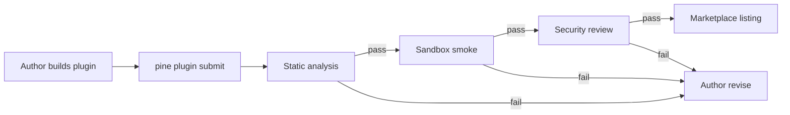
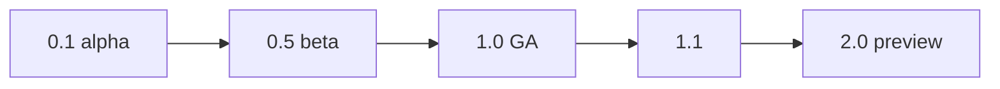

# 33 — Plugin SDK

| Field            | Value                                                                                |
|------------------|--------------------------------------------------------------------------------------|
| Document ID      | `PINE-DOC-33-PLUGIN-SDK`                                                              |
| Status           | Aspirational — no SDK exists                                                         |
| Reconciled       | 2026-08-31 · Same two empty projects (TD-37). Documents `pine plugin submit` (:69), which the CLI does not implement. |
| Owner            | Engineering Review Board                                                             |
| Created          | 2026-07-08                                                                           |
| Last Updated     | 2026-07-08                                                                           |
| Specification Standard | Internal (plugin SDK surface)                                                   |
| Glossary         | `PINE-DOC-03-GLOSSARY`                                                               |
| Prerequisites    | `00-Vision`..`32-AI-Training`                                                        |
| Related Documents| `12-Plugin-Architecture`, `15-Security`, `17-Risk-Analysis`, `22-Release-Plan`, `24-Contributing`, `34-API-Guidelines` |

---

## 1. Purpose

Define the **Plugin SDK**: the API surface a *plugin author*
uses to write a Pine plugin, the manifest format, the signing and
verification flow, the submission, the marketplace, the lifecycle
of a plugin release.

## 2. Scope

In scope: SDK API surface, manifest schema, signing, submission,
marketplace, lifecycle, deprecation, examples.

Out of scope: plugin trust model (high-level) → `12-Plugin-
Architecture`; plugin runtime host → `12-Plugin-Architecture`;
plugin sandbox → `15-Security` §6.

## 3. Definitions

| Term             | Working definition                                                                                |
|------------------|------------------------------------------------------------------------------------------------------|
| Plugin           | A signed, sandboxed extension contributed by a third party.                                        |
| Manifest         | A machine-readable description of a plugin.                                                        |
| Permission       | A scoped capability a plugin declares and the user grants.                                          |
| Capability       | A piece of functionality exposed by the SDK (e.g. read transactions).                              |
| Sandboxed        | Running a plugin in a constrained runtime (`.NET` host + restricted API).                            |
| Marketplace      | The public registry of vetted plugins.                                                              |
| Author           | The person or organisation that publishes a plugin.                                                |
| Maintainer       | The Pine-side contact for a plugin.                                                                |
| Reviewer         | A Pine-side person who reviews a plugin submission.                                                |

> **Assumption SDK-A-1.** A plugin is *additive*. Removing a plugin
> does not corrupt the user's data.

## 4. SDK Architecture

```mermaid
graph LR
    P[Plugin author] -->|writes| SRC[Plugin source]
    SRC -->|compiles| ART[Plugin artefact]
    ART -->|signs| MAN[Signed manifest + artefact]
    MAN -->|submits| MR[Marketplace review]
    MR -->|passes| MK[Marketplace listing]
    MK -->|downloads| H[Plugin host loads]
    H -->|granted perms| API[Plugin API surface]
```



### 4.1 Components

- **SDK library**: the .NET package a plugin links to in dev mode.
- **Plugin host**: the runtime that loads a plugin into a
  sandboxed process (per `12-Plugin-Architecture` §7).
- **Manifest schema**: the JSON/YAML schema documented in §6.
- **Submission CLI**: `pine plugin submit` for authors.
- **Marketplace backend**: the registry of vetted plugins.

## 5. SDK API Surface

### 5.1 Public API Categories

| Category              | Capabilities                                                              | Risk profile          |
|-----------------------|---------------------------------------------------------------------------|-----------------------|
| `read.transactions`   | List transactions, with field-level scoping per manifest.                 | low–medium            |
| `write.transactions`  | Modify transactions (split, tag, etc.).                                    | medium–high           |
| `read.accounts`       | List accounts, balances.                                                   | low                   |
| `write.accounts`      | Create / rename / archive accounts.                                        | medium                |
| `read.budgets`        | List budgets, progress.                                                    | low                   |
| `read.investments`    | List holdings, cost basis, P/L.                                            | low                   |
| `write.imports`       | Run an import plugin (CSV/Excel/OFX/QFX/PDF).                              | medium                |
| `read.sync.state`     | Read sync state (no secret).                                               | low                   |
| `notifications.send`  | Send a notification (subject to user preferences).                         | medium                |
| `ui.panels`           | Add a UI panel to the application.                                        | medium                |
| `rule.contribute`     | Add rules to the rule engine.                                              | medium                |
| `storage.scratchpad`  | Use a per-plugin scratchpad store.                                          | low                   |
| `bridge.services`     | Cross-plugin IPC (advanced).                                              | high                  |

### 5.2 Surface Rules

- The SDK surface is a *subset* of the application surface.
- A capability is granted by permission in the manifest (§6).
- A request for an undeclared capability fails closed.
- A request for an ungranted capability fails closed.
- A request with mismatched scope (e.g. wrong account) fails
  closed.

### 5.3 Lifecycle

- A plugin is loaded on application launch or on demand (per
  hook).
- A plugin is unloaded when the application disables it or
  terminates.
- A plugin is reloaded when its definition changes (per
  manifest version).

## 6. Manifest Schema

### 6.1 Required Fields

```jsonc
{
  "id": "com.example.bank-csv-import",
  "name": "Example CSV Importer",
  "version": "1.2.0",
  "author": {
    "name": "Example Org",
    "email": "ops@example.com",
    "url": "https://example.com"
  },
  "target": {
    "pine_min": "1.0.0",
    "pine_max": "2.0.0"
  },
  "entry": "plugin.dll",
  "permissions": [
    "read.transactions",
    "write.imports"
  ],
  "permissions_scope": {
    "accounts": ["*"],
    "tags": ["csv", "import"]
  },
  "risk_score": {
    "value": 35,
    "rationale": "Reads file system and posts notifications; no network."
  },
  "signature": { /* ... */ },
  "publisher_signature": { /* ... */ }
}
```

### 6.2 Permissions

- Permissions are *strings* with the form `<category>.<verb>`.
- A plugin declares its *requested* permissions.
- A user grants *actual* permissions on install.
- The granted set is stored per profile.
- The SDK rejects calls outside the granted set.

### 6.3 Permissions Scope

- `accounts`: list of account IDs or `*`.
- `tags`: list of tags the plugin is bound to.
- `time_window`: optional time range for read access.
- `field_set`: optional read-only masking (e.g. redact payee).

### 6.4 Risk Score

- A risk score is a 0–100 integer per `12-Plugin-Architecture`
  §6.
- The author MUST provide a `rationale`.
- The marketplace reviewer publishes an *adjudicated* risk score.
- A user sees the risk score in the install prompt.

## 7. Signing

### 7.1 Author Signing

- The author signs the artefact with an author key.
- The signature is stored inside the manifest.
- The key is published in the author's record.

### 7.2 Publisher Signing

- The publisher (Pine or a delegated partner) signs the manifest.
- The publisher key is part of the project's certificate chain.
- A plugin without publisher signature may be installed as a
  *sideload*, but is prominently flagged.

### 7.3 Chain

```
Author signature → Manifest signature → Publisher signature → Project root
```

## 8. Submission



### 8.1 Submission CLI

```
pine plugin submit --manifest ./manifest.json --artefact ./plugin.dll \
    --readme ./README.md --docs ./docs/
```

### 8.2 Static Analysis

- The submission pipeline runs:
  - The .NET IL static analyser.
  - A secret scanner.
  - A permission-pinning check.
  - An interface conformance check.

### 8.3 Sandbox Smoke

- The plugin runs in a sandbox profile with synthetic data.
- The smoke checks: launch, declarations, capability requests,
  teardown.

### 8.4 Security Review

- A reviewer from the project's trust team reviews the manifest,
  the static analysis report, and the smoke report.
- A reviewer MUST consult the risk register per
  `17-Risk-Analysis`.
- A reviewer MUST publish a security verdict.

## 9. Marketplace

### 9.1 Listing Format

A marketplace listing is public and includes:

- Name, author, version.
- Permissions requested.
- Risk score and rationale.
- Install size.
- Latest review date.
- Last security review date.
- Reviewer and verdict.
- Documentation link.
- Source link (when provided).

### 9.2 Listing Categories

- Verified (publisher-signed, audited).
- Community (author-signed, sandbox-tested).
- Sideload (no publisher signature, user-installed).

### 9.3 Promotions and Demotions

- A plugin can be promoted from Community to Verified via review.
- A plugin can be demoted or removed on security grounds.
- Demotions are public.

## 10. Versioning and Compatibility

- A plugin follows SemVer.
- A plugin declares `pine_min` and `pine_max`.
- A plugin that breaks the API MUST bump its major version.
- A plugin that uses a deprecated API MUST bump its minor version
  at the next release.
- A plugin MUST log a warning when a deprecated API is invoked.

## 11. Deprecation

- A plugin MAY be deprecated by its author.
- A plugin MAY be deprecated by the marketplace on policy or
  security grounds.
- A deprecated plugin is hidden from new installs but remains
  installed and functional in existing profiles.
- A deprecated plugin is removed from new searches after 6
  months.

## 12. Authoring Notes

### 12.1 Local-First Discipline

- A plugin MUST NOT call a remote endpoint without an explicit
  user-granted `bridge.network` permission (advanced; rarely
  granted).
- A plugin MUST NOT exfiltrate user data.

### 12.2 Performance Discipline

- A plugin MUST NOT block the main thread.
- A plugin MUST respect the on-device budget per NFR-PERF-*.
- A plugin MUST yield to other plugins on shared resources (e.g.
  the rule engine).

### 12.3 Accessibility Discipline

- A plugin UI panel MUST meet WCAG 2.2 AA per `40-Accessibility`.
- A plugin notification MUST have a textual body and a long
  description.

## 13. SDK Release Lifecycle



A breaking SDK change moves the SDK major version. The SDK major
version MUST track the Pine major version.

## 14. Cross-Cutting Constraints

- A plugin MUST be signed.
- A plugin MUST declare its permissions.
- A plugin MUST be sandboxed.
- A plugin MUST be reproducible from the manifest.

## 15. Deferred Decisions

| ID        | Decision                                                                                  | Owning document(s)         |
|-----------|-------------------------------------------------------------------------------------------|----------------------------|
| SDK-D-1   | Whether to allow a JS-style authoring language for plugins (transpiled).                   | `33-Plugin-SDK` (next rev.) |
| SDK-D-2   | Whether to allow web plugins via WASM.                                                    | `33-Plugin-SDK` (next rev.) |
| SDK-D-3   | Marketplace moderation queue SLAs.                                                         | `33-Plugin-SDK` (next rev.) |
| SDK-D-4   | Whether to expose the same plugin interface to AI tools (no: separate `Model SDK`).         | `13-AI-Architecture`       |

## 16. Quality Checklist

- [x] Architecture, API surface, manifest schema, signing,
      submission, marketplace, lifecycle, deprecation, versioning,
      authoring notes are all present.
- [x] No TODO placeholders.
- [x] No contradiction with `00-Vision`..`32-AI-Training`.

## 17. Revision History

| Version | Date       | Author                | Change                                                       |
|---------|------------|-----------------------|--------------------------------------------------------------|
| 0.1     | 2026-07-08 | Engineering Review Board | Initial Plugin SDK document.                                |
