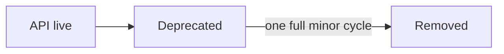

# 34 — API Guidelines

| Field            | Value                                                                                |
|------------------|--------------------------------------------------------------------------------------|
| Document ID      | `PINE-DOC-34-API-GUIDELINES`                                                         |
| Status           | Draft — pending review                                                               |
| Owner            | Engineering Review Board                                                             |
| Created          | 2026-07-08                                                                           |
| Last Updated     | 2026-07-08                                                                           |
| Specification Standard | Internal (API surface discipline)                                             |
| Glossary         | `PINE-DOC-03-GLOSSARY`                                                               |
| Prerequisites    | `00-Vision`..`33-Plugin-SDK`                                                        |
| Related Documents| `20-Coding-Standards`, `33-Plugin-SDK`, `35-Git-Workflow`, `37-Code-Review` |

---

## 1. Purpose

Define the *public API guidelines* of Pine: what counts as a public
API, how APIs are versioned, how backwards compatibility is
preserved (or broken deliberately), how deprecations are
introduced, how errors are surfaced, and how the docs and tests
track the surface.

## 2. Scope

In scope: API identification, versioning, compatibility,
deprecation, error contracts, async model, documentation, tests.

Out of scope: HTTP transport (when Pine Cloud exists; deferred
OD-D-3); plugin-specific contracts → `33-Plugin-SDK`; coding style
→ `20-Coding-Standards`.

## 3. Definitions

| Term             | Working definition                                                                                |
|------------------|------------------------------------------------------------------------------------------------------|
| Public API       | An interface intended for consumption outside the originating package.                              |
| Internal API     | An interface used inside Pine's codebase but not exposed beyond.                                    |
| Stable API       | A public API covered by backwards-compatibility guarantees.                                          |
| Preview API      | A public API that may change in subsequent minor versions.                                          |
| Deprecated API   | An API marked for removal in a future version.                                                      |
| Compatibility    | The property that a new version of an API behaves correctly with callers written to an older version. |
| Surface          | The set of public APIs at a given version.                                                          |
| Contract         | The documented behaviour of an API (preconditions, postconditions, errors).                          |

> **Assumption API-A-1.** The default API posture is *strict
> backwards compatibility inside a major version*. An intentional
> break bumps the major version and is preceded by a deprecation
> cycle.

## 4. API Surface Identification

### 4.1 Public vs Internal

- A public API is marked `public` (C#) or an explicit `public:` /
  `lua:` (other languages) and is in a documented namespace.
- An internal API lives in `*.Internal` namespaces.
- The boundary is enforced by:
  - A package-level `InternalsVisibleTo` for test projects only.
  - A lint rule that fails on internal references from public
    types.
  - An API surface test that snapshots the public types and
    members.

### 4.2 Documentation Surface

- A public type has an XML doc comment summary.
- A public method has an XML doc comment that names preconditions
  and postconditions.
- A public type or method MAY be marked `<exclude from="docs"/>` if
  it is public for technical reasons but not meant for
  consumption.

## 5. Versioning

### 5.1 Scheme

Pine APIs follow **Semantic Versioning** (SemVer 2.0).

### 5.2 SemVer Discipline

- Major: any backwards-incompatible change.
- Minor: any backwards-compatible feature addition.
- Patch: any backwards-compatible bug fix.
- Pre-release tags (alpha, beta, rc) follow the SemVer convention.

### 5.3 Pre-1.0 Cadence

- During `0.x`, behaviour may change without major bumps.
- `0.x.y` releases are explicit about the *scope* of the change.
- The first `1.0` locks the surface for the duration of `1.x`.

### 5.4 Surface Snapshot

- The API surface test snapshots every `minor` API version.
- The snapshot lives next to the test.
- A change to the surface is captured in the snapshot.

## 6. Backwards Compatibility

### 6.1 The Promise

Within a major version, Pine promises:

- The signature of a public method MAY be augmented with optional
  parameters, never narrowed.
- A public enum value MAY be added; existing values never change.
- A public type MAY be augmented with members; existing members
  never change signature.
- A public method MAY be deprecated; deprecated methods continue
  to work for the deprecation cycle.

### 6.2 Breaking Changes

A breaking change is allowed only:

- In a major version bump.
- With a documented migration.
- After a deprecation cycle of one full minor release (or two, for
  widely-used surface).

### 6.3 Additive Discipline

- A new public type introduces a new surface; it does not change
  the existing surface.
- A new public method on an existing type does not change the
  existing methods.
- A new permission on a manifest is a breaking change for plugins;
  it is treated as a major bump on the SDK.

## 7. Deprecation

### 7.1 Marking

- A deprecated API is marked `[Obsolete("...")]` and a `<remarks>`
  in the documentation.
- The doc comment links to the replacement.

### 7.2 Communication

- A deprecation is recorded in:
  - The doc comment.
  - The release notes.
  - A migration guide page on the docs site.
- Deprecations surface in IDE tooling via the `[Obsolete]`
  attribute.

## 8. Error Contracts

### 8.1 Result Types

- An API that can fail returns a `Result<T, Error>` style type.
- An API that is *pure* (cannot fail) returns `T`.

### 8.2 Error Categories

| Category         | Meaning                                                                    |
|------------------|------------------------------------------------------------------------------|
| `validation`     | Caller passed a malformed input                                             |
| `state`          | Caller asked for an operation that is invalid given the current state        |
| `permission`     | Caller lacks the permission                                                 |
| `not_found`      | Resource does not exist                                                     |
| `conflict`       | Concurrent state change                                                      |
| `io`             | Persistence failure                                                          |
| `internal`       | Unexpected internal error                                                    |

### 8.3 Error Content

- An error has a `code` (stable), a `message` (human-readable),
  and an optional `details` object.
- Error codes follow the pattern `domain.subdomain.reason`
  (e.g. `accounts.create.invalid_name`).

## 9. Async Model

- Public APIs that may suspend return `Task<T>` or `ValueTask<T>`.
- Cancellation flows through `CancellationToken`.
- An API MUST accept a token when it can suspend.
- An API MUST respect the token and exit cleanly.
- An API MUST NOT swallow cancellation.

## 10. Determinism and Time

- A public API MUST accept a `IClock` for any time-sensitive
  decision (per ADR-0009).
- A public API MUST accept an `IIdGenerator` for any id-generating
  decision where reproducibility matters.

## 11. Persistence APIs

- A persistence API exposes a *unit-of-work* boundary.
- A failure inside the boundary rolls back the work.
- A persistence API MUST be idempotent across retries (per the
  sync semantics per `14-Synchronization`).

## 12. Threading

- Public APIs are either *thread-safe* or marked so.
- A non-thread-safe public API documents the requirement.
- Mutation APIs are not thread-safe by default unless explicitly
  designed (e.g. plugin host).

## 13. Logging and Observability

- A public API does not log directly; the call site logs via the
  observer.
- A public API surfaces `trace_id` via the ambient tracing
  context.

## 14. Documentation Discipline

- A public type has a *conceptual* doc page in the docs site.
- A public method has an XML doc comment that names preconditions,
  postconditions, error conditions and a code example.
- The doc site is regenerated from the source on every release.
- The doc site is versioned alongside the API.

## 15. Test Surface

- Every public API has at least one behaviour test.
- Every public API has at least one failure-mode test.
- The API surface test asserts the public surface matches the
  snapshot.

## 16. Cross-Cutting Constraints

- A public API MUST NOT expose a domain-internal mutable type.
- A public API MUST NOT depend on a non-stable library.
- A public API MUST NOT throw `Exception` directly; it must use
  the result-error pattern.

## 17. Deferred Decisions

| ID       | Decision                                                                                  | Owning document(s)         |
|----------|-------------------------------------------------------------------------------------------|----------------------------|
| API-D-1  | HTTP API style for Pine Cloud (REST + JSON vs. gRPC vs. both).                            | `34-API-Guidelines` (next rev.) |
| API-D-2  | Whether to support schema-only event contracts (Avro/Protobuf) for syncing.              | `14-Synchronization`       |
| API-D-3  | API stability windows for first-party plugins vs. third-party plugins.                     | `33-Plugin-SDK`            |

## 18. Quality Checklist

- [x] Identification, versioning, compatibility, deprecation,
      error contracts, async model, determinism, persistence,
      threading, logging, docs, tests are all present.
- [x] No TODO placeholders.
- [x] No contradiction with `00-Vision`..`33-Plugin-SDK`.

## 19. Revision History

| Version | Date       | Author                | Change                                                       |
|---------|------------|-----------------------|--------------------------------------------------------------|
| 0.1     | 2026-07-08 | Engineering Review Board | Initial API guidelines.                                      |
