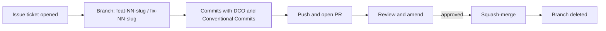
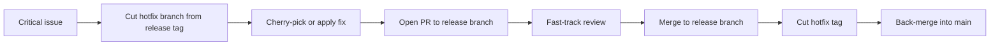

# 35 — Git Workflow

| Field            | Value                                                                                |
|------------------|--------------------------------------------------------------------------------------|
| Document ID      | `PINE-DOC-35-GIT-WORKFLOW`                                                            |
| Status           | Draft — pending review                                                               |
| Owner            | Engineering Review Board                                                             |
| Created          | 2026-07-08                                                                           |
| Last Updated     | 2026-07-08                                                                           |
| Specification Standard | Internal (git workflow)                                                     |
| Glossary         | `PINE-DOC-03-GLOSSARY`                                                               |
| Prerequisites    | `00-Vision`..`34-API-Guidelines`                                                    |
| Related Documents| `27-Development-Guidelines`, `36-Branching-Strategy`, `37-Code-Review` |

---

## 1. Purpose

Define the *day-to-day* Git workflow of Pine: branch naming,
commit hygiene, push/pull habits, pull request body, review hand-
off, merge, tagging, hotfix, and on-call rotation handoff. This is
the *operational* counterpart to the *strategic* branching
strategy in `36-Branching-Strategy`.

## 2. Scope

In scope: branches, commits, sync between machines, pull request
process, merge mechanics, tagging, hotfix.

Out of scope: branching *strategy* (model + cadence) →
`36-Branching-Strategy`; code review rules → `37-Code-Review`;
release mechanics → `22-Release-Plan`; CI/CD gate behaviour →
`28-CI-CD`.

## 3. Definitions

| Term             | Working definition                                                                                |
|------------------|------------------------------------------------------------------------------------------------------|
| Working tree     | The local checkout.                                                                                  |
| Index            | The staged changes.                                                                                   |
| Local commit     | A commit not yet pushed.                                                                             |
| Push             | Sending local refs to the remote.                                                                    |
| PR               | Pull Request (merge proposal).                                                                        |
| Reviewer         | A person who reviews the PR (see `37-Code-Review`).                                                  |
| Approver         | A reviewer with merge rights.                                                                        |
| Squash-merge     | Collapsing the PR's commits into a single commit on the target branch.                              |
| Linear history   | A history without merge commits.                                                                    |
| Hotfix branch    | A branch cut from a release tag to ship a critical fix.                                              |
| Tag              | A pointer to a specific commit, signed.                                                              |
| Annotated tag    | A tag with a message, author, signature.                                                             |

## 4. Branch Lifecycle



### 4.1 Branch Naming

| Kind       | Pattern                                              | Example                                  |
|------------|------------------------------------------------------|--------------------------------------------|
| Feature    | `feat-<ticket>-<slug>`                              | `feat-234-bulk-import-csv`                 |
| Fix        | `fix-<ticket>-<slug>`                               | `fix-1184-csv-import-quoted-fields`        |
| Refactor   | `refactor-<ticket>-<slug>`                          | `refactor-902-rule-engine-priority`        |
| Docs       | `docs-<ticket>-<slug>`                              | `docs-1032-add-roadmap-doc`                |
| Spike      | `spike-<ticket>-<slug>`                             | `spike-1525-webgl-charts-research`         |
| Hotfix     | `hotfix-<ticket>-<slug>`                            | `hotfix-2201-sync-merge-loss`              |
| Release    | `release-<version>`                                 | `release-1.0.0`                            |

### 4.2 Branch Discipline

- Branches are short-lived (≤ 14 days).
- A branch is re-synced with `main` regularly.
- A stale branch is closed after 30 days without activity.

## 5. Commits

### 5.1 Commit Discipline

- A commit MUST be small and focused.
- A commit MUST be self-describing.
- A commit MUST be bisectable (the build works at every commit).
- A commit MUST include a `Signed-off-by:` trailer.
- A commit MUST follow Conventional Commits.

### 5.2 Commit Authoring

```bash
git add -p                          # stage by hunk
git status                          # confirm
git commit -s -m "feat(imports): CSV quoted-field parser"
```

### 5.3 Commit Hygiene

- Force-push to a feature branch is allowed *only* before any
  reviewer has started.
- Force-push to `main` is forbidden by branch protection.
- Rewriting history past the merge point is forbidden.

## 6. Push and Sync

- A developer pushes at the end of every working unit.
- A developer pulls and rebases daily.
- A divergent feature branch is rebased onto `main` before merge.
- A push that triggers a CI gate MUST be watched by the developer.

## 7. Pull Request

### 7.1 PR Body Template

```markdown
## What
<one paragraph>

## Why
<link to issue / ADR>

## How
<approach, alternatives considered>

## Testing
<unit / integration / mutation / manual>

## Risks
<known risks + mitigations>

## Checklist
- [ ] Linked issue
- [ ] ADR if applicable
- [ ] Tests added
- [ ] Changelog updated
- [ ] Docs updated
- [ ] Signed off
```

### 7.2 PR Review Process

- See `37-Code-Review` for the review taxonomy and SLAs.
- The PR author pings the assigned reviewers after opening.
- The PR author keeps the PR up-to-date with `main`.

### 7.3 PR Merge

- Squash-merge is the default.
- Linear history is enforced on `main`.
- A merge MUST NOT bypass the gate per `28-CI-CD` §4.1.
- A merge MUST have at least one approval (policy-doc requires
  two).

## 8. Tags and Releases

- A release tag is *annotated* and *signed*.
- A release tag format: `vX.Y.Z[-pre.N]`.
- A tag is cut at the release cut moment by the release manager
  (per `22-Release-Plan`).
- The same tag MUST NOT be moved; a new tag supersedes it.

## 9. Hotfix Workflow



- A hotfix branch is cut from the most recent release tag.
- A hotfix PR is fast-tracked: at most one approval, but always
  with two reviewers for a security-sensitive change.
- The hotfix tag is published immediately on the release branch
  and picked up by the staged rollout.
- The hotfix is back-merged into `main` to keep the histories in
  sync.

## 10. Disaster Scenarios

### 10.1 Reverted Bad Merge

- A bad merge on `main` is reverted with `git revert -m 1`.
- A revert PR is reviewed as a normal PR.
- A revert of a hotfix is permitted; the release branch is
  patched via a follow-up hotfix.

### 10.2 Lost Tag

- A tag is re-cut only by the release manager.
- The release manager publishes a notice; downstream `git fetch`
  follows.

### 10.3 Compromised Signing Key

- The Engineering Review Board is alerted.
- Key rotation per `15-Security` is initiated.
- New tags are cut from the rotated key.

## 11. Local Branches and Worktrees

- A long-running feature may use `git worktree`.
- A worktree is associated with one task.
- Worktrees are tidied on task completion.

## 12. Submodules and Vendoring

- Pine vendors no third-party code in the main repo.
- A third-party plugin template MAY live as a sub-repository
  referenced by manifest.
- A sub-repository is updated via the SDK release flow.

## 13. Cross-Cutting Constraints

- Force-push to `main`, `release/*`, `hotfix/*` is forbidden.
- A commit on `main` MUST have a passing CI gate.
- A tag MUST be annotated and signed.
- A PR MUST be linked to an issue or ADR.
- A PR MUST be reviewed before merge.

## 14. Deferred Decisions

| ID       | Decision                                                                                  | Owning document(s)         |
|----------|-------------------------------------------------------------------------------------------|----------------------------|
| GW-D-1   | Whether to use `--force-with-lease` or plain `--force` on feature branches.                | `35-Git-Workflow` (next rev.) |
| GW-D-2   | Worktree default location.                                                                 | `35-Git-Workflow` (next rev.) |
| GW-D-3   | Default `git pull` strategy (`--rebase` vs. `--merge`).                                   | `35-Git-Workflow` (next rev.) |

## 15. Quality Checklist

- [x] Lifecycle, branch naming, commits, push, PR, tags, hotfix,
      disaster scenarios are all present.
- [x] Conventional Commits + DCO referenced.
- [x] No TODO placeholders.
- [x] No contradiction with `00-Vision`..`34-API-Guidelines`.

## 16. Revision History

| Version | Date       | Author                | Change                                                       |
|---------|------------|-----------------------|--------------------------------------------------------------|
| 0.1     | 2026-07-08 | Engineering Review Board | Initial git workflow document.                              |
