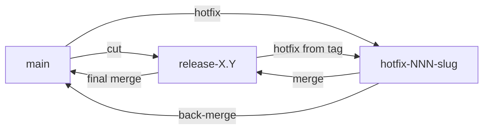
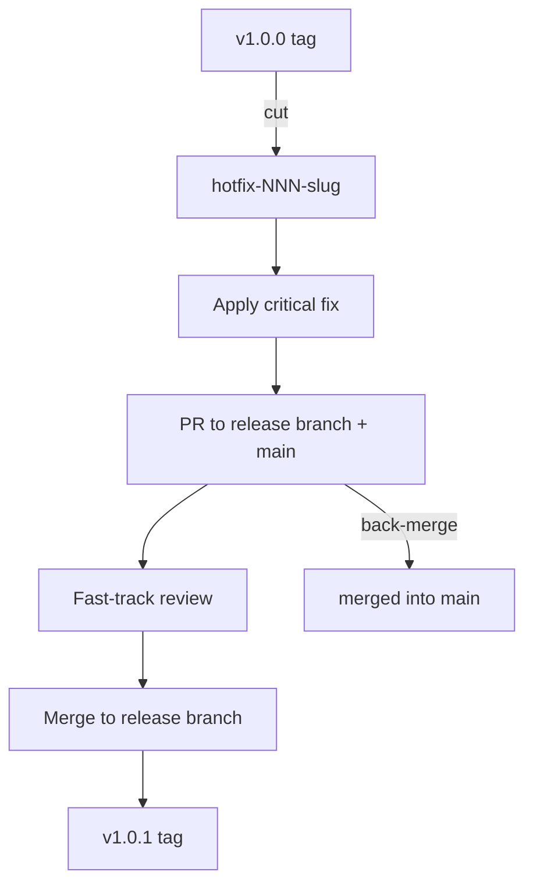

# 36 — Branching Strategy

| Field            | Value                                                                                |
|------------------|--------------------------------------------------------------------------------------|
| Document ID      | `PINE-DOC-36-BRANCHING`                                                              |
| Status           | Aspirational — the branch model is not in use                                        |
| Reconciled       | 2026-08-31 · No `release/*` branch exists. Work happens on `feat/*` branches merged directly; the model's release and hotfix lines have never been cut. |
| Owner            | Engineering Review Board                                                             |
| Created          | 2026-07-08                                                                           |
| Last Updated     | 2026-07-08                                                                           |
| Specification Standard | Internal (branching model)                                                     |
| Glossary         | `PINE-DOC-03-GLOSSARY`                                                               |
| Prerequisites    | `00-Vision`..`35-Git-Workflow`                                                       |
| Related Documents| `22-Release-Plan`, `28-CI-CD`, `29-Deployment`, `35-Git-Workflow`, `37-Code-Review` |

---

## 1. Purpose

Define Pine's branching *strategy*: the model (trunk-based), the
lifetime of branches, the role of release branches, the hotfix
flow, the protection rules, and the relationship to the release
cadence.

## 2. Scope

In scope: branch model, lifetimes, releases, hotfixes,
protections, merge mechanics, rebase discipline.

Out of scope: day-to-day git commands → `35-Git-Workflow`;
release mechanics → `22-Release-Plan`; review → `37-Code-Review`;
CI/CD pipeline → `28-CI-CD`.

## 3. Definitions

| Term             | Working definition                                                                                |
|------------------|------------------------------------------------------------------------------------------------------|
| Trunk            | The default branch (`main`).                                                                         |
| Trunk-based      | A model where the trunk is the source of truth and short-lived branches merge into it.              |
| Release branch   | A branch cut from a trunk commit to stabilise a release.                                            |
| Hotfix branch    | A branch cut from a release tag to ship a critical fix.                                              |
| Lifetime         | The expected maximum duration of a branch.                                                          |
| Long-lived branch| A branch with a lifetime longer than the release cadence; discouraged.                              |
| Protection       | A set of rules the branch enforces (reviewers, status checks, history).                             |

> **Assumption BS-A-1.** Pine follows a *trunk-based* model with
> short-lived branches and *optional* release branches when a
> release window needs stabilisation.

## 4. Branch Model

### 4.1 Default Branch

- The default branch is `main`.
- `main` is protected.
- All work targets `main` first.
- Releases are cut from `main` when ready.

### 4.2 Trunk Discipline

- `main` is always releasable.
- Every commit on `main` passes the CI gate.
- A broken `main` is an incident and is fixed in priority order.

## 5. Branch Lifetime

| Branch kind | Max lifetime | Comment                                                                    |
|-------------|--------------|------------------------------------------------------------------------------|
| feature     | 14 days      | Rebase onto `main` weekly                                                   |
| fix         | 7 days       | Urgency                                                                    |
| refactor    | 14 days      | Same as feature                                                            |
| docs        | 14 days      | Same as feature                                                            |
| spike       | 7 days       | Output is an ADR or a doc, not code                                        |
| hotfix      | 3 days       | Critical bug on a release                                                 |
| release     | min          | As short as possible; cut when stabilisation is needed, merged at GA          |

A long-lived branch is created only by an ADR.

## 6. Release Branches

### 6.1 When to Cut

A release branch is cut when:

- The release manager decides stabilisation is needed for a window.
- The release manager needs to back-port fixes to a previously
  released line.
- A customer requires a back-port.

### 6.2 What Goes In

- Selective bug fixes.
- Documentation corrections.
- Security patches.
- No new features (a feature is merged into `main` and ships in the
  next minor).

### 6.3 What Stays Out

- Trunk-only refactors that would distort the release.
- Performance regression fixes that require new dependencies.

### 6.4 Merge Mechanics

- Release branches are merged back into `main` once the GA tag is
  cut.
- The merge is a *merge commit* on `main` carrying the release
  history; the next release starts from this commit.

## 7. Hotfix Flow

### 7.1 Back-merge Discipline

- A hotfix branch is created from the release tag.
- The PR targets both the release branch and `main`.
- The same patch (or equivalent) is merged into `main`.

### 7.2 Hotfix SLA

- The "respond window" is 4 hours.
- The "fix window" is 24 hours for a critical regression, 7 days
  for a high-severity regression.
- The release manager publishes an internal timeline.

## 8. Branch Protection

| Branch                     | Required reviewers                       | Required checks                                | Force-push |
|----------------------------|------------------------------------------|------------------------------------------------|------------|
| `main`                     | 1 (code) / 2 (policy doc)               | All gates per `28-CI-CD` §13                   | forbidden  |
| `release/*`                | 1                                       | lint, mermaid, unit, integration, verify        | forbidden  |
| `hotfix/*`                 | 1 (security-sensitive: 2)              | lint, mermaid, unit, integration, verify        | forbidden  |
| `feat/*`, `fix/*`, `docs/*`, `refactor/*` | 1                          | lint, mermaid, unit, integration               | allowed*   |

`*` Allowed only when the branch is the author's and no review has
begun.

## 9. Merge Mechanics

- Default: **squash-merge**.
- A merge MUST NOT bypass the protected-branch rule.
- A squash-merge commit is signed off.
- The squash-merge subject references the PR number and the
  conventional commit type.

## 10. Linear History Enforcement

- `main` is linear.
- A merge commit on `main` is allowed only for a release or
  back-merge.
- A rebase is the default for re-syncing a feature branch with
  `main`.

## 11. Branch Cleanup

- Branches are deleted on merge by default.
- A branch left behind for > 30 days is closed by a bot.
- A revival is by re-creation.

## 12. Cross-Cutting Constraints

- A `release/*` branch MUST NOT receive a feature that has not
  shipped on `main`.
- A `hotfix/*` MUST NOT include refactors.
- A feature branch MUST be re-synced weekly.

## 13. Deferred Decisions

| ID       | Decision                                                                                  | Owning document(s)         |
|----------|-------------------------------------------------------------------------------------------|----------------------------|
| BS-D-1   | Whether to allow pull-rebase on `main` for the back-merge from `release/*`.                | `36-Branching-Strategy` (next rev.) |
| BS-D-2   | Cadence of stale-branch prune.                                                              | `35-Git-Workflow`          |
| BS-D-3   | Auto-merge bot policy (rules + scope).                                                       | `28-CI-CD` (next rev.)     |

## 14. Quality Checklist

- [x] Model, lifetime, release branches, hotfix, protections,
      merge mechanics, linear history, cleanup are all present.
- [x] No TODO placeholders.
- [x] No contradiction with `00-Vision`..`35-Git-Workflow`.

## 15. Revision History

| Version | Date       | Author                | Change                                                       |
|---------|------------|-----------------------|--------------------------------------------------------------|
| 0.1     | 2026-07-08 | Engineering Review Board | Initial branching strategy.                                  |
