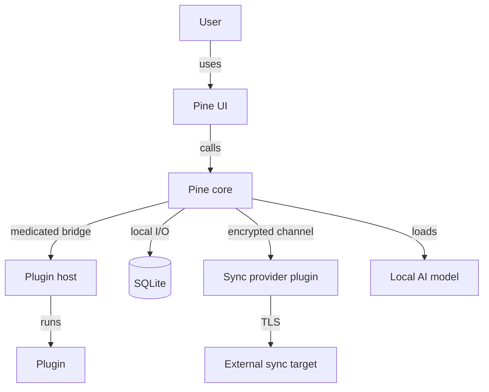
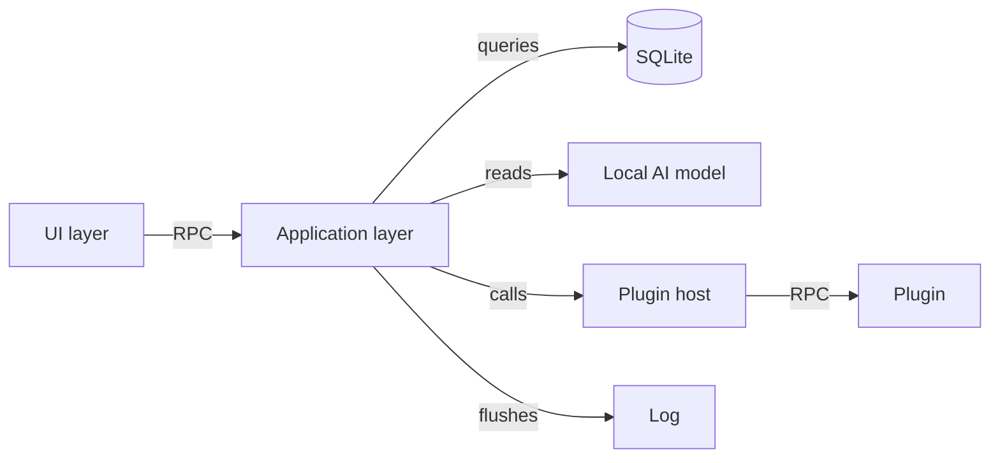
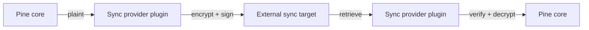
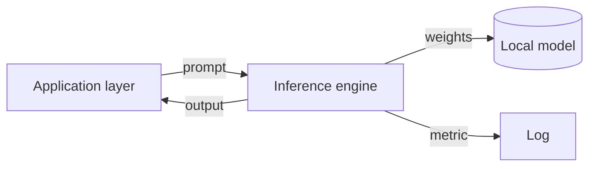

# 38 — Threat Model

| Field            | Value                                                                                |
|------------------|--------------------------------------------------------------------------------------|
| Document ID      | `PINE-DOC-38-THREAT-MODEL`                                                           |
| Status           | Partially implemented — several mitigations are real; the model is not maintained    |
| Reconciled       | 2026-08-31 · At-rest encryption, the Argon2id KDF, the key envelope and the absence of any network egress are implemented and are this document's strongest mitigations. Nothing re-runs the analysis when the architecture changes, and the plugin-trust and sync sections model subsystems that do not exist. |
| Owner            | Engineering Review Board                                                             |
| Created          | 2026-07-08                                                                           |
| Last Updated     | 2026-07-08                                                                           |
| Specification Standard | STRIDE + LINDDUN (privacy)                                                    |
| Glossary         | `PINE-DOC-03-GLOSSARY`                                                               |
| Prerequisites    | `00-Vision`..`37-Code-Review`                                                       |
| Related Documents| `12-Plugin-Architecture`, `13-AI-Architecture`, `14-Synchronization`, `15-Security`, `17-Risk-Analysis`, `26-Diagrams`, `33-Plugin-SDK` |

---

## 1. Purpose

Produce a **working threat model** of Pine: the trust boundaries,
the data flows crossing them, the threats per data flow, the
mitigations, and the residual risk. The threat model is the
*attacker-aware* companion to the architectural documents.

## 2. Scope

In scope: per-subsystem threat enumeration, mitigation cross-
references, residual risk, review cadence.

Out of scope: security controls in detail → `15-Security`;
threats against Pine Cloud (deferred OD-D-3) until Cloud exists;
risk register → `17-Risk-Analysis`.

## 3. Definitions

| Term             | Working definition                                                                                |
|------------------|------------------------------------------------------------------------------------------------------|
| Threat           | A potential cause of an incident.                                                                   |
| Trust boundary   | A line across which the threat model assumes different trust levels.                                |
| DFD              | Data Flow Diagram: nodes, processes, stores, flows.                                                 |
| STRIDE           | Microsoft threat taxonomy (Spoofing, Tampering, Repudiation, Information disclosure, DoS, EoP).       |
| LINDDUN          | Privacy threat taxonomy (Linkability, Identifiability, Non-repudiation, Detectability, Disclosure, Unawareness, Non-compliance). |
| Mitigation       | A control that reduces a threat.                                                                    |
| Residual risk     | The risk that remains after mitigations are applied.                                                |
| Data element      | A field or content unit crossing a trust boundary.                                                  |

> **Assumption TM-A-1.** Pine's threat model is *open*.
> The threat model is published at major milestones so the
> community can audit the assumptions.

## 4. Trust Boundaries

Pine recognises three primary trust boundaries:

| Boundary          | Inside                              | Outside                                                   |
|-------------------|---------------------------------------|------------------------------------------------------------|
| TB-1              | User device                          | Foreign processes, OS                                    |
| TB-2              | Pine core / sandbox                  | Plugin runtime                                            |
| TB-3              | Pine core                            | Sync provider (plugin) / external endpoints               |
| TB-4              | Pine core                            | Local AI model artefacts                                  |

### 4.1 Boundary Discipline

- Every cross-boundary channel is *explicit*.
- Every cross-boundary channel is *authenticated* and *authorised*.
- Every cross-boundary channel is *auditable* (logged).

## 5. Data Flow Diagrams (DFD)

The DFDs below focus on the *cross-boundary* flows. Within a
boundary, the model is implicitly less restrictive (single-trust).

### 5.1 Local Application DFD

### 5.2 Sync DFD

### 5.3 AI Inference DFD

## 6. Threat Enumeration

The threats are enumerated per STRIDE per data flow. Each threat
has an identifier `TM-NN`.

### 6.1 Application Layer

| ID    | STRIDE        | Threat                                                                                  | Mitigation                                                                                  | Residual |
|-------|---------------|------------------------------------------------------------------------------------------|----------------------------------------------------------------------------------------------|----------|
| TM-01 | Spoofing      | A malicious process calls into the application surface.                                   | Process boundary; capability ACL; secure inter-process comms.                                | Low      |
| TM-02 | Tampering     | A plugin tampers with the SQLite store.                                                  | Plugin host sandbox; explicit storage permission; signed reads/writes validation.            | Low      |
| TM-03 | Repudiation   | The user denies a transaction occurred.                                                   | Audit log with hash-chained entries (`15-Security` §5).                                       | Low      |
| TM-04 | Info disclosure| A logging path leaks PII.                                                              | PII-free log rules (`30-Observability` §4.3).                                                | Medium   |
| TM-05 | DoS           | A bug causes unbounded memory growth.                                                     | Resource budgets (NFR-PERF-*); watchdog in plugin host.                                      | Low      |
| TM-06 | EoP           | A plugin escalates permission.                                                            | Plugin host mediation; scoped permissions (ADR-0014); risk score.                             | Low      |
| TM-07 | LINDDUN-Ident.| A combination of fields identifies a user in a log or export.                            | Hash-bucket identifiers; raw identifiers never logged; allow/deny list per export.            | Medium   |

### 6.2 Sync Layer

| ID    | STRIDE        | Threat                                                                                  | Mitigation                                                                                  | Residual |
|-------|---------------|------------------------------------------------------------------------------------------|----------------------------------------------------------------------------------------------|----------|
| TM-10 | Info disclosure| A sync provider exfiltrates plaintext.                                                 | Encryption at the *application* layer (ADR-0013); zero-knowledge sync target.                | Low      |
| TM-11 | Tampering     | An attacker tampers with the sync stream.                                                | Signature on every sync delta; replay protection (per ADR-0015).                             | Low      |
| TM-12 | Spoofing      | An attacker spoofs the sync provider.                                                     | Mutual authentication; pinned provider id; capability check.                                | Low      |
| TM-13 | DoS           | Sync target unavailable; client falls back incorrectly.                                   | Backoff; local-first behaviour preserved; user notified.                                    | Medium   |

### 6.3 AI Inference Layer

| ID    | STRIDE        | Threat                                                                                  | Mitigation                                                                                  | Residual |
|-------|---------------|------------------------------------------------------------------------------------------|----------------------------------------------------------------------------------------------|----------|
| TM-20 | Tampering     | A malicious model artefact is loaded.                                                    | Signed artefacts; verify before load; allow-list.                                            | Low      |
| TM-21 | Info disclosure| Inference leaks user data to a remote endpoint.                                        | Local inference only (default); no paid third-party AI (Vision §10).                          | Low      |
| TM-22 | EoP           | A model produces output that is treated as authoritative.                                | Explanation layer; rule engine fallback; user confirmation required for destructive actions.  | Medium   |
| TM-23 | Misclass.     | The model is wrong in a way that violates user trust.                                    | Public evaluation card; correction loop; category confidence surfaced.                       | Medium   |

### 6.4 Plugin Layer

| ID    | STRIDE        | Threat                                                                                  | Mitigation                                                                                  | Residual |
|-------|---------------|------------------------------------------------------------------------------------------|----------------------------------------------------------------------------------------------|----------|
| TM-30 | EoP           | A plugin attempts to escalate.                                                            | Sandbox; per-permission grants; signed manifest; trust team review (ADR-0014).                | Medium   |
| TM-31 | Tampering     | A plugin modifies data outside its scope.                                                | Permission scope; cross-account blocked unless explicit.                                     | Low      |
| TM-32 | DoS           | A plugin wedges the host.                                                                 | Watchdog; per-plugin CPU budget; per-plugin storage budget.                                  | Low      |
| TM-33 | Info disclosure| A plugin reads data outside its scope.                                                  | Mediation; field scoping; redaction list.                                                    | Medium   |
| TM-34 | Repudiation   | A plugin denies an action.                                                                | Audit log captures plugin id and action.                                                     | Low      |

### 6.5 Local Storage

| ID    | STRIDE        | Threat                                                                                  | Mitigation                                                                                  | Residual |
|-------|---------------|------------------------------------------------------------------------------------------|----------------------------------------------------------------------------------------------|----------|
| TM-40 | Tampering     | Local SQLite is tampered with by malware.                                                | Encryption at rest (ADR-0013); integrity check at startup.                                  | Low      |
| TM-41 | Info disclosure| A backup of the local store leaks.                                                      | Encrypted backups; secret in user keychain; opt-in to portable archive (`14-Synchronization`). | Medium   |

## 7. Privacy Threats (LINDDUN)

| ID      | LINDDUN         | Threat                                                                                  | Mitigation                                                                                  |
|---------|-----------------|------------------------------------------------------------------------------------------|----------------------------------------------------------------------------------------------|
| TM-50   | Linkability     | Two anonymised events in the corpus link back to a user.                                  | Aggregation thresholds; k-anonymity.                                                         |
| TM-51   | Identifiability | Re-identification via a combination of fields.                                             | Field scoping; PII-free logging; differential privacy test where used.                       |
| TM-52   | Non-repudiation | The system can prove a user did something, when it shouldn't.                             | Audit log minimal exposure; user-visible audit; opt-out of audit by 3rd parties.             |
| TM-53   | Detectability   | The presence of a data subject is detectable.                                              | In-band identifiers bounded; out-of-band encryption; hash-anonymised defaults.              |
| TM-54   | Disclosure      | Data leaves the device without consent.                                                   | Default-off telemetry (ADR-0012); explicit consent flows.                                   |
| TM-55   | Unawareness     | The user does not know data has flowed.                                                  | DIB; diagnostic panel; notification on each upload.                                         |
| TM-56   | Non-compliance  | The product violates law (e.g. GDPR, CCPA).                                              | Legal review per region; documented consent; data export and deletion.                       |

## 8. Mitigation Cross-Reference

| Mitigation                                          | ADR / doc reference                                |
|------------------------------------------------------|----------------------------------------------------|
| Encryption at rest                                   | ADR-0013, `15-Security`                            |
| Plugin manifest signing                              | ADR-0014                                           |
| Domain-aware sync merge                              | ADR-0015                                           |
| Telemetry opt-in                                     | ADR-0012, `30-Observability`                       |
| Cloud-only encrypted local cache                     | ADR-0016                                           |
| Plugin sandbox                                       | `12-Plugin-Architecture` §7                        |
| Audit log                                             | `15-Security` §5                                   |
| DIB                                                   | `30-Observability` §9                              |
| Rule engine fallback                                 | `31-Rule-Engine`                                   |

## 9. Residual Risk Posture

The residual risk is *low–medium* with two areas of *medium*
residual risk: AI categorisation confidence (TM-22 / TM-23) and
plugin trust (TM-30 / TM-33).

### 9.1 Improvement Targets

- Reduce AI confidence residuals via better evaluation and an
  explanation layer.
- Reduce plugin trust residuals via deeper sandboxing (advanced:
  process isolation) and quicker revocation.

## 10. Threat Model Review Cadence

- The threat model is reviewed at every minor release.
- The threat model is updated when a new subsystem ships.
- The threat model is updated when a new external dependency ships.
- The threat model is published in the docs at v1.0.

## 11. Cross-Cutting Constraints

- A mitigation that addresses a Threat MUST cite an ADR or doc
  section.
- A residual risk is *owned* by the Engineering Review Board.
- A new subsystem MUST add a DFD and a STRIDE+LINDDUN enumeration
  before merge.

## 12. Deferred Decisions

| ID        | Decision                                                                                  | Owning document(s)         |
|-----------|-------------------------------------------------------------------------------------------|----------------------------|
| TM-D-1    | Whether to publish the threat model earlier than v1.0.                                      | `38-Threat-Model` (next rev.) |
| TM-D-2    | Process-isolation strength for plugin host (current: sandboxed CLR; advanced: per-plugin process). | `12-Plugin-Architecture` (next rev.) |
| TM-D-3    | Differential privacy budget for the corpus.                                                  | `32-AI-Training`           |

## 13. Quality Checklist

- [x] Trust boundaries, DFDs, threats per subsystem, mitigation
      cross-references, residual risk, review cadence are all
      present.
- [x] STRIDE + LINDDUN used.
- [x] No TODO placeholders.
- [x] No contradiction with `00-Vision`..`37-Code-Review`.

## 14. Revision History

| Version | Date       | Author                | Change                                                       |
|---------|------------|-----------------------|--------------------------------------------------------------|
| 0.1     | 2026-07-08 | Engineering Review Board | Initial threat model document.                               |
