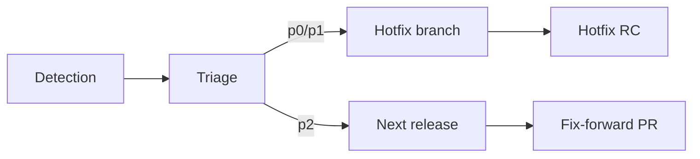

# 39 — Performance

| Field            | Value                                                                                |
|------------------|--------------------------------------------------------------------------------------|
| Document ID      | `PINE-DOC-39-PERFORMANCE`                                                             |
| Status           | Aspirational — no performance measurement exists                                     |
| Reconciled       | 2026-09-07 · **`tests/Pine.Tests.Performance` no longer exists** — iteration 27 deleted it (TD-38). It had held a single empty `UnitTest1.Test1()` from the `dotnet new xunit` template, asserting nothing; CI compiled it and deliberately refused to run it, because running it would have put a green tick under a heading that measured nothing. A project that must be excluded from the thing it is named after is carrying a promise, not a test, and the promise belongs here rather than in the build. Still documents `pine perf bench` (:184), which the CLI does not implement. **No performance measurement was lost, because there was none.** |
| Owner            | Engineering Review Board                                                             |
| Created          | 2026-07-08                                                                           |
| Last Updated     | 2026-07-08                                                                           |
| Specification Standard | Internal (performance practice)                                              |
| Glossary         | `PINE-DOC-03-GLOSSARY`                                                               |
| Prerequisites    | `00-Vision`..`38-Threat-Model`                                                       |
| Related Documents| `08-NonFunctional-Requirements`, `13-AI-Architecture`, `29-Deployment`, `30-Observability` |

---

## 1. Purpose

Define Pine's performance *practice*: budgets, measurement,
regression handling, and the relationship to the SLOs. Performance
is a *feature*, not a side-effect.

## 2. Scope

In scope: budgets per platform, measurement methodology,
regression handling, instrumentation, profile-aware profiles.

Out of scope: SLO thresholds in detail → `08-NonFunctional-
Requirements` §11; AI inference posture → `13-AI-Architecture`;
deployment signals → `29-Deployment` §11.

## 3. Definitions

| Term             | Working definition                                                                                |
|------------------|------------------------------------------------------------------------------------------------------|
| Budget           | A maximum allowed value for a metric.                                                              |
| Frame budget     | The wall-clock time allowed per logical frame at 60 FPS (16.6 ms).                                   |
| Cold start       | The first launch after install or upgrade.                                                          |
| Warm start       | A subsequent launch with a cached profile.                                                          |
| p95              | 95th percentile.                                                                                    |
| p99              | 99th percentile.                                                                                    |
| Regression       | A measurable degradation versus a baseline.                                                         |
| Baseline         | A reference build against which regressions are measured.                                          |

> **Assumption PERF-A-1.** Performance is measured on
> representative hardware per `08-NonFunctional-Requirements` §10.
> Hardware tiers are listed below.

## 4. Hardware Tiers

| Tier     | Description                                                              | Use                                  |
|----------|--------------------------------------------------------------------------|---------------------------------------|
| Tier 1   | Latest MacBook Air M-series; Surface Pro 11; Pixel 9; iPhone 16          | Best-case targets                     |
| Tier 2   | Mid-range laptops, mid-range phones (mid-tier Android, iPhone 13)        | Typical user targets                  |
| Tier 3   | Older devices (5+ years), low-end Android                                 | Minimum acceptable                    |

Per-platform targets are *tier-2* unless otherwise specified.

## 5. Frame Budget

The frame budget is 16.6 ms at 60 FPS. The frame budget *must*
include:

- Layout.
- Rendering.
- Script (UI logic).
- Plugin UI runs on the same budget per `33-Plugin-SDK`.

### 5.1 Frame Budget Allocation

| Subsystem                  | Budget (ms) per frame                                   |
|----------------------------|----------------------------------------------------------|
| Input                       | 1                                                       |
| Layout                      | 4                                                       |
| Rendering                   | 6                                                       |
| Plugin UI                   | 2                                                       |
| Asynchronous read model     | 1                                                       |
| Headroom                    | 2.6                                                     |

## 6. Startup Budget

### 6.1 Cold Start

| Metric                                | Budget (ms)                                            |
|---------------------------------------|----------------------------------------------------------|
| Process launch                        | 800                                                     |
| Profile open (encrypted vault unlock) | 600                                                     |
| Dashboard first paint                 | 1500                                                    |
| Dashboard interactive                 | 2500                                                    |
| Total cold start (Tier 2)             | 3000                                                    |

### 6.2 Warm Start

| Metric                                | Budget (ms)                                            |
|---------------------------------------|----------------------------------------------------------|
| Total warm start                       | 800                                                    |

## 7. Memory Budget

### 7.1 Per Platform

| Platform        | Budget (working set, MB)                                  |
|-----------------|------------------------------------------------------------|
| iOS              | 200                                                       |
| macOS            | 400                                                       |
| Android          | 250                                                       |
| Windows          | 400                                                       |
| Linux            | 350                                                       |
| Web (PWA tab)     | 200                                                       |

The working-set budget *excludes* AI model weight memory; model
weight budgets are in §10.

### 7.2 Memory Discipline

- The SQLite cache size is bounded.
- AI inferences stream where possible; memory-heavy pipelines use
  disk-backed scratch.
- Long-lived object allocations are tracked in the
  performance suite.

## 8. Storage Budget

| Element                              | Budget                                          |
|--------------------------------------|--------------------------------------------------|
| SQLite database file                 | 250 MB default cap (configurable per user)       |
| AI model artefact                    | 750 MB default cap                               |
| Log files                            | 500 MB                                           |
| Plugin cache                         | 100 MB per plugin                                |
| Diagnostic bundle                    | 50 MB                                            |

## 9. Sync and Network Budget

| Operation                              | Budget                                          |
|----------------------------------------|--------------------------------------------------|
| Encrypted sync delta (per sync run)    | ≤ 25% of last sync delta, p95                      |
| Sync run duration (50k tx)             | ≤ 60 s, p95                                      |
| Sync retry backoff                     | exponential, max 10 min                           |
| Network re-connection                  | within 30 s of WAN restoration                   |

## 10. AI Inference Budget

| Metric                                 | Budget                                          |
|----------------------------------------|--------------------------------------------------|
| Categorisation latency                 | ≤ 50 ms, p95 (Tier 2)                            |
| Explanation layer latency              | ≤ 150 ms, p95                                     |
| Batch import categorisation            | ≤ 500 tx / min (Tier 2)                          |
| Model weight memory                     | ≤ 200 MB (default), ≤ 1.5 GB (extended)         |
| Local fine-tune memory                  | ≤ 2 GB                                          |

A user may pick the *extended* model tier explicitly; the default
is the small tier.

## 11. Battery Budget

| Element                                                  | Budget                                  |
|----------------------------------------------------------|------------------------------------------|
| Active session battery use (mobile)                      | ≤ 6% per hour                            |
| Background sync battery use                              | ≤ 0.5% per hour when idle                |
| AI inference during sync import                          | ≤ 2% per 1000 transactions               |

## 12. Performance Measurement

### 12.1 Performance Suite

- A nightly performance suite runs on Tier 2 emulated hardware.
- The suite covers:
  - Cold start (auto).
  - Frame budgets (UI walkthroughs).
  - Memory working set (1-hour idle + 1-hour active).
  - Sync run latency (synthetic).
  - Import latency (synthetic 50k transactions).
  - AI inference latency (synthetic prompts).

### 12.2 Benchmark Replay

- Benchmark replays use *recorded* traces; they are reproducible
  bit-for-bit from the manifest.
- A regression > 10% over the baseline blocks the next release
  (per `28-CI-CD` §7.4).

### 12.3 Profile-Aware Profiles

- `pine perf bench start` — runs a baseline benchmark on the local
  machine.
- `pine perf bench compare` — compares against a tagged build.
- `pine perf bench report` — produces a Markdown report for a PR.

## 13. Regression Handling

### 13.1 Triage

- Triage categorises the regression (p0/p1/p2/p3).
- Triage publishes a *performance note* in the changelog.

### 13.2 Fix

- The fix may be in:
  - Algorithm (e.g. caching).
  - Data model (e.g. denormalisation).
  - UI layout (e.g. layout-off-main-thread).
  - Plugin surface (e.g. plugin API bound tightening).
- A fix MUST be measured and recorded in the ADR trail.

## 14. Performance Instrumentation

- The application surfaces p95 / p99 values for hot paths in the
  Diagnostics panel (per `30-Observability` §8).
- A developer may opt into a deeper *profile* mode.
- Profiling data is opt-in to send via DIB (§9.4).

## 15. Cross-Cutting Constraints

- A PR that adds a hot path MUST include a performance test.
- A PR that touches a budgeted subsystem MUST run the relevant
  perf gate in CI.
- A change that *regresses* a budget MUST be a blocker.
- A new subsystem MUST declare its budgets.

## 16. Deferred Decisions

| ID        | Decision                                                                                  | Owning document(s)         |
|-----------|-------------------------------------------------------------------------------------------|----------------------------|
| PERF-D-1  | Battery budget per platform (e.g. iPad vs. iPhone).                                        | `39-Performance` (next rev.) |
| PERF-D-2  | Tool for mobile frame measurement (e.g. Perfetto, Xcode Instruments).                      | `39-Performance` (next rev.) |
| PERF-D-3  | GPU usage budget (relevant for charts).                                                     | `39-Performance` (next rev.) |

## 17. Quality Checklist

- [x] Hardware tiers, frame budget, startup, memory, storage,
      sync, AI inference, battery, measurement, regression,
      instrumentation are all present.
- [x] Replay suite ensures reproducibility.
- [x] No TODO placeholders.
- [x] No contradiction with `00-Vision`..`38-Threat-Model`.

## 18. Revision History

| Version | Date       | Author                | Change                                                       |
|---------|------------|-----------------------|--------------------------------------------------------------|
| 0.1     | 2026-07-08 | Engineering Review Board | Initial performance document.                                |
