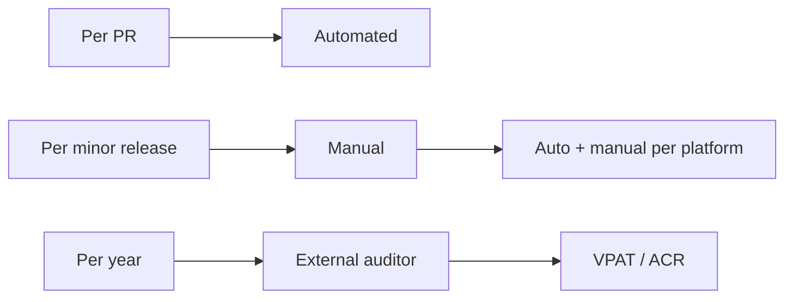

# 40 — Accessibility

| Field            | Value                                                                                |
|------------------|--------------------------------------------------------------------------------------|
| Document ID      | `PINE-DOC-40-ACCESSIBILITY`                                                          |
| Status           | Aspirational — no accessibility verification exists                                  |
| Reconciled       | 2026-09-07 · **`tests/Pine.Tests.Accessibility` no longer exists** — iteration 27 deleted it (TD-38), for the reason given in `39-Performance`: it held one empty template test, was compiled and never run, and named a kind of verification it did not perform. There is still no axe, no automated audit and no manual pass on record; that was true before the deletion and is unchanged by it. **No accessibility coverage was lost, because there was none.** |
| Owner            | Engineering Review Board                                                             |
| Created          | 2026-07-08                                                                           |
| Last Updated     | 2026-07-08                                                                           |
| Specification Standard | WCAG 2.2 Level AA                                          |
| Glossary         | `PINE-DOC-03-GLOSSARY`                                                               |
| Prerequisites    | `00-Vision`..`39-Performance`                                                        |
| Related Documents| `08-NonFunctional-Requirements`, `20-Coding-Standards`, `41-Localization`, `42-UX-Guidelines` |

---

## 1. Purpose

Define Pine's accessibility *practice*: the conformance target
(WCAG 2.2 AA), the platform-specific considerations, the design
tokens, the test discipline, the audit cadence, and the
publication of conformance evidence.

## 2. Scope

In scope: WCAG 2.2 AA target, visual design tokens, keyboard,
screen-reader, voice control, motion, captions, audio, focus
management, automations, manual audits, reporting, plugins.

Out of scope: visual design tokens themselves (lives in the design
system); localisation of accessibility strings → `41-Localization`;
general UX guidelines → `42-UX-Guidelines`.

## 3. Definitions

| Term             | Working definition                                                                                |
|------------------|------------------------------------------------------------------------------------------------------|
| WCAG             | Web Content Accessibility Guidelines (W3C, 2.2).                                                    |
| Conformance      | The degree to which a product meets a standard.                                                     |
| AT               | Assistive Technology (e.g. screen reader, switch control, voice control).                           |
| SR               | Screen reader.                                                                                       |
| Focus order      | The order in which interactive elements receive keyboard focus.                                      |
| Visible focus    | A clearly perceivable style indicating the currently-focused element.                                |
| Contrast         | The ratio of luminance between foreground and background colours.                                    |
| Motion           | Animation or movement.                                                                               |
| Cognitive load   | The mental effort required to use a UI.                                                              |

> **Assumption A11Y-A-1.** Pine targets WCAG 2.2 AA *throughout*
> the first-party UI. Plugins are encouraged but not required to
> meet the same bar; the marketplace gates the install experience
> to first-party-conformant plugins.

## 4. Conformance Targets

Pine targets **WCAG 2.2 Level AA** across:

- Web platform.
- Desktop (Windows, macOS, Linux).
- iOS, iPadOS.
- Android.

The conformance is verified per platform by automated and manual
audit (per §10).

### 4.1 Non-Goals

- AAA conformance is out of scope in the first-party UI.
- Plugin UI conformance is encouraged but not enforced (the plugin
  shows an accessibility badge when self-declared).

## 5. Platform Mapping

WCAG applies most directly to web. Pine maps the principles to
each platform:

| WCAG principle   | Web                  | iOS / Android           | Desktop                |
|-------------------|----------------------|--------------------------|------------------------|
| Perceivable       | HTML semantics       | AccessibilityKit / TalkBack | UIA / MSAA / AT-SPI  |
| Operable          | Keyboard, pointer   | VoiceOver / Switch Control | Keyboard, narrator    |
| Understandable    | Consistent UI        | Dynamic type             | Tooltips, hotkeys     |
| Robust            | ARIA live regions   | Native a11y APIs          | Native a11y APIs      |

## 6. Design Tokens for Accessibility

### 6.1 Contrast

| Use case                       | Minimum ratio                                       |
|--------------------------------|------------------------------------------------------|
| Body text                      | 4.5:1                                               |
| Large text (≥ 18pt or ≥ 14pt bold) | 3:1                                              |
| Non-text UI components          | 3:1                                                |
| Active focus indicator          | ≥ 3:1 against both background and adjacent colours  |

The tokens publish light and dark palettes with validated contrast
ratios.

### 6.2 Sizing

| Use case                       | Minimum                                            |
|--------------------------------|-----------------------------------------------------|
| Tap target                     | 44 × 44 px (mobile), 24 × 24 px (desktop dense UI)  |
| Text body                      | 16 px default; user-settable in 1-px steps          |
| Spacing between paragraphs     | ≥ 1.5 line height                                  |

### 6.3 Motion

- Motion is decorative.
- Motion can be reduced via `prefers-reduced-motion`.
- Critical motion (e.g. error highlighting) is paired with a non-
  motion indicator.

### 6.4 Colour Independence

- Colour is never the only carrier of meaning.
- Charts include labels, patterns, and tooltips.

## 7. Keyboard

### 7.1 First-class

- Every interactive element is reachable by keyboard.
- The visible focus ring is mandatory.
- Focus order is logical and stable.
- The user can escape any popover with `Esc`.

### 7.2 Shortcuts

- Shortcuts are documented.
- Shortcuts are re-bindable.
- Shortcuts do not conflict with platform conventions.

### 7.3 Skip Links

- A skip-to-content link is the first focusable element.
- The skip link is visible on focus.

## 8. Screen Reader

### 8.1 Semantics

- The UI exposes semantic roles, names, states.
- Decorative elements are hidden from AT.

### 8.2 Live Regions

- Status updates use ARIA live regions (or platform equivalents).
- Timeouts are announced.

### 8.3 Forms

- Every input has a visible label.
- Errors are announced and tied to the input via `aria-describedby`.

## 9. Voice Control

### 8.x Voice Control Coverage

- Every interactive element has a *visible* label that matches a
  user-spoken command.
- Voice control commands are tested with Voice Control (macOS /
  iOS), Voice Access (Android), and Dragon (where applicable).

## 10. Testing Discipline

### 10.1 Automated

- axe-core (or platform equivalent) on every UI PR.
- Automated tests check: contrast, naming, focus visibility, ARIA
  validity, keyboard tab order.

### 10.2 Manual

- Manual audits per platform per release.
- Manual audits cover:
  - Keyboard-only walkthrough.
  - Screen-reader walkthrough (VoiceOver, NVDA, TalkBack).
  - Voice control walkthrough.
  - Reduced-motion walkthrough.

### 10.3 User Testing

- Quarterly user tests with assistive-technology users (per
  `04-Stakeholders` §6).
- Findings are recorded as P0/P1/P2 issues.

## 11. Audit Cadence

### 11.1 Public Evidence

- A public WCAG conformance page is published per major release.
- An ACR / VPAT document is published at v1.0 and updated at major
  releases.
- The public page lists *known* gaps with target dates.

## 12. Motion, Audio, and Captions

### 12.1 Motion

- Critical motion is paired with a non-motion indicator.
- Auto-playing motion is reduced via `prefers-reduced-motion`.
- Motion does not contain essential information.

### 12.2 Audio

- Audio cues are short and not essential.
- Audio is captioned or has a visual cue.

## 13. Plugin Accessibility

- Plugins MAY self-declare conformance.
- The marketplace shows the self-declared conformance badge.
- A plugin UI lacking a label is a marketplace warning.
- Plugin conformance enforcement is *advisory* not *blocking*
  (the host is conformant).

## 14. Reporting and Feedback

- An `a11y@pine` mailbox.
- An in-app "Accessibility issue" entry point in the Diagnostics
  panel.
- An issue tracker label `a11y`.
- An issue tracker label `severity/p0` for blocker violations.

## 15. Cross-Cutting Constraints

- A UI PR MUST pass the automated tests.
- A UI release MUST have a manual audit record.
- A *new* UI capability MUST have accessibility tokens defined.
- A *new* motion MUST be paired with a non-motion indicator.

## 16. Deferred Decisions

| ID        | Decision                                                                                  | Owning document(s)         |
|-----------|-------------------------------------------------------------------------------------------|----------------------------|
| A11Y-D-1  | Reduced-motion granularity (per app / per user).                                            | `40-Accessibility` (next rev.) |
| A11Y-D-2  | Public VPAT vendor (issuance, hosting).                                                    | `40-Accessibility` (next rev.) |
| A11Y-D-3  | Voice control test inclusion in CI.                                                         | `28-CI-CD`                 |
| A11Y-D-4  | Colour-blind palette options beyond the default.                                            | `42-UX-Guidelines`         |

## 17. Quality Checklist

- [x] Conformance target, platform mapping, tokens, keyboard,
      screen reader, voice, motion, audio, testing, audit cadence,
      plugin posture, reporting are all present.
- [x] WCAG 2.2 AA target named.
- [x] No TODO placeholders.
- [x] No contradiction with `00-Vision`..`39-Performance`.

## 18. Revision History

| Version | Date       | Author                | Change                                                       |
|---------|------------|-----------------------|--------------------------------------------------------------|
| 0.1     | 2026-07-08 | Engineering Review Board | Initial accessibility document.                              |
