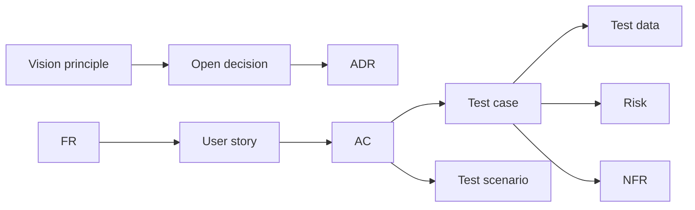

# 43 — Testing Artifacts

| Field            | Value                                                                                |
|------------------|--------------------------------------------------------------------------------------|
| Document ID      | `PINE-DOC-43-TESTING-ARTIFACTS`                                                       |
| Status           | Aspirational — the artefact workflow is not in use                                   |
| Reconciled       | 2026-08-31 · The `docs/49-test-cases/`, `docs/50-test-scenarios/` and `docs/51-test-data/` trees it specifies do not exist. Note also that its `TD-NNNN` identifier for Test Data (:63) collides with the audit's `TD-NN` technical-debt ids. |
| Owner            | Engineering Review Board                                                             |
| Created          | 2026-07-08                                                                           |
| Last Updated     | 2026-07-08                                                                           |
| Specification Standard | ISTQB + IEEE 29148 (testing practice)                                          |
| Glossary         | `PINE-DOC-03-GLOSSARY`                                                               |
| Prerequisites    | `00-Vision`..`42-UX-Guidelines`                                                      |
| Related Documents| `18-Test-Strategy`, `19-Traceability-Matrix`, `44-Backlog`, `47-User-Stories`, `48-Acceptance-Criteria`, `49-Test-Cases`, `50-Test-Scenarios`, `51-Test-Data` |

---

## 1. Purpose

Define the *artefacts* of testing: the user stories, acceptance
criteria, test cases, test scenarios, test data, and the rules
that bind them. This is the *operational* counterpart to the
test strategy (`18-Test-Strategy`) and the traceability matrix
(`19-Traceability-Matrix`).

## 2. Scope

In scope: artefact taxonomy, naming, content, traceability,
quality bar, ownership, and tooling.

Out of scope: detailed test strategy → `18-Test-Strategy`;
traceability matrix → `19-Traceability-Matrix`; backlog →
`44-Backlog`; coding standards → `20-Coding-Standards`.

## 3. Definitions

| Term             | Working definition                                                                                |
|------------------|------------------------------------------------------------------------------------------------------|
| User story       | A short, persona-led description of a unit of value.                                                |
| Acceptance criterion | A binary test of whether a user story is satisfied.                                             |
| Test case        | A single, low-level check with input, action, and expected result.                                  |
| Test scenario    | A higher-level grouping of test cases that exercises a path or capability.                          |
| Test data        | The fixtures and synthetic inputs used to drive a test.                                              |
| Test harness     | The framework that runs a test (per language/platform).                                             |
| Test pyramid     | The mix of unit, integration, end-to-end, and manual tests.                                          |
| Coverage         | The fraction of source exercised by a test suite.                                                   |
| Mutation score   | The fraction of mutants killed by a test suite.                                                     |
| Acceptance gate  | The set of criteria a user story MUST pass to be accepted.                                          |

> **Assumption TA-A-1.** Testing artefacts are *engineering
> artefacts*, not afterthoughts. They live in the repo and evolve
> with the code.

## 4. Artefact Taxonomy

Pine uses five test artefact types:

| Artefact         | Granularity      | Lives in        | Owner        | Path                                            |
|------------------|-------------------|------------------|---------------|--------------------------------------------------|
| User story       | Coarse            | `47-User-Stories` | Product       | `docs/47-user-stories/US-NNNN-slug.md`           |
| Acceptance criterion | Per user story | `48-Acceptance-Criteria` | QA + Engineering | `docs/48-acceptance-criteria/AC-NNNN-slug.md`   |
| Test case        | Per behaviour unit | `49-Test-Cases`   | QA + Engineering | `docs/49-test-cases/TC-NNNN-slug.md`             |
| Test scenario    | Per capability path | `50-Test-Scenarios` | QA          | `docs/50-test-scenarios/TS-NNNN-slug.md`         |
| Test data        | Per dataset        | `51-Test-Data`    | QA          | `docs/51-test-data/TD-NNNN-slug.md`              |

## 5. User Story

### 5.1 Format

```markdown
# US-NNNN — Short Title

| Field         | Value                                                      |
|---------------|-------------------------------------------------------------|
| User story    | As a \<persona\>, I want \<capability\>, so that \<outcome\>. |
| Persona       | PERS-NN                                                      |
| Epic          | EPIC-NN                                                      |
| Feature       | FEAT-NN                                                      |
| Priority      | P0 / P1 / P2 / P3                                            |
| Status        | Draft / Ready / In Progress / Done / Won't Fix              |
| Owner         | Person or team                                               |
| Linked FR     | FR-XXX                                                       |
| Linked NFR    | NFR-XXX                                                      |
| Acceptance criteria | AC-XXXX                                               |
| Test cases    | TC-XXXX                                                      |
| Test scenarios| TS-XXXX                                                      |
| Notes         | Free-form                                                    |
```

### 5.2 Quality Bar

- A user story is *one* unit of value.
- A user story is *testable*.
- A user story is *negotiable* (the team can refine).
- A user story is *small* (estimate fits in a sprint).
- A user story is *independent* of other stories in the same
  epic.

## 6. Acceptance Criterion

### 6.1 Format

```markdown
# AC-NNNN — Short Title

| Field          | Value                                                      |
|----------------|-------------------------------------------------------------|
| User story     | US-NNNN                                                     |
| Given          | A precondition                                              |
| When           | An action                                                   |
| Then           | An observable result                                         |
| FR ref         | FR-XXX                                                      |
| NFR ref        | NFR-XXX                                                     |
| Test cases     | TC-XXXX                                                     |
| Test scenarios | TS-XXXX                                                     |
| Status         | Pending / Pass / Fail / Flaky                               |
```

### 6.2 Quality Bar

- An AC is a *binary* (pass or fail) check.
- An AC has a *single* Then clause per Given/When.
- An AC is *measurable*; the Then is observable.
- An AC is *not* implementation detail.

## 7. Test Case

### 7.1 Format

```markdown
# TC-NNNN — Short Title

| Field           | Value                                                     |
|-----------------|-------------------------------------------------------------|
| AC              | AC-NNNN                                                     |
| Type            | unit / integration / e2e / manual / mutation                |
| Inputs          | Free-form or table                                          |
| Preconditions   | Free-form or table                                          |
| Steps           | 1. ... 2. ...                                              |
| Expected        | Observable                                                 |
| Coverage target | Source path or branch                                       |
| Status          | Active / Skipped / Deprecated                              |
| Author          | Person                                                      |
```

### 7.2 Quality Bar

- A test case is *one* check.
- A test case is *reproducible* (the inputs are explicit).
- A test case is *idempotent* (running it twice yields the same
  result).
- A test case is *isolated* (no leakage from other tests).
- A test case is *named* in line with its function.

## 8. Test Scenario

### 8.1 Format

```markdown
# TS-NNNN — Short Title

| Field           | Value                                                     |
|-----------------|-------------------------------------------------------------|
| Capability      | FR-XXX or capability name                                  |
| Path            | A description of the path covered                          |
| Test cases      | TC-XXXX, TC-XXXX, ...                                      |
| Preconditions   | Free-form                                                  |
| Steps           | 1. ... 2. ...                                              |
| Expected        | Observable                                                 |
| Author          | Person                                                      |
```

### 8.2 Quality Bar

- A scenario is *cohesive* (one path).
- A scenario is *exercising* a real flow (not a single test).
- A scenario is *linked* to test cases.

## 9. Test Data

### 9.1 Format

```markdown
# TD-NNNN — Short Title

| Field           | Value                                                     |
|-----------------|-------------------------------------------------------------|
| Owner           | Person                                                      |
| Profiles        | A list of profiles that use the data                       |
| Anonymisation   | Method                                                     |
| Reproducibility| Commit hash, seed                                          |
| Notes           | Free-form                                                  |
```

### 9.2 Quality Bar

- A test datum is *PII-free* unless explicitly noted (and then
  covered by the security gate).
- A test datum is *reproducible* (the seed is recorded).
- A test datum is *minimal* (only the fields needed for the test
  are present).
- A test datum is *versioned* (TD IDs are stable).

## 10. Traceability



### 10.1 Forward Traceability

- A user story MUST trace to a FR.
- An AC MUST trace to a user story and a FR.
- A test case MUST trace to an AC and (where applicable) an NFR.
- A test scenario MUST trace to a capability and its test cases.
- A test datum MUST trace to the test cases that use it.

### 10.2 Backward Traceability

- An FR MUST have ≥ 1 user story.
- A user story MUST have ≥ 1 AC.
- An AC MUST have ≥ 1 test case.
- A test case MUST trace back to a FR and an NFR.
- A risk (`17-Risk-Analysis`) MUST have ≥ 1 mitigation test case.

### 10.3 Coverage

- The traceability matrix (`19-Traceability-Matrix`) reports
  coverage at the FR, NFR, and risk level.
- A coverage gap is a *P1* issue for the next minor release.

## 11. Quality Bar Across Artefacts

- An artefact is *owned* by a person or team.
- An artefact is *versioned* (file path or ID).
- An artefact is *linkable* (other docs cite its ID).
- An artefact is *stale* if the upstream change is not reflected
  within 30 days.

## 12. Tools

- A CLI in `pine` exposes:
  - `pine test story new` — scaffold a new user story.
  - `pine test ac new` — scaffold an AC.
  - `pine test tc new` — scaffold a test case.
  - `pine test ts new` — scaffold a test scenario.
  - `pine test td new` — scaffold a test datum.
  - `pine test trace` — print the trace chain.
  - `pine test coverage` — print the coverage report.
- The CLI validates the artefact on save.

## 13. Cross-Cutting Constraints

- A user story MUST NOT be merged without acceptance criteria.
- An acceptance criterion MUST NOT be merged without a test case.
- A test case MUST be reproducible.
- A test datum MUST be PII-free unless explicitly approved.

## 14. Deferred Decisions

| ID        | Decision                                                                                  | Owning document(s)         |
|-----------|-------------------------------------------------------------------------------------------|----------------------------|
| TA-D-1    | BDD style for ACs (Given/When/Then vs. plain English).                                     | `43-Testing-Artifacts` (next rev.) |
| TA-D-2    | Test management tool (open vs. managed).                                                  | `43-Testing-Artifacts` (next rev.) |
| TA-D-3    | Whether to mandate a specific mutation tool (per DG-D-4).                                  | `18-Test-Strategy`         |
| TA-D-4    | AC translation strategy.                                                                   | `41-Localization`          |

## 15. Quality Checklist

- [x] Taxonomy, formats, traceability, quality bar, ownership,
      tooling are all present.
- [x] ISTQB / IEEE 29148 referenced.
- [x] No TODO placeholders.
- [x] No contradiction with `00-Vision`..`42-UX-Guidelines`.

## 16. Revision History

| Version | Date       | Author                | Change                                                       |
|---------|------------|-----------------------|--------------------------------------------------------------|
| 0.1     | 2026-07-08 | Engineering Review Board | Initial testing artifacts document.                          |
