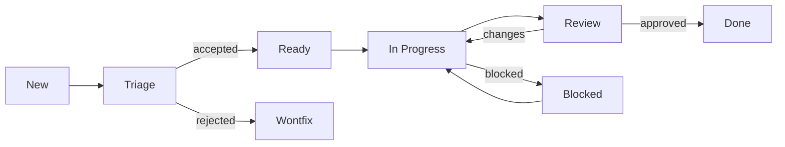

# 44 — Backlog

| Field            | Value                                                                                |
|------------------|--------------------------------------------------------------------------------------|
| Document ID      | `PINE-DOC-44-BACKLOG`                                                                 |
| Status           | Draft — pending review                                                               |
| Owner            | Engineering Review Board                                                             |
| Created          | 2026-07-08                                                                           |
| Last Updated     | 2026-07-08                                                                           |
| Specification Standard | Internal (backlog practice)                                                   |
| Glossary         | `PINE-DOC-03-GLOSSARY`                                                               |
| Prerequisites    | `00-Vision`..`43-Testing-Artifacts`                                                  |
| Related Documents| `17-Risk-Analysis`, `19-Traceability-Matrix`, `22-Release-Plan`, `23-Roadmap`, `45-Epics`, `46-Features`, `47-User-Stories` |

---

## 1. Purpose

Define Pine's backlog: the *single* list of work to be done,
the prioritisation discipline, the estimation, the slicing
heuristic, the cadence, and the relationship to epics, features
and user stories.

## 2. Scope

In scope: backlog item format, status, priority, estimation,
slicing, capacity, cadence, tools.

Out of scope: roadmap → `23-Roadmap`; epics → `45-Epics`;
features → `46-Features`; user stories → `47-User-Stories`;
release mechanics → `22-Release-Plan`.

## 3. Definitions

| Term             | Working definition                                                                                |
|------------------|------------------------------------------------------------------------------------------------------|
| Backlog item     | A unit of work tracked in the backlog.                                                              |
| Story point      | A relative unit of effort.                                                                          |
| Cycle            | A planning period (default: 2 weeks).                                                                |
| Capacity         | The total story points a team can take in a cycle.                                                   |
| Slice            | A small, deliverable increment of a larger item.                                                     |
| WIP              | Work-in-progress.                                                                                    |
| Triage           | The act of evaluating an item for fit, priority, and clarity.                                        |
| Wontfix          | A status indicating an item has been evaluated and will not be implemented.                          |
| Spike            | A time-boxed research item that produces an ADR or a document, not code.                              |

> **Assumption BL-A-1.** A backlog item is *small*. An item that
> cannot fit in a cycle is *split* or *deferred*; an item that
> cannot be split is *re-scoped* or *closed*.

## 4. Backlog Item Format

```markdown
# BL-NNNN — Short Title

| Field          | Value                                                      |
|----------------|-------------------------------------------------------------|
| Type           | feature | bug | chore | spike | doc                        |
| Epic           | EPIC-NN (optional)                                          |
| Feature        | FEAT-NN (optional)                                          |
| Linked FR      | FR-XXX                                                      |
| Priority       | P0 | P1 | P2 | P3                                         |
| Story points   | 1 | 2 | 3 | 5 | 8 | 13 | 21 (Fibonacci)                    |
| Status         | New | Ready | In Progress | Review | Done | Wontfix        |
| Owner          | Person or team                                              |
| Acceptance     | AC-XXXX (≥ 1)                                              |
| Test cases     | TC-XXXX (≥ 1)                                              |
| Notes          | Free-form                                                   |
```

## 5. Status Workflow



## 6. Prioritisation

### 6.1 Priority Tiers

| Priority | Definition                                                                                  |
|----------|-----------------------------------------------------------------------------------------------|
| P0       | Critical. Bug, security, or roadmap blocker. Ship ASAP.                                       |
| P1       | High. Roadmap item in the current minor.                                                       |
| P2       | Medium. Roadmap item in the current major.                                                     |
| P3       | Low. Roadmap item in a future major or aspirational.                                          |

### 6.2 Inputs to Prioritisation

- Vision principles (`00-Vision` §3).
- Open decisions (`00-Vision` §13).
- Roadmap windows (`23-Roadmap` §5).
- Risk register (`17-Risk-Analysis`).
- User demand (per support themes and issue tracker volume).
- Engineering capacity.

### 6.3 Tie-Breakers

- A security-related item beats a feature.
- A bug beats a feature.
- A privacy-related item beats a usability item.
- A accessibility-related item beats a styling item.

## 7. Estimation

- Estimation uses **story points** on a Fibonacci scale
  (1, 2, 3, 5, 8, 13, 21).
- An item sized > 13 MUST be split.
- An item sized > 21 is a defect in the slicing.

### 7.1 Slicing Heuristic

A large item is split by:

- Capability (the *thin slice* of a feature).
- Persona (different personas have different paths).
- Edge case (handle a narrow edge case first).
- Platform (one platform first).
- State (one state at a time).

The chosen slice MUST be valuable on its own.

## 8. Capacity

- Capacity is published per team per cycle.
- Capacity is the *sum* of story points, not the *head count*.
- Capacity is reviewed weekly; deviations are tracked.

### 8.1 WIP Discipline

- WIP per person is bounded.
- WIP per team is bounded.
- A blocked item MUST have a *blocker reason* field.

## 9. Cadence

| Event                  | Cadence                                                          |
|------------------------|------------------------------------------------------------------|
| Triage                  | Daily, ≤ 30 min                                                  |
| Cycle planning          | Every 2 weeks                                                    |
| Cycle review            | End of cycle                                                      |
| Cycle retro             | End of cycle                                                      |
| Roadmap review          | Per minor release (`22-Release-Plan`)                            |
| Backlog grooming        | Mid-cycle                                                          |

## 10. Slicing Examples

### 10.1 Large Item: "Pine Cloud"

A large item like "Pine Cloud" is sliced into:

- Cloud account creation (v1.0).
- Cloud-key escrow.
- Cloud syncing.
- Cloud-side model storage.
- Cloud-side rules.
- Cloud analytics.

Each slice is a separate backlog item with its own priority and
size.

### 10.2 Large Item: "AI categorisation"

Sliced into:

- Default categoriser (v1.0).
- Recurring detection.
- Confidence display.
- Correction loop.
- Local fine-tune.
- Cloud-side fine-tune (deferred).

## 11. Backlog Hygiene

- A stale item is closed after 90 days without activity.
- A wontfix item is recorded with a reason.
- A done item is archived after 30 days.

## 12. Tools

- The issue tracker is the source of truth.
- The CLI `pine backlog list` prints the queue.
- The CLI `pine backlog triage` opens the triage view.
- The CLI `pine backlog stats` prints the cycle stats.

## 13. Cross-Cutting Constraints

- A backlog item MUST be linked to an FR.
- A backlog item MUST have a status and a priority.
- A backlog item MUST have an owner or be unowned (in which case
  the team owns it).
- A backlog item MUST have ≥ 1 AC and ≥ 1 TC.

## 14. Deferred Decisions

| ID        | Decision                                                                                  | Owning document(s)         |
|-----------|-------------------------------------------------------------------------------------------|----------------------------|
| BL-D-1    | Whether to use a non-Fibonacci scale (e.g. t-shirt sizes).                                  | `44-Backlog` (next rev.)   |
| BL-D-2    | Whether to publish the public backlog.                                                       | `44-Backlog` (next rev.)   |
| BL-D-3    | Whether to allow external contribution to backlog.                                           | `24-Contributing`          |

## 15. Quality Checklist

- [x] Format, status, prioritisation, estimation, slicing,
      capacity, cadence, hygiene, tools are all present.
- [x] No TODO placeholders.
- [x] No contradiction with `00-Vision`..`43-Testing-Artifacts`.

## 16. Revision History

| Version | Date       | Author                | Change                                                       |
|---------|------------|-----------------------|--------------------------------------------------------------|
| 0.1     | 2026-07-08 | Engineering Review Board | Initial backlog document.                                    |
