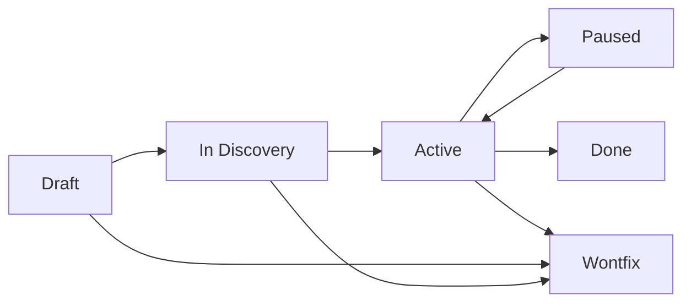

# 45 — Epics

| Field            | Value                                                                                |
|------------------|--------------------------------------------------------------------------------------|
| Document ID      | `PINE-DOC-45-EPICS`                                                                   |
| Status           | Draft — pending review                                                               |
| Owner            | Engineering Review Board                                                             |
| Created          | 2026-07-08                                                                           |
| Last Updated     | 2026-07-08                                                                           |
| Specification Standard | Internal (epic practice)                                                     |
| Glossary         | `PINE-DOC-03-GLOSSARY`                                                               |
| Prerequisites    | `00-Vision`..`44-Backlog`                                                            |
| Related Documents| `17-Risk-Analysis`, `23-Roadmap`, `44-Backlog`, `46-Features`, `47-User-Stories` |

---

## 1. Purpose

Define what an *epic* is in Pine, the format, the lifecycle, the
relationship to features and user stories, and the discipline of
epic decomposition.

## 2. Scope

In scope: epic definition, format, lifecycle, decomposition,
status, capacity, governance.

Out of scope: roadmap → `23-Roadmap`; features → `46-Features`;
user stories → `47-User-Stories`; backlog → `44-Backlog`.

## 3. Definitions

| Term             | Working definition                                                                                |
|------------------|------------------------------------------------------------------------------------------------------|
| Epic             | A coarse-grained container of related features that delivers a strategic outcome.                   |
| Feature          | A fine-grained capability that lives inside an epic.                                                  |
| Theme            | A communication-level grouping of capabilities (per `23-Roadmap`); not the same as an epic.          |
| Decompose        | The act of breaking an epic into features.                                                          |
| Owner            | The person or team accountable for the epic.                                                          |
| Sponsor          | The person or team accountable for the strategic value of the epic.                                  |

> **Assumption EP-A-1.** An epic is a *communication* artefact as
> much as a planning artefact. An epic is the level at which
> stakeholders align on value.

## 4. Epic Format

```markdown
# EPIC-NN — Short Title

| Field          | Value                                                      |
|----------------|-------------------------------------------------------------|
| Type           | product | infrastructure | compliance | research          |
| Sponsor        | Person or team                                              |
| Owner          | Person or team                                              |
| Linked FR      | FR-XXX                                                      |
| Linked NFR     | NFR-XXX                                                     |
| Status         | Draft | In Discovery | Active | Paused | Done | Wontfix      |
| Target release | vX.Y (informational)                                        |
| Features       | FEAT-NN, FEAT-NN, ...                                       |
| Success metrics| Metric: target                                              |
| Notes          | Free-form                                                   |
```

## 5. Epic vs. Theme vs. Feature vs. User Story

| Level       | Granularity       | Owner    | Example                                                  |
|-------------|-------------------|----------|-----------------------------------------------------------|
| Theme       | Communication     | Product  | "Investments" (per `23-Roadmap` §5)                        |
| Epic        | Strategic         | Sponsor  | "Investment accounts: read + write"                        |
| Feature     | Capability        | Owner    | "Investment account P/L"                                  |
| User story  | User-facing       | Engineer | "As an investor, I want to see cost basis on a position"  |

Themes communicate; epics plan; features build; user stories test.

## 6. Lifecycle



### 6.1 In Discovery

- The epic is being shaped.
- Output: features, success metrics, risk sketch.

### 6.2 Active

- The epic has features in the backlog.
- Output: features, releases.

### 6.3 Paused

- The epic is paused (capacity reallocation, re-scoping).
- Output: pause note, reactivation plan.

### 6.4 Done

- All features are done and the success metrics are met.
- Output: closure note, retrospective.

### 6.5 Wontfix

- The epic is closed without delivering value.
- Output: reason, alternatives considered.

## 7. Decomposition

A discovery output includes:

- The list of features (FEAT-NN).
- The list of FRs.
- The list of NFRs.
- The list of risks.
- The success metrics.
- The target release (informational).

### 7.1 Decomposition Heuristic

- One feature = one user-visible capability.
- A feature can ship independently.
- A feature has its own acceptance criteria.
- A feature has its own user stories.

## 8. Success Metrics

Each epic has ≥ 1 success metric. A metric is a *measurable* value
the epic MUST move.

| Metric kind      | Example                                                                          |
|-------------------|----------------------------------------------------------------------------------|
| Adoption          | "≥ 30% of users enable investment tracking within 60 days of v1.1"                |
| Quality           | "Crash-free rate ≥ 99.5% during the release"                                      |
| Performance       | "P95 categorisation ≤ 50 ms on Tier 2"                                            |
| Security          | "Zero medium-severity vulnerabilities at release"                                 |
| Compliance        | "WCAG 2.2 AA public conformance page published"                                   |

## 9. Status Reporting

- An epic has a *weekly* status.
- A status includes: progress, blockers, scope changes, risks.
- A status is published to the stakeholders per
  `04-Stakeholders` §3.

## 10. Epic-to-Release Mapping

- A epic MAY span releases.
- A release MAY include multiple epics.
- The mapping is *informational* in the SSoT; the *plan* is in
  `22-Release-Plan`.

## 11. Capacity Discipline

- A team does not own more than 2 active epics per cycle.
- An epic in discovery counts as 0.5 against the cap.
- A paused epic does not count.

## 12. Governance

- New epics are proposed by the Sponsor.
- New epics are reviewed by the Engineering Review Board.
- New epics affecting a Vision principle are escalated to the
  Maintainer Council.

## 13. Tools

- The issue tracker exposes an *epic* entity.
- The CLI `pine epics list` prints the active epics.
- The CLI `pine epics status EPIC-NN` prints the status.

## 14. Cross-Cutting Constraints

- An epic MUST have an Owner and a Sponsor.
- An epic MUST have ≥ 1 success metric.
- An epic MUST have a target release (informational).
- An epic MUST have a list of features.

## 15. Deferred Decisions

| ID        | Decision                                                                                  | Owning document(s)         |
|-----------|-------------------------------------------------------------------------------------------|----------------------------|
| EP-D-1    | Whether to publish the public epic list.                                                  | `45-Epics` (next rev.)     |
| EP-D-2    | Sponsor rotation policy.                                                                   | `45-Epics` (next rev.)     |
| EP-D-3    | Whether to allow non-engineering sponsors (e.g. design).                                   | `45-Epics` (next rev.)     |

## 16. Quality Checklist

- [x] Definition, format, lifecycle, decomposition, success
      metrics, status reporting, capacity, governance, tooling are
      all present.
- [x] No TODO placeholders.
- [x] No contradiction with `00-Vision`..`44-Backlog`.

## 17. Revision History

| Version | Date       | Author                | Change                                                       |
|---------|------------|-----------------------|--------------------------------------------------------------|
| 0.1     | 2026-07-08 | Engineering Review Board | Initial epics document.                                      |
