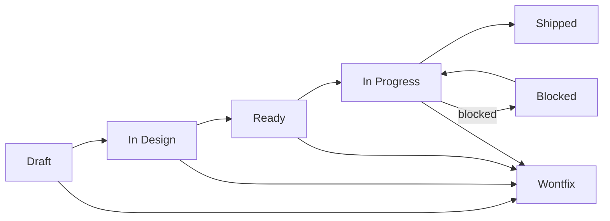

# 46 — Features

| Field            | Value                                                                                |
|------------------|--------------------------------------------------------------------------------------|
| Document ID      | `PINE-DOC-46-FEATURES`                                                                |
| Status           | Draft — pending review                                                               |
| Owner            | Engineering Review Board                                                             |
| Created          | 2026-07-08                                                                           |
| Last Updated     | 2026-07-08                                                                           |
| Specification Standard | Internal (feature practice)                                                 |
| Glossary         | `PINE-DOC-03-GLOSSARY`                                                               |
| Prerequisites    | `00-Vision`..`45-Epics`                                                              |
| Related Documents| `44-Backlog`, `45-Epics`, `47-User-Stories`, `48-Acceptance-Criteria` |

---

## 1. Purpose

Define what a *feature* is in Pine, the format, the lifecycle, the
relationship to epics and user stories, and the discipline of
feature decomposition and ownership.

## 2. Scope

In scope: feature definition, format, lifecycle, decomposition,
status, ownership, success criteria, traceability.

Out of scope: epics → `45-Epics`; user stories → `47-User-Stories`;
acceptance criteria → `48-Acceptance-Criteria`; backlog →
`44-Backlog`.

## 3. Definitions

| Term             | Working definition                                                                                |
|------------------|------------------------------------------------------------------------------------------------------|
| Feature          | A coarse-grained capability that is independently shippable inside an epic.                        |
| Capability       | A user-facing function (a synonym for "feature" in user-facing contexts).                          |
| Slice            | A small, deliverable increment of a feature.                                                       |
| User story       | A user-facing, testable statement of value (lives under a feature).                               |
| Spec             | A technical specification for a feature (architecture-level decisions).                            |

> **Assumption FT-A-1.** A feature is *one* user-facing capability.
> A feature is decomposed into user stories; a feature is not a
> collection of "tasks".

## 4. Feature Format

```markdown
# FEAT-NN — Short Title

| Field          | Value                                                      |
|----------------|-------------------------------------------------------------|
| Epic           | EPIC-NN                                                     |
| Owner          | Person or team                                              |
| Spec           | Path to spec or ADR (e.g. ADR-0014)                         |
| Linked FR      | FR-XXX                                                      |
| Linked NFR     | NFR-XXX                                                     |
| Status         | Draft | In Design | Ready | In Progress | Shipped | Wontfix |
| Target release | vX.Y (informational)                                        |
| User stories   | US-NNNN, US-NNNN, ...                                       |
| Acceptance     | AC-XXXX                                                    |
| Test cases     | TC-XXXX                                                    |
| Notes          | Free-form                                                   |
```

## 5. Lifecycle



### 5.1 In Design

- Spec is being written.
- User stories are being drafted.
- An ADR may be proposed.

### 5.2 Ready

- Spec is signed off.
- User stories have AC.
- AC has TC.
- Feature is sized and slotted.

### 5.3 In Progress

- At least one user story is in progress.
- A daily status is recorded.

### 5.4 Shipped

- All user stories are done.
- AC passes.
- TC passes.
- Spec is archived.

## 6. Decomposition

A feature is decomposed into user stories. A user story satisfies
the *Given/When/Then* model.

### 6.1 Heuristic

- A user story fits in a cycle.
- A user story is independently testable.
- A user story is independently shippable (or nearly so).
- A user story has a clear persona.

### 6.2 Story Map

A feature's user stories are organised on a *story map*:

- The backbone: end-to-end flow.
- Walking skeletons: thin slices that span the flow.
- Supporting stories: extensions, edge cases, polish.

## 7. Status Reporting

- A feature has a *weekly* status.
- Status includes: progress, blockers, scope changes.
- Status is published to the sponsor of the parent epic.

## 8. Feature Flags and Feature Lifecycle

- A feature is *gated* by a feature flag during its life
  (per `29-Deployment` §8).
- The feature flag is *short-lived* (≤ 3 minor releases).
- The feature flag is removed once the feature is *stable*.

## 9. Spec Discipline

A feature has a spec when:

- The feature introduces a new architecture-level decision.
- The feature has multiple valid implementations.
- The feature affects security, privacy, or performance.

A spec is an ADR (per `25-ADR`).

## 10. Cross-Platform Considerations

- A feature is shipped on all five platforms at GA, or an explicit
  reason is recorded in the SSoT.
- A platform-specific deviation is documented in the feature.

## 11. Capacity Discipline

- A team does not own more than 3 active features per cycle.
- A feature in design counts as 0.5 against the cap.

## 12. Governance

- New features are proposed by an Owner.
- New features are reviewed by the Engineering Review Board.
- New features affecting a Vision principle are escalated.

## 13. Tools

- The issue tracker exposes a *feature* entity.
- The CLI `pine features list` prints the active features.
- The CLI `pine features status FEAT-NN` prints the status.

## 14. Cross-Cutting Constraints

- A feature MUST have an Owner and an Epic.
- A feature MUST have ≥ 1 user story and ≥ 1 AC.
- A feature MUST have a target release (informational).
- A feature MUST have a spec when it meets the criteria in §9.

## 15. Deferred Decisions

| ID        | Decision                                                                                  | Owning document(s)         |
|-----------|-------------------------------------------------------------------------------------------|----------------------------|
| FT-D-1    | Whether to allow platform-specific features.                                              | `46-Features` (next rev.)  |
| FT-D-2    | Whether to allow partner-requested features (with sponsorship).                           | `24-Contributing`          |
| FT-D-3    | Whether to publish a public feature list.                                                  | `46-Features` (next rev.)  |

## 16. Quality Checklist

- [x] Definition, format, lifecycle, decomposition, status, flags,
      spec, cross-platform, capacity, governance, tooling are all
      present.
- [x] No TODO placeholders.
- [x] No contradiction with `00-Vision`..`45-Epics`.

## 17. Revision History

| Version | Date       | Author                | Change                                                       |
|---------|------------|-----------------------|--------------------------------------------------------------|
| 0.1     | 2026-07-08 | Engineering Review Board | Initial features document.                                   |
