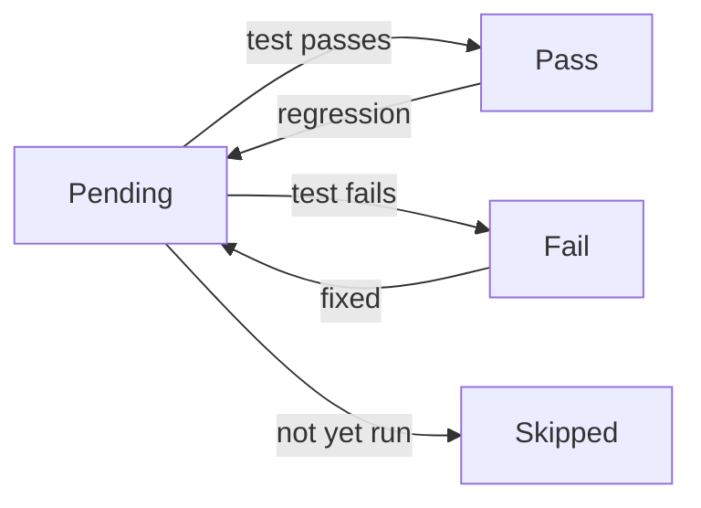

# 48 — Acceptance Criteria

| Field            | Value                                                                                |
|------------------|--------------------------------------------------------------------------------------|
| Document ID      | `PINE-DOC-48-ACCEPTANCE-CRITERIA`                                                    |
| Status           | Aspirational — the process is not in use                                             |
| Reconciled       | 2026-08-31 · Documents `pine ac new|ready|status|coverage` (:175-178); the CLI implements none of them. |
| Owner            | Engineering Review Board                                                             |
| Created          | 2026-07-08                                                                           |
| Last Updated     | 2026-07-08                                                                           |
| Specification Standard | BDD / Gherkin Given-When-Then (per `43-Testing-Artifacts` §6.1)        |
| Glossary         | `PINE-DOC-03-GLOSSARY`                                                               |
| Prerequisites    | `00-Vision`..`47-User-Stories`                                                       |
| Related Documents| `43-Testing-Artifacts`, `47-User-Stories`, `49-Test-Cases`, `50-Test-Scenarios` |

---

## 1. Purpose

Define Pine's acceptance criteria (AC) practice: the format, the
quality bar, the relationship to user stories and test cases, and
the discipline of writing testable criteria.

## 2. Scope

In scope: definition, format, Given/When/Then, quality bar,
priority, traceability, tooling.

Out of scope: user stories → `47-User-Stories`; test cases →
`49-Test-Cases`; test scenarios → `50-Test-Scenarios`; testing
artefacts taxonomy → `43-Testing-Artifacts`.

## 3. Definitions

| Term             | Working definition                                                                                |
|------------------|------------------------------------------------------------------------------------------------------|
| Acceptance criterion | A binary check of whether a user story is satisfied.                                          |
| Given            | The precondition.                                                                                  |
| When             | The action.                                                                                        |
| Then             | The observable result.                                                                              |
| BDD              | Behaviour-Driven Development: a style that uses Given/When/Then to specify behaviour.              |
| Gherkin          | A BDD syntax used in tools like Cucumber.                                                          |
| Edge case        | A behaviour outside the happy path.                                                                |
| Negative AC      | An AC that specifies what MUST NOT happen.                                                         |
| Positive AC      | An AC that specifies what MUST happen.                                                             |
| Performance AC   | An AC that specifies a performance budget.                                                          |

> **Assumption AC-A-1.** An AC is the *contract* of a user story.
> The contract is binary; the implementation is free.

## 4. Acceptance Criterion Format

```markdown
# AC-NNNN — Short Title

| Field         | Value                                                      |
|---------------|-------------------------------------------------------------|
| User story    | US-NNNN                                                     |
| FR            | FR-XXX                                                      |
| NFR           | NFR-XXX                                                     |
| Type          | positive | negative | edge | performance | accessibility  |
| Given         | A precondition                                              |
| When          | An action                                                   |
| Then          | An observable result                                         |
| Test cases    | TC-XXXX                                                     |
| Test scenarios| TS-XXXX                                                     |
| Status        | Pending / Pass / Fail / Skipped                             |
```

### 4.1 Gherkin Form

A more verbose form is allowed when a tooling integration benefits
from it:

```gherkin
Given <precondition>
When <action>
Then <observable>
```

## 5. Quality Bar

An AC is *good* when:

- It is **binary** (pass or fail).
- It has a **single** Then clause per Given/When.
- It is **measurable** (the Then is observable).
- It is **not** implementation detail.
- It is **independent** of other ACs in the same story.
- It is **stable** (a refactor does not break the AC).

## 6. Coverage

A user story SHOULD have:

- ≥ 1 positive AC (the happy path).
- ≥ 1 negative AC (the failure path).
- ≥ 1 edge AC (a boundary case).
- ≥ 1 accessibility AC (when UI is involved).
- ≥ 1 performance AC (when performance is involved).

### 6.1 Anti-Patterns

- "Should work" — not measurable.
- "Fast enough" — not measurable; cite a budget.
- "Looks good" — not measurable; cite a token.
- "Works on Windows" — too vague; cite a behaviour.

## 7. AC Types

| Type            | When to use                                                                          |
|-----------------|---------------------------------------------------------------------------------------|
| Positive        | Default behaviour.                                                                  |
| Negative        | Failure handling.                                                                    |
| Edge            | Boundary case.                                                                       |
| Performance     | A measurable budget.                                                                  |
| Accessibility   | WCAG 2.2 AA mapping.                                                                  |
| Security        | A security posture.                                                                  |
| Privacy         | A privacy posture.                                                                    |
| Localisation    | A locale behaviour.                                                                  |
| Multi-platform  | A platform-specific behaviour.                                                       |

## 8. Performance AC

A performance AC cites a budget from `39-Performance`:

```markdown
Then the dashboard first paint is ≤ 1500 ms on Tier 2 hardware.
```

The budget is part of the AC; a regression fails the AC.

## 9. Accessibility AC

An accessibility AC cites a WCAG 2.2 success criterion:

```markdown
Then the focus indicator is visible against both background and adjacent colours (WCAG 2.4.11, 2.4.12).
```

## 10. Privacy AC

A privacy AC cites a privacy posture:

```markdown
Then the user's payee field is not present in any log line at info or above.
```

## 11. Status Workflow



### 11.1 Status Updates

- The status is updated on every CI run.
- The status is part of the user story's release check.

## 12. Traceability

- An AC MUST trace to a user story and a FR.
- An AC MUST have ≥ 1 test case.
- An AC MAY trace to an NFR (when the NFR is the reason for the
  AC).
- An AC MAY trace to a risk (when the risk is the reason for the
  AC).

## 13. Tools

- The CLI `pine ac new` scaffolds an AC.
- The CLI `pine ac ready AC-NNNN` checks the quality bar.
- The CLI `pine ac status AC-NNNN` prints the status.
- The CLI `pine ac coverage US-NNNN` prints the coverage report.

## 14. Cross-Cutting Constraints

- An AC MUST be binary.
- An AC MUST have a single Then clause.
- An AC MUST have a test case.
- An AC MUST be independent of other ACs in the same story.

## 15. Deferred Decisions

| ID        | Decision                                                                                  | Owning document(s)         |
|-----------|-------------------------------------------------------------------------------------------|----------------------------|
| AC-D-1    | Whether to require a BDD tool integration in CI.                                          | `48-Acceptance-Criteria` (next rev.) |
| AC-D-2    | Whether to mandate specific performance budgets in performance ACs.                       | `39-Performance`           |
| AC-D-3    | Whether to publish AC status publicly.                                                     | `48-Acceptance-Criteria` (next rev.) |

## 16. Quality Checklist

- [x] Definition, format, quality bar, coverage, types, performance,
      accessibility, privacy, status, traceability, tools are all
      present.
- [x] No TODO placeholders.
- [x] No contradiction with `00-Vision`..`47-User-Stories`.

## 17. Revision History

| Version | Date       | Author                | Change                                                       |
|---------|------------|-----------------------|--------------------------------------------------------------|
| 0.1     | 2026-07-08 | Engineering Review Board | Initial acceptance criteria document.                         |
