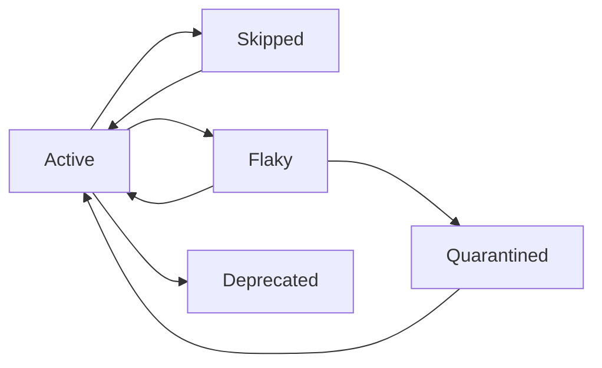

# 49 — Test Cases

| Field            | Value                                                                                |
|------------------|--------------------------------------------------------------------------------------|
| Document ID      | `PINE-DOC-49-TEST-CASES`                                                              |
| Status           | Aspirational — the process is not in use                                             |
| Reconciled       | 2026-08-31 · Documents `pine tc new|run|coverage` (:212-214); the CLI implements none of them. Test cases live as xUnit facts, not as the artefacts this specifies. |
| Owner            | Engineering Review Board                                                             |
| Created          | 2026-07-08                                                                           |
| Last Updated     | 2026-07-08                                                                           |
| Specification Standard | ISTQB test case practice                                                  |
| Glossary         | `PINE-DOC-03-GLOSSARY`                                                               |
| Prerequisites    | `00-Vision`..`48-Acceptance-Criteria`                                                |
| Related Documents| `18-Test-Strategy`, `43-Testing-Artifacts`, `48-Acceptance-Criteria`, `50-Test-Scenarios`, `51-Test-Data` |

---

## 1. Purpose

Define Pine's test case (TC) practice: the format, the types, the
quality bar, the relationship to acceptance criteria and test
data, and the discipline of writing robust tests.

## 2. Scope

In scope: definition, format, types, quality bar, isolation,
idempotence, determinism, ownership, lifecycle, traceability.

Out of scope: AC → `48-Acceptance-Criteria`; test scenarios →
`50-Test-Scenarios`; test data → `51-Test-Data`; test strategy
→ `18-Test-Strategy`; testing artefact taxonomy →
`43-Testing-Artifacts`.

## 3. Definitions

| Term             | Working definition                                                                                |
|------------------|------------------------------------------------------------------------------------------------------|
| Test case        | A single, low-level check with input, action, and expected result.                                  |
| Precondition     | The state required before the test runs.                                                            |
| Step             | An action in the test.                                                                              |
| Expected         | The observable result of the test.                                                                 |
| Isolation        | The property that a test does not depend on the state of another test.                             |
| Idempotence      | The property that a test can run repeatedly with the same result.                                  |
| Determinism      | The property that a test produces the same result for the same input.                              |
| Flake             | A test that occasionally fails without a code change.                                              |
| Coverage          | The fraction of code paths exercised by a test.                                                    |
| Mutation score    | The fraction of mutants killed by a test.                                                          |
| Tag               | A label that classifies a test (e.g. "smoke", "regression", "perf").                               |

> **Assumption TC-A-1.** A test case is *an executable
> specification*. The test name describes the behaviour; the
> implementation verifies it.

## 4. Test Case Format

```markdown
# TC-NNNN — Short Title

| Field           | Value                                                     |
|-----------------|-------------------------------------------------------------|
| AC              | AC-NNNN                                                     |
| FR              | FR-XXX                                                      |
| NFR             | NFR-XXX                                                     |
| Type            | unit | integration | e2e | manual | mutation | perf        |
| Profile         | default | sandbox | hermetic                                |
| Inputs          | Free-form or table                                          |
| Preconditions   | Free-form or table                                          |
| Steps           | 1. ... 2. ...                                              |
| Expected        | Observable                                                 |
| Tags            | smoke | regression | ...                                    |
| Owner           | Person                                                      |
| Status          | Active | Skipped | Deprecated | Flaky                      |
| Linked risks    | RSK-NN                                                      |
```

## 5. Test Types

| Type            | Purpose                                                                            | Where it runs                       |
|-----------------|------------------------------------------------------------------------------------|--------------------------------------|
| Unit            | Domain / application behaviour in isolation.                                       | In-process, on a developer machine.  |
| Integration     | End-to-end flow inside Pine (across modules).                                       | Hermetic runner.                     |
| E2E             | End-to-end flow including the UI.                                                  | Hermetic runner; UI automation.      |
| Manual          | A check that is not automatable.                                                   | Manual.                              |
| Mutation        | A mutation-targeted check (subset of unit, run nightly).                           | CI nightly.                          |
| Performance     | A budgeted check (subset of integration, run nightly).                            | CI nightly.                          |
| Accessibility   | An automated a11y check (subset of integration, run on every UI PR).               | CI per PR.                            |
| Security        | A security posture check (subset of integration).                                  | CI per PR.                            |

## 6. Quality Bar

A test case is *good* when:

- It is **one** check.
- It is **reproducible** (the inputs are explicit).
- It is **idempotent** (running it twice yields the same result).
- It is **isolated** (no leakage from other tests).
- It is **named** in line with its function.
- It is **fast** (the test runs in the smallest possible scope).
- It is **deterministic** (no random inputs without a seed).
- It is **self-describing** (failure messages are informative).

## 7. Test Naming Discipline

A test name has the form:

```
<Method or Capability>_<State>_<Expected>
```

Example:

```
CategoriseTransaction_WithUnknownMerchant_ReturnsLowConfidence
```

The name communicates: what is being tested, in what state, with
what result.

## 8. Isolation Discipline

- A test MUST NOT depend on the result of another test.
- A test MUST NOT write to a shared file system without cleanup.
- A test MUST use a temporary profile (per `27-Development-
  Guidelines`).
- A test MUST NOT call a real network endpoint.

## 9. Determinism Discipline

- A test MUST use a seeded RNG when randomness is required.
- A test MUST freeze time when the test is time-sensitive.
- A test MUST NOT depend on the local time zone.
- A test MUST use a fixed locale for locale-sensitive tests.

## 10. Test Data

A test case MUST cite its test data (`51-Test-Data`):

- A test that uses complex data cites a TD.
- A test that uses simple inline data does not need a TD.
- A test that uses PII cites a TD with explicit approval.

## 11. Test Flake

### 11.1 Definition

A test is *flaky* if it fails in CI at least once in the last 30
runs *without* a code change.

### 11.2 Triage

- A flaky test is *immediately* marked Flaky.
- The Flaky tag is a *signal*, not a permanent state.
- A Flaky test MUST be fixed within 7 days.
- A test that is not fixed within 7 days is *Skipped* and the
  skip is reviewed in triage.

### 11.3 Quarantine

- A Flaky test MAY be moved to a *quarantine* suite.
- The quarantine suite is *not* a gate.
- A test in quarantine longer than 14 days is escalated.

## 12. Test Tags

| Tag            | Meaning                                                                            |
|----------------|------------------------------------------------------------------------------------|
| smoke          | A minimal subset that runs in < 5 min; gate for every PR.                         |
| regression     | The full set; gate for the main branch.                                           |
| perf           | Performance budget tests; gate for nightly.                                       |
| mutation       | Mutation-targeted tests; gate for nightly.                                        |
| a11y           | Accessibility tests; gate for UI PR.                                              |
| security       | Security tests; gate for sensitive PR.                                            |
| localization   | Localisation tests; gate for release.                                             |

## 13. Test Suite Composition

The default suite is composed of:

- All unit tests (`Pine.Tests.Unit`).
- All integration tests (`Pine.Tests.Integration`).
- The smoke E2E tests.
- The accessibility tests.
- The security tests.

The nightly suite adds:

- The full E2E tests.
- The mutation tests.
- The performance tests.

## 14. Status Workflow



## 15. Traceability

- A test case MUST trace to an AC and (where applicable) a FR and
  an NFR.
- A test case MUST trace to a TD when the data is complex.
- A test case MAY trace to a risk (`17-Risk-Analysis`).

## 16. Tools

- The CLI `pine tc new` scaffolds a test case.
- The CLI `pine tc run TC-NNNN` runs a single test.
- The CLI `pine tc coverage TC-NNNN` prints the coverage report.

## 17. Cross-Cutting Constraints

- A test case MUST be reproducible.
- A test case MUST be idempotent.
- A test case MUST be isolated.
- A test case MUST NOT depend on the local time zone.
- A test case MUST NOT call a real network endpoint.

## 18. Deferred Decisions

| ID        | Decision                                                                                  | Owning document(s)         |
|-----------|-------------------------------------------------------------------------------------------|----------------------------|
| TC-D-1    | Whether to mandate a specific test framework.                                              | `49-Test-Cases` (next rev.) |
| TC-D-2    | Quarantine suite retention default.                                                         | `49-Test-Cases` (next rev.) |
| TC-D-3    | Whether to ship a public mutation score.                                                   | `32-AI-Training`           |

## 19. Quality Checklist

- [x] Definition, format, types, quality bar, naming, isolation,
      determinism, test data, flake, tags, suite, status,
      traceability, tools are all present.
- [x] ISTQB referenced.
- [x] No TODO placeholders.
- [x] No contradiction with `00-Vision`..`48-Acceptance-Criteria`.

## 20. Revision History

| Version | Date       | Author                | Change                                                       |
|---------|------------|-----------------------|--------------------------------------------------------------|
| 0.1     | 2026-07-08 | Engineering Review Board | Initial test cases document.                                 |
