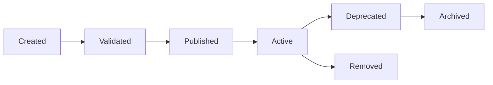

# 51 — Test Data

| Field            | Value                                                                                |
|------------------|--------------------------------------------------------------------------------------|
| Document ID      | `PINE-DOC-51-TEST-DATA`                                                               |
| Status           | Draft — pending review                                                               |
| Owner            | Engineering Review Board                                                             |
| Created          | 2026-07-08                                                                           |
| Last Updated     | 2026-07-08                                                                           |
| Specification Standard | ISTQB test data practice                                                  |
| Glossary         | `PINE-DOC-03-GLOSSARY`                                                               |
| Prerequisites    | `00-Vision`..`50-Test-Scenarios`                                                      |
| Related Documents| `15-Security`, `18-Test-Strategy`, `30-Observability`, `49-Test-Cases`, `50-Test-Scenarios` |

---

## 1. Purpose

Define Pine's test data (TD) practice: the format, the categories,
the privacy posture, the reproducibility discipline, the
relationship to test cases, and the maintenance rules.

## 2. Scope

In scope: definition, format, categories, privacy posture,
reproducibility, ownership, lifecycle, traceability, tooling.

Out of scope: test cases → `49-Test-Cases`; test scenarios →
`50-Test-Scenarios`; security posture for data → `15-Security`;
DIB → `30-Observability`.

## 3. Definitions

| Term             | Working definition                                                                                |
|------------------|------------------------------------------------------------------------------------------------------|
| Test data        | A dataset used to drive a test.                                                                    |
| Fixture          | A test data file or set of files used to set up a test.                                            |
| Synthetic data   | Data generated for testing, not derived from real users.                                            |
| Anonymised data  | Data derived from real users but with identifying fields removed or hashed.                        |
| Seed             | A value used to initialise a random number generator (RNG).                                          |
| Golden set       | A canonical dataset for a capability.                                                              |
| PII              | Personally Identifiable Information (per `15-Security` §3).                                          |

> **Assumption TD-A-1.** Test data is *PII-free by default*. Real
> user data is forbidden in test data without an explicit
> exception, signed off by the trust team.

## 4. Test Data Format

```markdown
# TD-NNNN — Short Title

| Field           | Value                                                     |
|-----------------|-------------------------------------------------------------|
| Owner           | Person                                                      |
| Category        | synthetic | anonymised | golden | golden-anonymised | sample |
| Privacy posture | PII-free | PII-light | PII-full (with approval)            |
| Profiles        | Profiles that use this data                                |
| Reproducibility| Commit hash, seed                                          |
| License         | Per-data licence (synthetic = project; golden = see source) |
| Notes           | Free-form                                                  |
```

### 4.1 Data Files

A test data file is a self-describing file. Example:

```yaml
# TD-0001 — sample_profile
id: td-0001-sample-profile
version: 1
seed: 42
currency: USD
locale: en-US
accounts:
  - id: acct-1
    name: "Checking"
    type: checking
    opening_balance: 1000.00
transactions:
  - date: 2025-01-02
    amount: -42.50
    payee: "Sample Coffee"
    category: "Coffee"
```

## 5. Categories

| Category             | Source                                                                  | Privacy posture                    |
|----------------------|--------------------------------------------------------------------------|--------------------------------------|
| Synthetic            | Generated in the test or by a fixture tool                                | PII-free                            |
| Anonymised           | Real user data with identifiers removed or hashed                        | PII-light (after anonymisation)      |
| Golden                | Hand-curated canonical dataset for a capability                          | PII-free                            |
| Golden-anonymised     | Golden set with anonymisation discipline                                  | PII-light                            |
| Sample               | Tiny dataset used in tutorials and quickstarts                            | PII-free                            |
| Market               | Public market data (e.g. tickers, indices)                                | PII-free                            |
| Tax                  | Public tax tables (e.g. brackets by jurisdiction)                         | PII-free                            |

## 6. Privacy Posture

- A test data file is PII-free by default.
- A test data file that contains PII MUST have an *approval* signed
  off by the trust team.
- A test data file that contains PII MUST be stored in an encrypted
  location.
- A test data file that contains PII MUST be excluded from public
  artefacts.

### 6.1 PII Discipline

- A payee name is *not* PII; it is a free-text field.
- An account name is *not* PII; it is a free-text field.
- A real person's name is PII.
- A real account number is PII.
- A real email address is PII.
- A real phone number is PII.
- A real physical address is PII.

## 7. Reproducibility

- A test data file MUST have a *seed* if randomness is used.
- A test data file MUST have a *commit hash* if generated.
- A test data file MUST be reproducible from the seed and the
  generator version.
- A test that depends on a test data file MUST be re-runnable from
  the same seed.

## 8. Lifecycle



### 8.1 Validation

- A TD is validated when:
  - The schema is correct.
  - The reproducibility is verified.
  - The privacy posture is verified.
  - The data is licensed.

### 8.2 Publication

- A validated TD is published in the repo.
- The TD is exposed to the test runner.
- The TD is documented in the test that uses it.

### 8.3 Deprecation

- A TD is deprecated when:
  - The capability is removed.
  - The schema changes.
  - The privacy posture changes.

A deprecated TD is retained for 90 days, then archived.

## 9. Versioning

- A TD has a `version` field.
- A TD MAY be split into multiple versions.
- A test case that uses a TD MUST cite the version.
- A TD upgrade MAY require a test case update.

## 10. Traceability

- A TD MUST list the test cases that use it.
- A TD MUST list the test scenarios that use it.
- A TD MUST trace to a capability (when applicable).

## 11. Tools

- The CLI `pine td new` scaffolds a TD.
- The CLI `pine td validate TD-NNNN` validates a TD.
- The CLI `pine td list` lists the TDs.

## 12. Cross-Cutting Constraints

- A TD MUST be PII-free by default.
- A TD MUST be reproducible from the seed.
- A TD MUST be documented in the test that uses it.
- A TD MUST be excluded from public artefacts when it contains
  PII.

## 13. Deferred Decisions

| ID        | Decision                                                                                  | Owning document(s)         |
|-----------|-------------------------------------------------------------------------------------------|----------------------------|
| TD-D-1    | Test data hosting strategy (per repo vs. external registry).                              | `51-Test-Data` (next rev.) |
| TD-D-2    | Schema migration tool for TDs.                                                            | `51-Test-Data` (next rev.) |
| TD-D-3    | Public test data distribution (per release).                                              | `51-Test-Data` (next rev.) |

## 14. Quality Checklist

- [x] Definition, format, categories, privacy, reproducibility,
      lifecycle, versioning, traceability, tools are all present.
- [x] ISTQB referenced.
- [x] No TODO placeholders.
- [x] No contradiction with `00-Vision`..`50-Test-Scenarios`.

## 15. Revision History

| Version | Date       | Author                | Change                                                       |
|---------|------------|-----------------------|--------------------------------------------------------------|
| 0.1     | 2026-07-08 | Engineering Review Board | Initial test data document.                                  |
