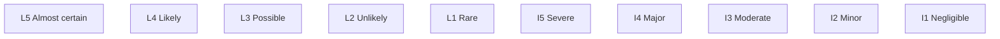

# 52 — Risk Matrix

| Field            | Value                                                                                |
|------------------|--------------------------------------------------------------------------------------|
| Document ID      | `PINE-DOC-52-RISK-MATRIX`                                                             |
| Status           | Non-normative — operational risk register                                            |
| Reconciled       | 2026-08-31 · Documents `pine risk new|review|report` (:201-203), which the CLI does not implement. |
| Owner            | Engineering Review Board                                                             |
| Created          | 2026-07-08                                                                           |
| Last Updated     | 2026-07-08                                                                           |
| Specification Standard | ISO 31000 (adapted) + NIST 800-30                                            |
| Glossary         | `PINE-DOC-03-GLOSSARY`                                                               |
| Prerequisites    | `00-Vision`..`51-Test-Data`                                                          |
| Related Documents| `17-Risk-Analysis`, `18-Test-Strategy`, `19-Traceability-Matrix`, `38-Threat-Model`, `44-Backlog` |

---

## 1. Purpose

Define Pine's risk matrix: the *operational* view of risk, the
likelihood × impact grid, the heat map, the response strategies,
the cadence, and the relationship to the risk register in
`17-Risk-Analysis`.

## 2. Scope

In scope: likelihood scale, impact scale, grid, response
strategies, residual risk, cadence, ownership, reporting,
linkage to the register and to test cases.

Out of scope: risk register content → `17-Risk-Analysis`;
threat model → `38-Threat-Model`; test strategy → `18-Test-
Strategy`; traceability matrix → `19-Traceability-Matrix`.

## 3. Definitions

| Term             | Working definition                                                                                |
|------------------|------------------------------------------------------------------------------------------------------|
| Risk             | A potential cause of an incident with a probability and an impact.                                |
| Likelihood        | The probability that a risk will materialise in a given period.                                     |
| Impact           | The severity of the consequence if a risk materialises.                                            |
| Inherent risk     | The risk before mitigations.                                                                      |
| Residual risk     | The risk after mitigations.                                                                        |
| Risk register     | The list of identified risks.                                                                      |
| Risk owner        | The person accountable for the mitigation.                                                          |
| Risk response     | The strategy: avoid, mitigate, transfer, accept.                                                   |
| Heat map          | A 2D grid of likelihood × impact used to visualise risk.                                            |
| Risk appetite     | The level of risk the project is willing to accept.                                                |

> **Assumption RMX-A-1.** Risk management is a *continuous*
> practice. The matrix is updated at every minor release.

## 4. Likelihood Scale

| Level   | Description                                                                                  | Probability (annual) |
|---------|----------------------------------------------------------------------------------------------|------------------------|
| 1 — Rare    | Has not happened in the project; theoretical.                                            | < 5%                |
| 2 — Unlikely | Has happened in similar projects; not in this one.                                       | 5–25%               |
| 3 — Possible | Has happened in this project in the past.                                                 | 25–50%              |
| 4 — Likely   | Has happened in the past 12 months.                                                       | 50–80%              |
| 5 — Almost certain | Has happened in the past 30 days; expected to recur.                              | > 80%               |

## 5. Impact Scale

| Level   | Description                                                                                  |
|---------|----------------------------------------------------------------------------------------------|
| 1 — Negligible | Cosmetic; no user impact.                                                          |
| 2 — Minor      | Slight inconvenience; recoverable in < 1 hour.                                       |
| 3 — Moderate   | User impact; recoverable in < 1 day.                                                 |
| 4 — Major      | Significant user impact; requires a hotfix.                                          |
| 5 — Severe     | Loss of user trust; data loss; security breach; legal exposure.                        |

### 5.1 Per-Domain Impact

| Domain       | 4 — Major                                                    | 5 — Severe                                                |
|--------------|---------------------------------------------------------------|------------------------------------------------------------|
| Privacy      | Exposure of a user's data through a single vector.          | Mass exposure; legal exposure.                             |
| Security     | Vulnerability that requires user action.                    | Remote unauthenticated code execution.                      |
| Financial    | Loss of a small subset of transactions.                    | Loss of user funds; data loss.                              |
| Performance  | Latency degradation of 25–50% on a hot path.                 | Latency degradation of > 100% on a hot path.                |
| Accessibility | A failure that affects one assistive-technology user.        | A failure that affects all assistive-technology users.      |
| Compliance   | A single instance of non-compliance.                        | A pattern of non-compliance; legal exposure.                |

## 6. Grid



The heat map is the 5×5 grid formed by `Likelihood × Impact`. The
risk score is `Likelihood × Impact` (1–25). The heat zones are:

| Zone       | Score     | Treatment                                                                  |
|------------|-----------|-----------------------------------------------------------------------------|
| Low        | 1–3       | Acceptable.                                                                 |
| Medium     | 4–9       | Track. Mitigate if cheap.                                                  |
| High       | 10–15     | Mitigate before next release.                                              |
| Critical   | 16–25     | Mitigate before next minor release or escalate.                            |

## 7. Response Strategies

| Strategy  | When to use                                                                                  |
|-----------|-----------------------------------------------------------------------------------------------|
| Avoid     | The risk is not worth taking; remove the cause.                                              |
| Mitigate  | The risk can be reduced to an acceptable level.                                              |
| Transfer  | The risk can be shared with a third party (e.g. insurance, vendor).                            |
| Accept    | The risk is below appetite; the cost of mitigation exceeds the loss.                         |

A *Critical* risk MUST NOT be *Accept*-ed; a Critical risk MUST
be *Mitigated* or *Avoided*.

## 8. Risk Register Linkage

Each risk in the register (`17-Risk-Analysis`) has:

- An identifier `RSK-NN`.
- An owner.
- A likelihood (current).
- An impact (current).
- A response.
- A mitigation plan.
- A residual likelihood.
- A residual impact.
- A review date.
- A status (Open, Mitigating, Mitigated, Accepted, Closed).

### 8.1 Register Format

```markdown
# RSK-NN — Short Title

| Field           | Value                                                     |
|-----------------|-------------------------------------------------------------|
| Inherent L / I  | L4 / I5                                                     |
| Inherent score  | 20                                                          |
| Response        | Mitigate                                                    |
| Mitigation      | Free-form                                                   |
| Residual L / I  | L2 / I4                                                     |
| Residual score  | 8                                                           |
| Owner           | Person                                                      |
| Status          | Open / Mitigating / Mitigated / Accepted / Closed           |
| Linked ADR      | ADR-NNNN                                                    |
| Linked TC       | TC-XXXX                                                     |
| Linked FR       | FR-XXX                                                      |
| Linked NFR      | NFR-XXX                                                     |
| Review date     | YYYY-MM-DD                                                  |
| Notes           | Free-form                                                   |
```

## 9. Risk Appetite

| Domain        | Appetite                                                                       |
|---------------|--------------------------------------------------------------------------------|
| Privacy       | Zero tolerance for any 4+ impact.                                              |
| Security      | Zero tolerance for any 4+ impact.                                              |
| Financial     | Zero tolerance for any 4+ impact.                                              |
| Performance   | Tolerance for ≤ 2 impact.                                                      |
| Accessibility | Zero tolerance for any 3+ impact.                                              |
| Compliance    | Zero tolerance for any 3+ impact.                                              |

A 5-impact risk in a zero-tolerance domain triggers an *immediate
escalation* to the Maintainer Council.

## 10. Reporting

- A weekly risk summary is published.
- A monthly risk register is published (private to the
  Engineering Review Board).
- A quarterly public risk summary is published.
- An annual external risk review is published.

## 11. Cadence

| Event                       | Cadence                                                            |
|-----------------------------|--------------------------------------------------------------------|
| Risk identification         | Continuous                                                          |
| Risk review (each register entry) | At the review date, at least quarterly                       |
| Risk register review         | Monthly                                                            |
| Public risk summary          | Quarterly                                                          |
| External risk review         | Annual                                                              |

## 12. Linkage to Test Cases

- A *Critical* or *High* risk MUST have ≥ 1 mitigation test case.
- A mitigation test case MUST trace to the risk and to the AC.
- A risk that is *Accepted* MUST be signed off by the Engineering
  Review Board.

## 13. Tools

- The CLI `pine risk new` scaffolds a risk.
- The CLI `pine risk review RSK-NN` opens a review.
- The CLI `pine risk report` prints the heat map.

## 14. Cross-Cutting Constraints

- A risk MUST have an owner.
- A *Critical* risk MUST NOT be *Accept*-ed.
- A *High* or *Critical* risk MUST have a mitigation test case.
- A risk MUST be reviewed at the review date.

## 15. Deferred Decisions

| ID        | Decision                                                                                  | Owning document(s)         |
|-----------|-------------------------------------------------------------------------------------------|----------------------------|
| RMX-D-1   | Whether to publish the public risk register.                                              | `52-Risk-Matrix` (next rev.) |
| RMX-D-2   | External auditor selection.                                                               | `52-Risk-Matrix` (next rev.) |
| RMX-D-3   | Insurance posture for transferred risks.                                                  | `52-Risk-Matrix` (next rev.) |

## 16. Quality Checklist

- [x] Likelihood, impact, grid, response, register, appetite,
      reporting, cadence, linkage, tools are all present.
- [x] ISO 31000 + NIST 800-30 referenced.
- [x] No TODO placeholders.
- [x] No contradiction with `00-Vision`..`51-Test-Data`.

## 17. Revision History

| Version | Date       | Author                | Change                                                       |
|---------|------------|-----------------------|--------------------------------------------------------------|
| 0.1     | 2026-07-08 | Engineering Review Board | Initial risk matrix document.                               |
