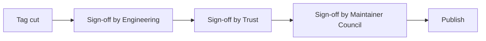
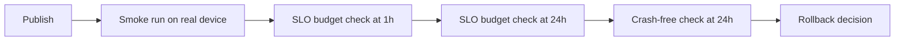
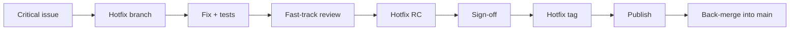

# 53 — Release Checklist

| Field            | Value                                                                                |
|------------------|--------------------------------------------------------------------------------------|
| Document ID      | `PINE-DOC-53-RELEASE-CHECKLIST`                                                       |
| Status           | Aspirational — several gates cannot currently be satisfied                           |
| Reconciled       | 2026-08-31 · It requires green CI — which since 2026-09-10 does fire by itself, on `pull_request` into `main` and on `push` to `main` (TD-07) — plus performance, mutation and accessibility gates (all three projects were empty templates and were deleted in iteration 27), and sign-off from a Trust team and a Maintainer Council that do not exist. |
| Owner            | Engineering Review Board                                                             |
| Created          | 2026-07-08                                                                           |
| Last Updated     | 2026-07-08                                                                           |
| Specification Standard | Internal (release gate)                                                     |
| Glossary         | `PINE-DOC-03-GLOSSARY`                                                               |
| Prerequisites    | `00-Vision`..`52-Risk-Matrix`                                                        |
| Related Documents| `17-Risk-Analysis`, `18-Test-Strategy`, `21-Definition-of-Done`, `22-Release-Plan`, `28-CI-CD`, `29-Deployment`, `30-Observability` |

---

## 1. Purpose

Define the **release checklist**: the gate a release MUST pass
before it ships. The checklist is the *operational* counterpart
to `21-Definition-of-Done` and `22-Release-Plan`.

## 2. Scope

In scope: pre-release, release, post-release gates, roles,
sign-off, rollback, and the linkage to the verification stage.

Out of scope: definition of done → `21-Definition-of-Done`;
release plan → `22-Release-Plan`; deployment topology →
`29-Deployment`; CI/CD pipeline → `28-CI-CD`; risk matrix →
`52-Risk-Matrix`.

## 3. Definitions

| Term             | Working definition                                                                                |
|------------------|------------------------------------------------------------------------------------------------------|
| Gate             | A condition that MUST pass for the release to proceed.                                              |
| Sign-off         | A formal approval by a named role.                                                                  |
| Release manager   | The person who owns the release flow.                                                              |
| Release candidate | A build that has passed all gates and is ready for promotion.                                     |
| Hotfix            | A release cut from a release tag to ship a critical fix.                                            |
| Rollback          | Returning to a previous version.                                                                    |
| Verification     | The stage that runs the candidate in a sandbox and asserts the result.                              |
| Publish          | The act of distributing the candidate to users.                                                    |

> **Assumption RC-A-1.** A release that fails a gate is *not*
> released. There is no override flag.

## 4. Pre-Release Gates

```mermaid
graph LR
    A[Code freeze] --> B[CI green]
    B --> C[Performance green]
    C --> D[Mutation green]
    D --> E[Security green]
    E --> F[Accessibility green]
    F --> G[Localization green]
    G --> H[Documentation green]
    H --> I[Changelog green]
    I --> J[Threat model updated]
    J --> K[Risk register reviewed]
    K --> L[Verification passed]
    L --> M[Tag cut]
```

### 4.1 Code Freeze

- A code freeze is announced ≥ 24 hours before the RC cut.
- The freeze applies to all non-hotfix branches.
- Hotfix branches are allowed.

### 4.2 CI Green

- All CI gates per `28-CI-CD` §4.1 are green.
- The build matrix is green.
- The signing and attestation are green.

### 4.3 Performance Green

- The performance suite is green.
- No regression > 10% on a budgeted metric.
- The SLO budget for the release is met.

### 4.4 Mutation Green

- The mutation score is within the project's tolerance.
- A regression in mutation score is documented; the release may
  proceed only with a *mitigation plan* signed off.

### 4.5 Security Green

- No open *Critical* or *High* vulnerabilities.
- All advisory acknowledgements resolved.
- SBOM published.
- SLSA provenance published.

### 4.6 Accessibility Green

- WCAG 2.2 AA automated checks pass.
- Manual audit records are on file.

### 4.7 Localization Green

- All first-wave locales are 100% translated.
- Pseudo-locale build passes.
- Visual QA on the pseudo-locale build passes.

### 4.8 Documentation Green

- All new capabilities have docs.
- The changelog is updated.
- The release notes are drafted.
- The migration guide is published (if applicable).

### 4.9 Changelog Green

- The `## [Unreleased]` section is current.
- The release section is drafted.
- The release notes are approved.

### 4.10 Threat Model Updated

- The threat model is updated for the new capabilities.
- The risk register is updated.
- The mitigations are linked to test cases.

### 4.11 Risk Register Reviewed

- The risk register is reviewed.
- New risks are added.
- Mitigations are updated.
- Residual risk is signed off.

### 4.12 Verification Passed

- The verification stage (`28-CI-CD` §10) passes.
- A smoke run on a real device passes.
- The DIB matches the expected behaviour.

## 5. Release Gates

### 5.1 Sign-off

The sign-off is by:

- Engineering Review Board (technical sign-off).
- Trust team (security sign-off).
- Maintainer Council (policy sign-off for major releases).

### 5.2 Tag Cut

- The release manager cuts the tag.
- The tag is annotated and signed.
- The tag follows the format `vX.Y.Z[-pre.N]`.

### 5.3 Publish

- The publish is per `29-Deployment` §4.
- The publish is staged per `29-Deployment` §6.
- The publish is monitored per `29-Deployment` §11.

## 6. Post-Release Gates

### 6.1 Smoke Run

- A smoke run on a real device is performed within 1 hour of
  publish.
- The smoke run covers the headline capability.

### 6.2 SLO Budget Check

- The SLO budget is checked at 1 hour and 24 hours.
- A breach triggers the rollback decision per `29-Deployment` §7.

### 6.3 Crash-Free Check

- The crash-free rate is checked at 24 hours.
- A breach > 0.5% triggers a rollback decision.

### 6.4 Rollback Decision

- A rollback decision is published.
- A rollback note is added to the changelog.
- A postmortem is scheduled.

## 7. Hotfix Release

### 7.1 Hotfix Gates

The hotfix gates are a *subset* of the full gates:

- CI green (lint, mermaid, unit, integration, verify).
- Security green.
- Sign-off by Engineering + Trust.
- Verification passed.

### 7.2 Hotfix SLA

- Triage window: ≤ 1 hour.
- Fix window: ≤ 24 hours.
- Publish window: ≤ 30 minutes after sign-off.

## 8. Roles

| Role                       | Responsibility                                                              |
|----------------------------|------------------------------------------------------------------------------|
| Release manager             | Owns the release flow.                                                       |
| Engineering Review Board    | Technical sign-off.                                                          |
| Trust team                  | Security sign-off.                                                           |
| Maintainer Council          | Policy sign-off (major releases).                                            |
| QA                          | Verification stage; manual audit records.                                    |
| Documentation maintainer    | Documentation sign-off.                                                      |
| Localization lead           | Localization sign-off.                                                       |
| Designer                    | UX sign-off for UI changes.                                                  |
| Product                     | Roadmap alignment.                                                            |

## 9. Records

- A release record is created per release.
- The record includes: tag, sign-offs, verification artefacts,
  post-release checks, rollback decisions.

## 10. Cross-Cutting Constraints

- A release MUST pass every gate.
- A gate MUST NOT be skipped.
- A sign-off MUST be by a named person.
- A rollback MUST be published in the changelog.

## 11. Deferred Decisions

| ID        | Decision                                                                                  | Owning document(s)         |
|-----------|-------------------------------------------------------------------------------------------|----------------------------|
| RC-D-1    | Whether to require a *demo* in the sign-off for user-visible changes.                     | `42-UX-Guidelines`         |
| RC-D-2    | Whether to publish a public release dashboard.                                            | `30-Observability`         |
| RC-D-3    | Whether to add a *privacy* gate beyond the security gate.                                 | `15-Security`              |

## 12. Quality Checklist

- [x] Pre-release, release, post-release gates, hotfix, roles,
      records are all present.
- [x] No TODO placeholders.
- [x] No contradiction with `00-Vision`..`52-Risk-Matrix`.

## 13. Revision History

| Version | Date       | Author                | Change                                                       |
|---------|------------|-----------------------|--------------------------------------------------------------|
| 0.1     | 2026-07-08 | Engineering Review Board | Initial release checklist document.                          |
