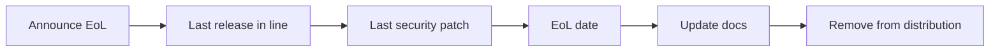

# 54 — Maintenance

| Field            | Value                                                                                |
|------------------|--------------------------------------------------------------------------------------|
| Document ID      | `PINE-DOC-54-MAINTENANCE`                                                             |
| Status           | Draft — pending review                                                               |
| Owner            | Engineering Review Board                                                             |
| Created          | 2026-07-08                                                                           |
| Last Updated     | 2026-07-08                                                                           |
| Specification Standard | Internal (maintenance practice)                                                |
| Glossary         | `PINE-DOC-03-GLOSSARY`                                                               |
| Prerequisites    | `00-Vision`..`53-Release-Checklist`                                                  |
| Related Documents| `21-Definition-of-Done`, `22-Release-Plan`, `23-Roadmap`, `28-CI-CD`, `29-Deployment`, `30-Observability` |

---

## 1. Purpose

Define Pine's maintenance practice: what is *maintained* between
releases, who maintains it, on what cadence, with what response
times, and how maintenance work is tracked. The maintenance
practice is the *steady-state* counterpart to the release
practice.

## 2. Scope

In scope: supported versions, maintenance windows, support
channels, security patches, dependency updates, deprecation
process, end-of-life, and contribution to upstream.

Out of scope: release mechanics → `22-Release-Plan`; release
checklist → `53-Release-Checklist`; deployment topology →
`29-Deployment`; observability → `30-Observability`.

## 3. Definitions

| Term             | Working definition                                                                                |
|------------------|------------------------------------------------------------------------------------------------------|
| LTS              | Long-Term Support.                                                                                 |
| Maintenance window | A scheduled time during which maintenance work is performed.                                       |
| Hotfix            | A release cut from a release tag to ship a critical fix.                                            |
| Security patch    | A release cut to address a security vulnerability.                                                  |
| Patch release     | A release that contains only bug fixes and security patches.                                        |
| Minor release     | A release that contains new features but is backwards-compatible.                                  |
| Major release     | A release that may contain breaking changes.                                                       |
| EoL              | End-of-life: a release is no longer supported.                                                      |
| Security advisory | A public document describing a vulnerability and its mitigation.                                   |

> **Assumption MNT-A-1.** Pine supports the current and the
> previous minor line. The previous minor line receives *security
> patches only* for a defined window.

## 4. Supported Versions

| Release line | Status   | Support window                                                  |
|--------------|----------|------------------------------------------------------------------|
| `v1.x`        | Active   | 18 months from GA of `v1.0`                                       |
| `v0.9.x`      | LTS      | 12 months from GA of `v0.9`                                       |
| `v0.8.x`      | EoL      | 6 months from GA of `v0.9`                                        |
| Earlier       | EoL      | n/a                                                              |

A release line is *Active* when:

- It receives feature updates.
- It receives security patches.
- It receives performance improvements.
- It receives accessibility fixes.

A release line is *LTS* when:

- It receives security patches only.
- It receives accessibility fixes.

A release line is *EoL* when it receives no further updates.

## 5. Maintenance Windows

| Window                       | Cadence                                                            |
|------------------------------|--------------------------------------------------------------------|
| Patch release                | Monthly, on the second Tuesday                                       |
| Security release (out-of-band) | As needed                                                       |
| Dependency updates            | Continuous, with a weekly bundle                                   |
| Performance sweep             | Quarterly                                                           |
| Accessibility sweep           | Per release + ad-hoc                                                |
| Localization sweep            | Per release + ad-hoc                                                |

## 6. Hotfix and Security Patch Path

```mermaid
graph LR
    A[Issue identified] --> B[Triage]
    B -->|security| C[Trust team]
    B -->|regression| D[Engineering]
    C -->|severity| E[Critical | High | Medium | Low]
    D -->|severity| E
    E -->|Critical/High| F[Hotfix branch]
    E -->|Medium/Low| G[Patch release]
    F --> H[RC + sign-off]
    G --> H
    H --> I[Publish]
```

### 6.1 Severity Response Times

| Severity    | Triage window | Fix window                                                         |
|-------------|---------------|--------------------------------------------------------------------|
| Critical     | ≤ 1 hour      | ≤ 24 hours                                                          |
| High         | ≤ 4 hours     | ≤ 7 days                                                            |
| Medium       | ≤ 1 day       | ≤ 30 days                                                            |
| Low          | ≤ 1 week      | Next minor release                                                   |

### 6.2 Coordinated Disclosure

- Pine follows a 90-day coordinated disclosure SLA.
- The disclosure is published in the security advisory page.
- A CVE is assigned through a recognised CNA when applicable.

## 7. Dependency Updates

- Pine's dependencies are tracked in a Software Bill of Materials
  (SBOM).
- The SBOM is published per release.
- A dependency update is *automated* for *non-breaking* updates.
- A dependency update is *manual* for *breaking* updates.
- A dependency update is gated by the CI pipeline.

### 7.1 Update Posture

| Update kind            | Posture                                                                |
|------------------------|-------------------------------------------------------------------------|
| Patch                  | Auto-merge after CI green                                                |
| Minor                  | Manual review; PR with rationale                                         |
| Major                  | Manual review; ADR if it widens the surface                             |
| Security advisory     | Manual review; back-port per the supported lines                          |

## 8. Deprecation

- A deprecation follows `34-API-Guidelines` §7.
- A user-facing deprecation is published in the changelog and the
  in-app notifications.
- A user-facing deprecation has a *sunset* date.
- A deprecation is *announced* ≥ 1 minor release before removal.

## 9. End-of-Life

- A release line is announced EoL ≥ 6 months before EoL.
- The announcement cites the EoL date and the upgrade path.
- During the EoL window, the release line receives *security
  patches only* and only for *Critical* or *High* severities.
- After EoL, the release line receives *no* updates.

### 9.1 EoL Process



## 10. Support Channels

- An issue tracker (public).
- A `security@pine` mailbox (private).
- A `support@pine` mailbox (private, deferred OD-D-3).
- A community channel (deferred).
- A docs site (public).

## 11. Maintenance Tracking

- Maintenance work is tracked in the backlog (`44-Backlog`) under a
  `maintenance` label.
- A maintenance item has a *kind* (security, regression, perf,
  accessibility, dependency, deprecation, EoL).
- A maintenance item has a *severity*.
- A maintenance item has an *owner*.

## 12. Quality Bar

- A patch release MUST NOT introduce a regression.
- A patch release MUST be reproducible from the manifest.
- A security patch MUST be coordinated.
- A deprecation MUST be announced.
- An EoL MUST be announced ≥ 6 months in advance.

## 13. Cross-Cutting Constraints

- A maintained release MUST be reproducible.
- A security patch MUST be signed.
- A deprecation MUST have a sunset date.
- An EoL MUST be announced in advance.

## 14. Deferred Decisions

| ID        | Decision                                                                                  | Owning document(s)         |
|-----------|-------------------------------------------------------------------------------------------|----------------------------|
| MNT-D-1   | LTS cadence (per minor line vs. per major line).                                          | `54-Maintenance` (next rev.) |
| MNT-D-2   | Paid support tier (deferred OD-D-3).                                                      | `24-Contributing`          |
| MNT-D-3   | Whether to ship security patches for *Medium* severities on LTS lines.                     | `54-Maintenance` (next rev.) |

## 15. Quality Checklist

- [x] Supported versions, windows, hotfix path, dependency
      updates, deprecation, EoL, channels, tracking, quality bar
      are all present.
- [x] No TODO placeholders.
- [x] No contradiction with `00-Vision`..`53-Release-Checklist`.

## 16. Revision History

| Version | Date       | Author                | Change                                                       |
|---------|------------|-----------------------|--------------------------------------------------------------|
| 0.1     | 2026-07-08 | Engineering Review Board | Initial maintenance document.                                |
